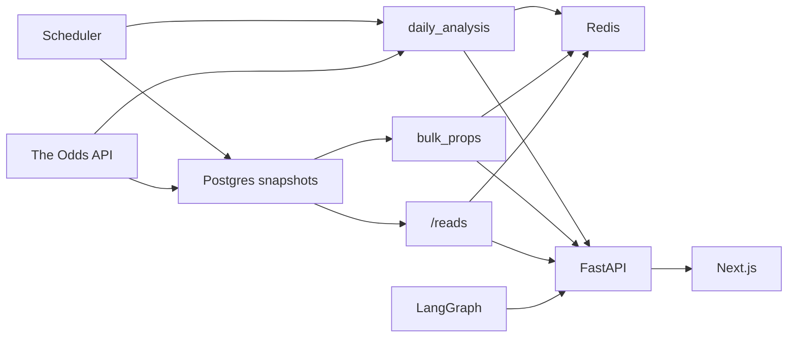
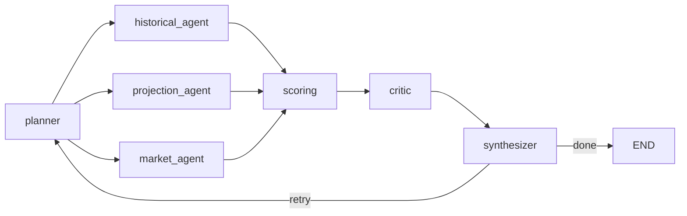

# Sports Lab

NBA 球員 props 的投注參考工具。WNBA 暫停；舊程式留著，路由沒拆。

細項在 `docs/task-summaries/` 和 PR。這份只給現況。

## 系統架構

`daily_analysis` 自己打 Odds API，不讀快照表。快照給 `bulk_props` 和 `/reads`。LangGraph 是問答，不在每日精選的計算鏈上。

| 盒子 | 做什麼 | 路徑 |
|---|---|---|
| The Odds API | 賽事與盤口 | `backend/app/services/odds_gateway.py` |
| Scheduler | APScheduler。每日分析、三次快照、先發、CSV | `backend/app/services/scheduler.py` |
| daily_analysis | 一本書一條主線，算出今日精選，寫進 Redis 15 分鐘 | `backend/app/services/daily_analysis.py` |
| Postgres snapshots | `odds_line_snapshots`。一天三次，用 America/New_York 的比賽日。替代盤另外留一列 | `backend/app/services/odds_snapshot_service.py` |
| Redis | 精選、盤口、先發。bulk props 組好的 JSON 快取 60 秒 | `backend/app/services/cache.py` |
| bulk_props | 只讀最新快照。不打 Odds API | `backend/app/services/bulk_props.py` |
| lineup | 先發共識。Redis，沒中再讀 Postgres | `backend/app/services/lineup_service.py` |
| LangGraph | 問答。見下圖 | `scripts/agents/graph.py` |
| FastAPI | 啟動 scheduler，掛上各路由 | `backend/app/main.py` |
| Next.js | No-Vig 介面 | `frontend/app/layout.tsx` |

單場是 `GET /api/nba/events/{event_id}`，讀既有清單和它的 Redis 快取，命中不打 Odds API。每位已開盤球員是 `GET /api/nba/events/{event_id}/reads`。

`nba_lineup_rag/` 給問答的傷兵工具用（`scripts/agents/tools/historical.py`）。每日精選不讀它。

| 節點 | 做什麼 | 路徑 |
|---|---|---|
| planner | 拆問題 | `scripts/agents/agents.py` `planner_node` |
| historical_agent | 歷史 | 同檔 `historical_agent_node` |
| projection_agent | 程式標成 stub，回傳 `all_unavailable` | 同檔 `projection_agent_node` |
| market_agent | 盤口 | 同檔 `market_agent_node` |
| scoring | 三路收斂後的確定性評分 | `scripts/agents/agents.py` `scoring_node`（呼叫 `scripts/agents/scoring.py` `compute_scorecard`） |
| critic | 檢查 | `scripts/agents/agents.py` `critic_node` |
| synthesizer | 答案。缺必要資料就回到 planner，最多重試 2 次（synthesizer 最多跑 3 次） | `scripts/agents/agents.py` `synthesizer_node` |

## 一張精選怎麼算出來

| 步驟 | 規則 | 程式 |
|---|---|---|
| 主線 | 一本書一票。雙邊、最接近五五波（去水後）。距離相同留較低的點。不把兩個不同的點平均 | `backend/app/services/daily_analysis.py` `_main_book_line` |
| 共識線 | 每本書先投自己的主線，再取眾數。平手留最接近五五波的點，再留較低的點。不把兩個點平均 | `backend/app/services/prob.py` `calculate_mode_threshold` |
| 標題機率 | `probability` 仍是該線的歷史命中率。NBA 畫面上旁邊的數字改為 `combined_probability`，見下段 | `DailyPick.probability` |
| 去水 | modal line 的 no-vig。這是 market 輸入，不是標題 | `backend/app/services/pick_signals.py` `resolve_market_probability` |
| 五個 signals | market、last 10、history、projection、defense。缺資料是 null，不是中性 | `backend/app/services/pick_signals.py` |
| combined | `sigmoid(logit(market) + Platt(四項調整之和))`。市場係數是 1。Platt 只乘調整項 | `pick_signals.combined_probability` |
| 空值 | 沒有盤口價，或傷兵 Out / Doubtful，`combined_probability` 是 null。WNBA 兩個欄位都是 null | `backend/app/models/schemas.py` |
| tier | NBA 分桶的是 `combined_probability`。WNBA 分桶的是 `probability`。切點仍是下面這張表。儲存仍看歷史命中率 | `backend/app/services/daily_analysis.py`、`frontend/lib/nba-card.ts` |
| 球隊 | 只留下這場主隊或客隊。不在這場的 CSV 球隊是空白，精選畫破折號 | `csv_player_history.team_on_event` |

調整項各自先截斷 ±0.15，加總再截斷 ±0.35，然後 `PLATT_A + PLATT_B * total`（`0.28036258`、`2.15982400`）。常數在 `backend/app/services/pick_signal_constants.py`。

| 機率 | 後端 `tier` | WNBA `readTier` |
|---|---|---|
| ≥ 0.70 | Strong play | strong / Strong play |
| ≥ 0.65 | Playable | playable / Playable |
| ≥ 0.56 | Lean | lean / Lean only |
| < 0.56 | null | pass / Pass |

預設看板仍是 0.65、至少 10 場。NBA 這道 0.65 看 `combined_probability`。低於歷史 0.56 的列仍不進儲存。NBA 仍把歷史 Lean 和 5 場的列存進 Redis。預設查詢要 blend 過 0.65 且至少 10 場，所以歷史 Lean 可以上看板。

NBA 畫面上，tier 用後端送來的字串。Today、Picks、比賽頁、Bet Slip（含總計）的卡片百分比都用 `formatTierPercent` 無條件捨去，例如 `0.697` 印 `69%`。blend 是 null 才退回 `probability`。有 blend、沒有 tier 時還沒統一，見進行中：`nbaTierFace` 仍走 `formatPercent`（Today、Picks、比賽頁把 `0.697` 印成 `70%`），Bet Slip 的 `slipFace` 則是 `69%`。vig 維持一位小數。EV 的格式仍等 Eason 決定。WNBA 仍用 `readTier`，精選頁仍寫沒有 blended probability。About 仍把 blend 標成 planned。真實盤口的校正還沒過（SPO-112）。

## 現況

### 完成

分組依主題，不依合併日。SPO-106、SPO-107 也在 2026-11-10 合併，放在資料與回測。2026-11-10 這批在下面，一行一票。

| 組 | 票號 |
|---|---|
| WNBA 舊版 | SPO-31、32、33、34、35、37、48、52、58、60、64、83 |
| 事件頁 | SPO-10、11、15、16、17、18、20、26、101、102、103、104、105、123 |
| 測試與流程 | SPO-22、23、24、25、70、76、95、96、100、119 |
| 資料與回測 | SPO-97、98、99、106、107、117、122 |
| 介面與後端欄位 | SPO-110a、110b、110c、111、112、113、114、115、118、120a、121、121b |

| 票 | PR | 結果 |
|---|---|---|
| SPO-119 | #50 | 這份檔是 owner 的現況。功能 PR 不改它。這條規則已生效。 |
| SPO-117 | #56 | 快照改用 America/New_York，晚場有列。唯一鍵含 `line`，替代盤不蓋主線。平手留最接近五五波的點，再留較低的點。 |
| SPO-120a | #51 | No-Vig token、全寬 header、Today。機率印成整數。Today 印後端 `tier`，時鐘用 `commence_time_et`。 |
| SPO-121 | #52 | `GET /api/nba/events/{event_id}/reads` 給每位已開盤球員一則 read。NBA 的 tier 和精選看板改看 `combined_probability`。錄製的 player_points 看板由 4 變成 6。`team_code` 走 `team_on_event`。 |
| SPO-121b | #57 | NBA 用後端送來的 tier 字串。有 tier 時，Today、Picks、比賽頁、Bet Slip（含總計）的卡片百分比都無條件捨去（`0.697` 印 `69%`）。vig 一位小數。EV 仍等 Eason 決定。WNBA 的 `readTier` 沒變。 |
| SPO-122 | #53 | 不在這場的 CSV 球隊不再當標籤。Simons 在 Celtics at 76ers 不再是 CHI。精選的空白球隊畫破折號。 |
| SPO-123 | #54 | `GET /api/nba/events/{event_id}` 從清單快取回一場。命中不打 Odds API。省略日期用呼叫端的本地日。 |

SPO-10 與 SPO-11 在 `dev` `6688384` 驗證：backend 1041 passed、23 skipped、6 xfailed、CI 6/6。WNBA live coverage 延後，因為 WNBA 工作暫停。

### 進行中

| 項目 | 狀態 |
|---|---|
| SPO-120b | #55 仍開著。賽事頁的設計對齊。要在 #57 之後合（#57 已在 `dev`） |
| #57 / #55 | `nbaTierFace` 在有 blend、沒有 tier 時仍四捨五入。#55 合入 #57 後改用 `formatTierPercent`，讓各頁一致 |

### 已關閉、未合併

| 票 | PR |
|---|---|
| SPO-67 | #21 |
| SPO-73 | #23 |
| SPO-94 | #26 |

### 未歸類

`research/SPO-65-parlay-correlation`（`268fd28`）在 remote，沒有合併進 `dev`，也沒有進 `dev` 的 PR。

### 卡住

| 項目 | 狀態 |
|---|---|
| WNBA | 暫停。舊程式留著 |

## 已知問題與風險

| 項目 | 現況 |
|---|---|
| `/reads` 與每日精選 | Bovada 在共識線上的雙邊替代盤，每日精選算、`/reads` 不算。錄製最大差 0.0069。測試鎖在 0.01 |
| 滾動部署 | 舊行程仍用舊的 ON CONFLICT。新唯一鍵上去之後，那些寫入會失敗，直到舊行程結束。一天三次，窗口短 |
| 沒價格的平手 | 留較低的點，偏向 Over。每日精選和 bulk props 有傳距離，這條路徑目前沒用到 |
| Odds API 額度 | 2026-05-13 實測月配額 500，當時剩餘 331（SPO-31）。程式沒把 500 寫進設定。快照一天三次，規劃約 225 credits/天，約 6,750/月，遠高於 500。要先確認現在的方案。225 是規劃，不是帳單（`docs/decisions/spo-114-bulk-props/decision_20261110_snapshot-only.md`） |
| limiter | Redis 掛了改用行程內計數。`swallow_errors` 讓 limiter 出錯仍放行。多個 worker 之前要重看。`backend/app/middleware/rate_limit.py` |

## 待辦

- SPO-124：暫停，等 Eason 選資料來源。提案是 balldontlie（ALL-STAR 一個月 $9.99；GOAT 一個月 $39.99，含先發和位置）。Last-10 要混賽季，被交易球員在舊東家的場次仍算。`lineup_source_support.py` 的 roster cache（310–313 行）仍用沒有這場比賽的 `team_from_game_logs`，歸這張票。CSV 仍停在 2026-05-11。
- 回測的 tier：一月是用十一月到十二月去配，combined 比 historical 差（SPO-112）。Platt 配的是哪一群還沒定。現在的係數是常規賽 proxy，市場項固定 0.5，列到 2026-03-17。SPO-117 已在寫美國賽程，要在存下來的真實盤口上重驗。
- #57 / #55：`nbaTierFace` 在有 blend、沒有 tier 時仍四捨五入。#55 合入 #57 後改用 `formatTierPercent`，讓各頁一致。
- #56 不阻擋：滾動部署時舊行程的寫入會短暫失敗。沒有價格的平手留較低的點。`run_daily_analysis` 仍預設 UTC+8，那是觀眾的今天，不是快照表。
- `/reads` 和每日精選還會差一點。見上面。Bovada 的那條雙邊替代盤，等之後對齊。
- #52 的可選測試還沒套。QA 的 patch 有 8 個案例：交易日、缺球隊、對上舊東家、快取退回。
- #54：清單路由省略 `date` 仍是今天 UTC。省略 `tz_offset` 仍是 480。單場路由省略日期則用呼叫端的本地日。前端賽事頁仍自己載整份清單。
- #52：升級前的快取沒有 `roster_event` 時，最多 60 秒會退回最新一列的球隊。`_event_day_text` 若收到 `datetime`，用的是 `value.date()`（該時區的日曆日），沒有走 America/Los_Angeles；正式路徑的 snapshot `date` 是 slate 日，所以沒問題。`test_position_and_team_code_come_from_the_latest_log` 現在測的是沒傳 home/away 時的 fallback，名稱可以之後改。`top_read` 和 `GET /api/picks/today` 仍用歷史率。儲存仍丟掉歷史低於 0.56 的人。`season_mean` 常常是 null。`attach_roster_fields` 仍在 event loop 上查名字。錄製的位移是一場、一個 market。
- #53：轉隊到這場兩邊的人，歷史隊友和今晚陣容可能混在一起。只出現在今晚陣容的隊友，共同出賽可以是 0 場，畫面沒說明。WNBA projection 代碼 `LV`、`NY`、`PHO`、`LA`、`GS`、`WSH` 還沒對上。
- #47 QA：把 `_main_book_line`、`_even_money_distance`、`_posted_point` 抽成共用的公開模組。
- #47 QA：`rate_limit.py` 註明行程內計數，以及 `swallow_errors` 會放行 limiter 錯誤。
- #47 QA：`test_spo113_qa_review.py` 斷言 `opponent_position_rank_source`。
- #47 QA：`test_spo113_field_enrichment.py` 的 Odds API shape 註解改成我們的 cache。
- #47 QA：Redis 掛掉的測試不要 patch slowapi 的私有屬性。
- #47 QA：`bulk_props._as_float` 拒絕 NaN / inf。
- #47 QA：補上 QA 的 SPO-118 測試。
- 下一步：開第二個 worker 之前，重看 limiter 的 in-memory fallback。

## 開發流程

| 誰 | 做什麼 |
|---|---|
| 工程師 | 從 `origin/dev` 開分支，一個 PR 進 `dev` |
| QA | 測、審 |
| Eason | squash-merge。只有 Eason 合併 |
| 功能 PR | 不改 `docs/progress.md`。progress note 放在 PR body 的 `## Progress notes (for the docs PR)`。`docs/decisions/` 仍可改。SPO-119（#50）已生效 |
| 文件 PR | 每批合併後，一位工程師開一個小 docs PR 更新 `docs/progress.md` |
| git | commit 不附工具或模型署名。不直接 push `dev` 或 `master` |
