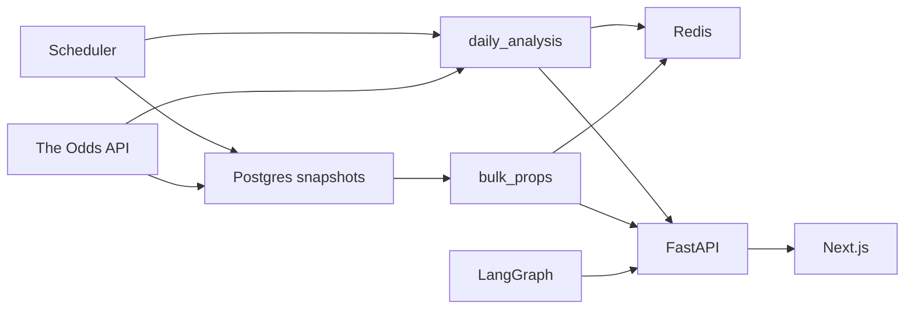
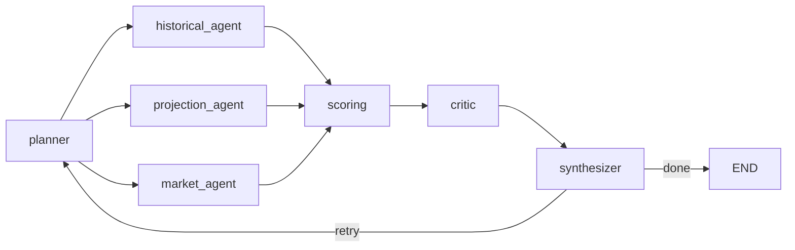

# Sports Lab

NBA 球員 props 的投注參考工具。WNBA 暫停；舊程式留著，路由沒拆。

細項在 `docs/task-summaries/` 和 PR。這份只給現況。

## 系統架構

`daily_analysis` 自己打 Odds API，不讀快照表。快照給 `bulk_props`。LangGraph 是問答，不在每日精選的計算鏈上。

| 盒子 | 做什麼 | 路徑 |
|---|---|---|
| The Odds API | 賽事與盤口 | `backend/app/services/odds_gateway.py` |
| Scheduler | APScheduler。每日分析、三次快照、先發、CSV | `backend/app/services/scheduler.py` |
| daily_analysis | 一本書一條主線，算出今日精選，寫進 Redis 15 分鐘 | `backend/app/services/daily_analysis.py` |
| Postgres snapshots | `odds_line_snapshots`。一天三次 | `backend/app/services/odds_snapshot_service.py` |
| Redis | 精選、盤口、先發。bulk props 組好的 JSON 快取 60 秒 | `backend/app/services/cache.py` |
| bulk_props | 只讀最新快照。不打 Odds API | `backend/app/services/bulk_props.py` |
| lineup | 先發共識。Redis，沒中再讀 Postgres | `backend/app/services/lineup_service.py` |
| LangGraph | 問答。見下圖 | `scripts/agents/graph.py` |
| FastAPI | 啟動 scheduler，掛上各路由 | `backend/app/main.py` |
| Next.js | No-Vig 介面 | `frontend/app/layout.tsx` |

`nba_lineup_rag/` 給問答的傷兵工具用（`scripts/agents/tools/historical.py`）。每日精選不讀它。

| 節點 | 做什麼 | 路徑 |
|---|---|---|
| planner | 拆問題 | `scripts/agents/agents.py` `planner_node` |
| historical_agent | 歷史 | 同檔 `historical_agent_node` |
| projection_agent | 程式標成 stub，回傳 `all_unavailable` | 同檔 `projection_agent_node` |
| market_agent | 盤口 | 同檔 `market_agent_node` |
| scoring | 三路收斂後的確定性評分 | `scripts/agents/agents.py` `scoring_node`（呼叫 `scripts/agents/scoring.py` `compute_scorecard`） |
| critic | 檢查 | `scripts/agents/agents.py` `critic_node` |
| synthesizer | 答案。缺必要資料就回到 planner，最多重試 2 次（synthesizer 最多跑 3 次） | `scripts/agents/agents.py` `synthesizer_node` |

## 一張精選怎麼算出來

| 步驟 | 規則 | 程式 |
|---|---|---|
| 主線 | 一本書一票。雙邊、最接近五五波（去水後）。距離相同留較低的點。不把兩個不同的點平均 | `backend/app/services/daily_analysis.py` `_main_book_line` |
| 共識線 | 那些主線的眾數 | `backend/app/services/prob.py` `calculate_mode_threshold` |
| 標題機率 | 該線的歷史命中率。這就是 `probability` | `DailyPick.probability` |
| 去水 | modal line 的 no-vig。這是 market 輸入，不是標題 | `backend/app/services/pick_signals.py` `resolve_market_probability` |
| 五個 signals | market、last 10、history、projection、defense。缺資料是 null，不是中性 | `backend/app/services/pick_signals.py` |
| combined | `sigmoid(logit(market) + Platt(四項調整之和))`。市場係數是 1。Platt 只乘調整項 | `pick_signals.combined_probability` |
| 空值 | 沒有盤口價，或傷兵 Out / Doubtful，`combined_probability` 是 null。WNBA 兩個欄位都是 null | `backend/app/models/schemas.py` |
| tier | 分桶的是 `probability`，不是 combined。後端 `READ_TIER_CUTOFFS`，前端 `readTier` | `backend/app/services/daily_analysis.py`、`frontend/lib/today-board.ts` |

調整項各自先截斷 ±0.15，加總再截斷 ±0.35，然後 `PLATT_A + PLATT_B * total`（`0.28036258`、`2.15982400`）。常數在 `backend/app/services/pick_signal_constants.py`。

| 機率 | 後端 `tier` | 前端 `readTier` |
|---|---|---|
| ≥ 0.70 | Strong play | strong / Strong play |
| ≥ 0.65 | Playable | playable / Playable |
| ≥ 0.56 | Lean | lean / Lean only |
| < 0.56 | null | pass / Pass |

預設看板仍是 0.65、至少 10 場。NBA 會把 Lean（0.56）和 5 場的列存進 Redis，預設查詢不拿出它們。

畫面上的大數字是 `probability`。`frontend/` 沒有讀 `combined_probability`。精選頁寫明沒有 blended probability。真實盤口的校正還沒過（SPO-112），所以 combined 是補充，不能當標題。

## 現況

### 完成

分組依主題，不依合併日。SPO-106、SPO-107 也在 2026-11-10 合併，放在資料與回測。

| 組 | 票號 |
|---|---|
| WNBA 舊版 | SPO-31、32、33、34、35、37、48、52、58、60、64、83 |
| 事件頁 | SPO-10、11、15、16、17、18、20、26、101、102、103、104、105 |
| 測試與流程 | SPO-22、23、24、25、70、76、95、96、100 |
| 資料與回測 | SPO-97、98、99、106、107 |
| 介面與後端欄位 | SPO-110a、110b、110c、111、112、113、114、115、118 |

SPO-10 與 SPO-11 在 `dev` `6688384` 驗證：backend 1041 passed、23 skipped、6 xfailed、CI 6/6。WNBA live coverage 延後，因為 WNBA 工作暫停。

### 進行中

| 項目 | 狀態 |
|---|---|
| 功能票 | 無 |

### 已關閉、未合併

| 票 | PR |
|---|---|
| SPO-67 | #21 |
| SPO-73 | #23 |
| SPO-94 | #26 |

### 未歸類

`research/SPO-65-parlay-correlation`（`268fd28`）在 remote，沒有合併進 `dev`，也沒有進 `dev` 的 PR。

### 卡住

| 項目 | 狀態 |
|---|---|
| SPO-117 | 快照寫入 0 列、替代盤口蓋掉主線。等 Eason 核准 |
| WNBA | 暫停。舊程式留著 |
| 標題機率 | 真實盤口校正未過。標題維持 `probability` |

## 已知問題與風險

| 項目 | 現況 |
|---|---|
| 快照 0 列 | SPO-117。等 Eason 核准。寫入器在 `odds_snapshot_service.rows_from_bookmakers` |
| Odds API 額度 | 2026-05-13 實測月配額 500，當時剩餘 331（SPO-31）。程式沒把 500 寫進設定。快照一天三次，規劃約 225 credits/天，約 6,750/月，遠高於 500。要先確認現在的方案。225 是規劃，不是帳單（`docs/decisions/spo-114-bulk-props/decision_20261110_snapshot-only.md`） |
| limiter | Redis 掛了改用行程內計數。`swallow_errors` 讓 limiter 出錯仍放行。多個 worker 之前要重看。`backend/app/middleware/rate_limit.py` |

## 待辦

- SPO-117：快照 0 列；替代盤口蓋掉主線。等核准。
- SPO-117 平手：待確認。同一本書裡不平均是 SPO-115 的刻意設計。`bulk_props._main_book_line` 呼叫 `daily_analysis._main_book_line`，沒有走 `calculate_mode_threshold`。球員的 `line` 有走。先確認這條路徑，不是已決定的修法。
- #47 QA：把 `_main_book_line`、`_even_money_distance`、`_posted_point` 抽成共用的公開模組。
- #47 QA：`rate_limit.py` 註明行程內計數，以及 `swallow_errors` 會放行 limiter 錯誤。
- #47 QA：`test_spo113_qa_review.py` 斷言 `opponent_position_rank_source`。
- #47 QA：`test_spo113_field_enrichment.py` 的 Odds API shape 註解改成我們的 cache。
- #47 QA：Redis 掛掉的測試不要 patch slowapi 的私有屬性。
- #47 QA：`bulk_props._as_float` 拒絕 NaN / inf。
- #47 QA：補上 QA 的 SPO-118 測試。
- 下一步：開第二個 worker 之前，重看 limiter 的 in-memory fallback。

## 開發流程

| 誰 | 做什麼 |
|---|---|
| 工程師 | 從 `origin/dev` 開分支，一個 PR 進 `dev` |
| QA | 測、審 |
| Eason | squash-merge。只有 Eason 合併 |
| 功能 PR | 不改 `docs/progress.md`。progress note 放在 PR body 的 `## Progress notes (for the docs PR)`。`docs/decisions/` 仍可改 |
| 文件 PR | 每批合併後，一位工程師開一個小 docs PR 更新 `docs/progress.md` |
| git | commit 不附工具或模型署名。不直接 push `dev` 或 `master` |
