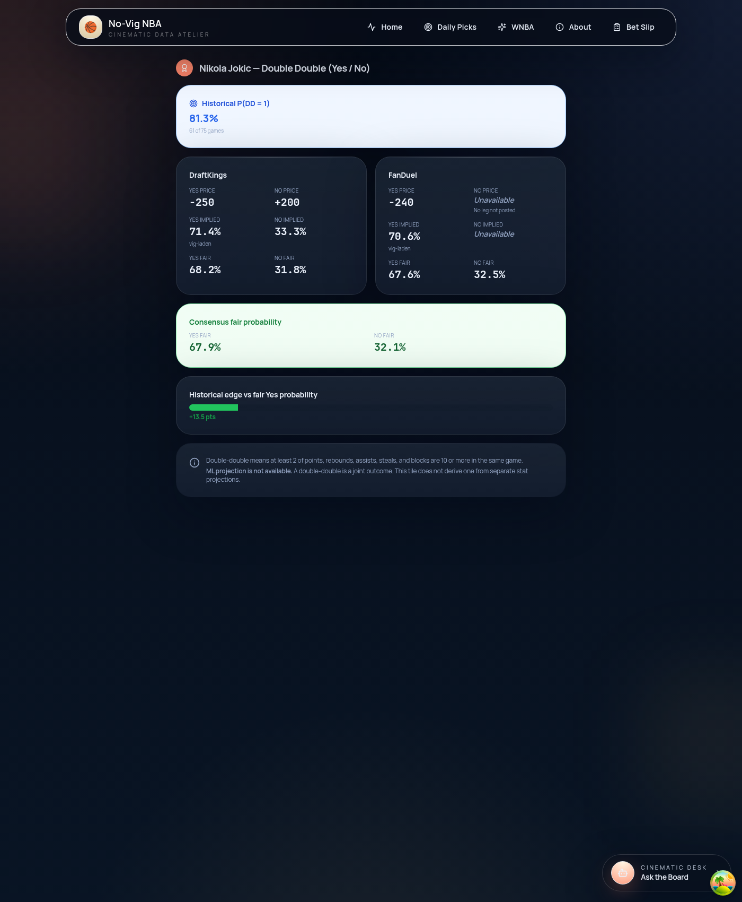
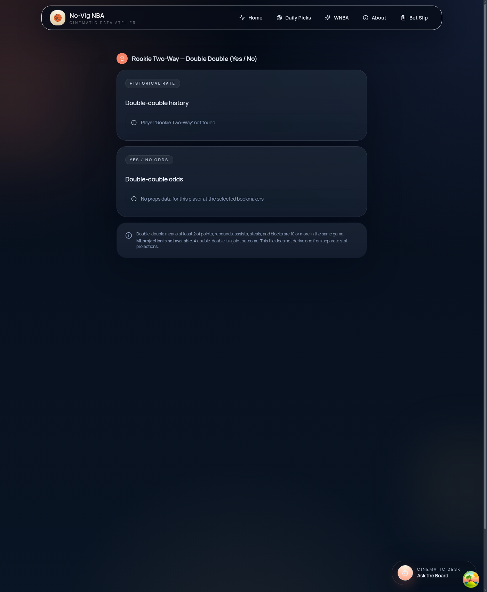

# SPO-102 — Wire PlayerDDTile to /player-dd-history and the yes/no no-vig branch

## Summary

`PlayerDDTile` no longer documents double-double props as pending. It loads history from `GET /api/{nba|wnba}/player-dd-history` and Yes/No prices from `POST /api/{nba|wnba}/props/no-vig` with `market=player_double_double`. The tile reads the explicit binary fields only. A missing, null, or empty payload stays on an explicit unavailable state, including loading and error. NBA and WNBA both expose these routes, and the event page passes the matching client.

## Changes

| File | Change |
|---|---|
| `frontend/lib/schemas.ts` | `bookmakerResultSchema` accepts `yes_price`, `no_price`, `p_yes_imp`, `p_no_imp`, `yes_fair_prob`, `no_fair_prob` (nullable, optional). `consensusSchema` accepts `p_yes_fair`, `p_no_fair`. `noVigResponseSchema` keeps `fetched_at`, `data_age_seconds`, `cache_state`, and `source` with the backend types. New `playerDDHistoryResponseSchema` / `PlayerDDHistoryRequest` match `PlayerDDHistoryResponse`. |
| `frontend/lib/api.ts` | `getPlayerDDHistory` → `GET /api/nba/player-dd-history`. `getWNBAPlayerDDHistory` → `GET /api/wnba/player-dd-history`. Query params are `player` and optional `season`. No `threshold`. |
| `frontend/lib/player-dd.ts` | Selects a book only when `yes_price` is a posted number. Ignores `over_*` / `under_*` and the `line` sentinel. History is shown only when `prob_dd` is present and `n_games` > 0. Percentages use half-up rounding. A snapshot older than 30 seconds, or one marked `cache_state: "stale"`, produces a stale-line warning. |
| `frontend/lib/use-player-dd.ts` | TanStack Query hook. League `wnba` calls the WNBA clients; `nba` calls the NBA clients; any other league does not fetch. Odds stale time is 30s. |
| `frontend/components/PlayerDDTile.tsx` | Fetches through the hook. Renders book Yes/No prices, implied and fair probabilities, consensus fair probability, historical `prob_dd`, the edge against fair Yes, and the stale-line warning. Consensus values use `text-green-800` because `text-dark` is `#ebf1fb` and disappears on the light green card. A blank player name, empty payload, null Yes fields, loading, and error each have an explicit state. `league` is required. |
| `frontend/components/PlayerHistoryStats.tsx` | Passes `eventId`, league from `cacheNamespace`, and the DD history client into the tile. When no odds client is injected, `cacheNamespace: "wnba"` uses `calculateWNBANoVig`. The continuous `/player-history` query stays disabled for `dd`. The 0.5 line is not copied into the threshold box. |
| `frontend/components/EventDetail.tsx` | NBA config uses `getPlayerDDHistory`; WNBA config uses `getWNBAPlayerDDHistory`. |
| `frontend/components/PlayerDDTile.test.tsx` | Fixture-backed yes/no odds, null yes/no fields (the `-777` stand-in stays a control), empty history, history error, odds error, loading, missing event, blank player, stale snapshot, WNBA route selection, unsupported league. Consensus `67.9%` / `32.1%` must carry `text-green-800`. The 31-second warning is matched in full and must not say "game window". |
| `frontend/components/PlayerHistoryStats.dd.test.tsx` | WNBA event page path uses the recorded Wilson history and the recorded no-vig fixture. With only `cacheNamespace="wnba"`, both fetches stay on `/api/wnba/`. |
| `frontend/lib/player-dd-schema.test.ts` | Zod parse of the SPO-26 history body, a null `prob_dd`, binary yes/no rows, an Over/Under row that omits the new fields, and retention of `cache_state` / `data_age_seconds`. |
| `frontend/test/test-utils.tsx` | Mounts `WnbaBetSlipProvider` beside the NBA slip, matching `app/providers.tsx`. Navbar and the pick menu call `useWnbaBetSlip`. |
| `frontend/package.json`, `frontend/vitest.config.mts` | Pin the test clock to `America/Chicago` so existing local-date assertions hold on a UTC runner. |
| `docs/task-summaries/SPO-102-screenshots/` | Populated and empty tile screenshots from the dev server against a mocked API. |
| `docs/progress.md` | SPO-102 entry. |

## Why

SPO-26 already returns the binary shape. The tile was still hard-coded to null and told the user the endpoint did not exist. Wiring it means the event page can show a real historical rate next to posted Yes/No prices.

The route also fills legacy `over_*` / `under_*` fields (`over` = Yes, `under` = No, `line` = 0.5). On a single-leg quote, `under_odds` is a copy of the Yes price so the non-null legacy schema still validates, while `no_price` stays null. Reading `over_odds` when `yes_price` is null would display a number the binary contract did not publish. The tile therefore uses only `yes_*` / `no_*` and `consensus.p_yes_fair` / `p_no_fair`. It does not average American prices, does not compute `1 - p_yes` on the client, and does not turn `dd_games / n_games` into a rate when `prob_dd` is null.

Both `backend/app/api/nba.py` and `backend/app/api/wnba.py` register `/player-dd-history` and dispatch `player_double_double` through `_build_binary_no_vig_response`. The WNBA event page passes `getWNBAPlayerDDHistory` and `calculateWNBANoVig`. An unrecognized league renders the unavailable state and does not call either API.

The edge bar compares historical `prob_dd` to fair Yes probability (consensus when the route sent `p_yes_fair`, otherwise the single book's `yes_fair_prob`). Implied probability stays labeled vig-laden and is not used as the edge reference.

A disabled TanStack Query v5 query with no data reports `isPending`. The tile used that flag as its loading state, so a blank player name — which correctly disables the history query and the odds query — spun forever on “Loading double-double history.” Missing input now renders “Enter a player name…” and neither query is treated as loading unless it is actually fetching. The odds block uses the same fetching check, and a blank name returns before that block, so it does not fall through to the “need a game” message when an event id is present.

Percents use half-up rounding at one decimal place. `(0.6755 * 100).toFixed(1)` prints `67.5` because the product is `67.549999999999997` in IEEE-754. The helper scales, nudges by a few units in the last place, then rounds half away from zero, so FanDuel’s recorded `yes_fair_prob` of `0.6755` displays `67.6%`. The other recorded probabilities stay on the same displayed values (`81.3%`, `71.4%`, `68.2%`, `67.9%`, `32.5%`, `+13.5 pts`).

The warning names the age of the odds response. It does not say a game is underway. The 30-second cutoff is still the in-game cache budget: live odds are kept for 30 seconds or less while a game is on, because a book can move several points in that window, and the payload does not say whether the game has tipped. A response is warned when `data_age_seconds` is greater than 30 or `cache_state` is `"stale"`. Age of exactly 30 stays quiet. The recorded fixture (`fresh`, 12 seconds) does not warn. Prices stay on screen under the warning.

## Tests / Verification

- Frontend: `npm test` — 19 files, 74 tests, passed. The script sets `TZ=America/Chicago`, and `frontend/vitest.config.mts` pins the same zone. QA’s five `it.fails` cases are now ordinary `it` cases, with the same assertions:
  - `frontend/components/PlayerDDTile.test.tsx` — `0.6755` renders `67.6%`.
  - `frontend/components/PlayerDDTile.test.tsx` — a whitespace player name shows “Enter a player…”, does not show “Loading double-double history”, and does not call the history client.
  - `frontend/components/PlayerDDTile.test.tsx` — `cache_state: "stale"` and `data_age_seconds: 90` render a stale warning that includes `90`, and the tile still shows `81.3%`.
  - `frontend/lib/player-dd-schema.test.ts` — parsing the no-vig fixture keeps `cache_state: "stale"` and `data_age_seconds: 90`.
  - `frontend/components/PlayerHistoryStats.dd.test.tsx` — `cacheNamespace="wnba"` with no injected client fetches `/api/wnba/player-dd-history` and `/api/wnba/props/no-vig`, does not fetch `/api/nba/props/no-vig`, and shows `47.3%`.
- The populated tile tests and the WNBA history-stats test read `frontend/test/fixtures/player-dd-history/jokic.json`, `wilson.json`, and `frontend/test/fixtures/props-no-vig/player-double-double.json`. The null-field test still uses the hand-built row whose `over_odds` is `-777`, so a regression that displayed that stand-in would fail.
- `npx tsc --noEmit` — passed.
- `npm run lint` — passed.
- Integration test: SKIPPED (no new external API client; the tile calls the existing backend routes).
- Manual: the populated screenshot is the recorded Jokic fixture (`jokic.json` and `player-double-double.json`): 81.3% (61 of 75 games), DraftKings -250 / +200, FanDuel No price unavailable, FanDuel fair Yes 67.6%, consensus 67.9% / 32.1% in dark green, edge +13.5 pts. The empty screenshot is the unavailable history and odds state and was already current, so it was left in place.

Screenshots:

## Follow-ups

- Single-leg rows keep `no_price` and `p_no_imp` null, but `under_odds` is copied from the Yes price and `p_under_imp` is the complement. `BookmakerResult.under_odds` is a required float, which is why the route does this. A later schema change could make the legacy No leg optional for binary markets so other clients cannot mistake that copy for a posted No price.
- When the vig prior cannot be applied, the route omits the row and explains it in `message` instead of returning `yes_fair_prob: null`. The tile shows that message. No frontend change is required unless Backend starts emitting the row with null fair fields; the null path is already an unavailable state.
- `/wnba/player/[name]` is still the continuous-metric page. It does not mount `PlayerDDTile` because that page has no event id for live odds. History-only DD on that page is a separate slice.
- There is no season control on the tile. The client omits `season`, which the route treats as all seasons.

## Backend fields used

History (`PlayerDDHistoryResponse`): `player`, `season`, `n_games`, `dd_games`, `prob_dd`, `message`.

No-vig request: `event_id`, `player_name`, `market` = `player_double_double`, `regions` = `us`, `bookmakers` = null, `odds_format` = `american`.

No-vig response: `results[].bookmaker`, `results[].yes_price`, `results[].no_price`, `results[].p_yes_imp`, `results[].p_no_imp`, `results[].yes_fair_prob`, `results[].no_fair_prob`, `consensus.p_yes_fair`, `consensus.p_no_fair`, `message`, `fetched_at`, `data_age_seconds`, `cache_state`, `source`. `results` length distinguishes an empty board from a row whose Yes fields are null. `fetched_at` is an ISO datetime string (`Optional[datetime]`). `data_age_seconds` is an optional int. `cache_state` is `fresh | stale | refreshed`. `source` is `snapshot_cache | upstream`.

Not displayed: `line` (0.5 sentinel), `over_odds`, `under_odds`, `p_over_imp`, `p_under_imp`, `p_over_fair`, `p_under_fair`, `vig`.
