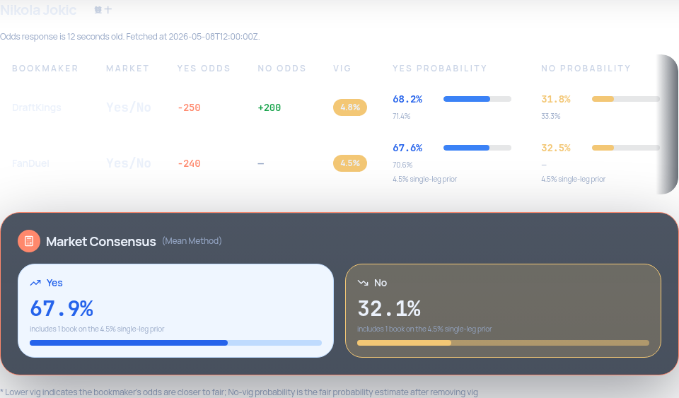
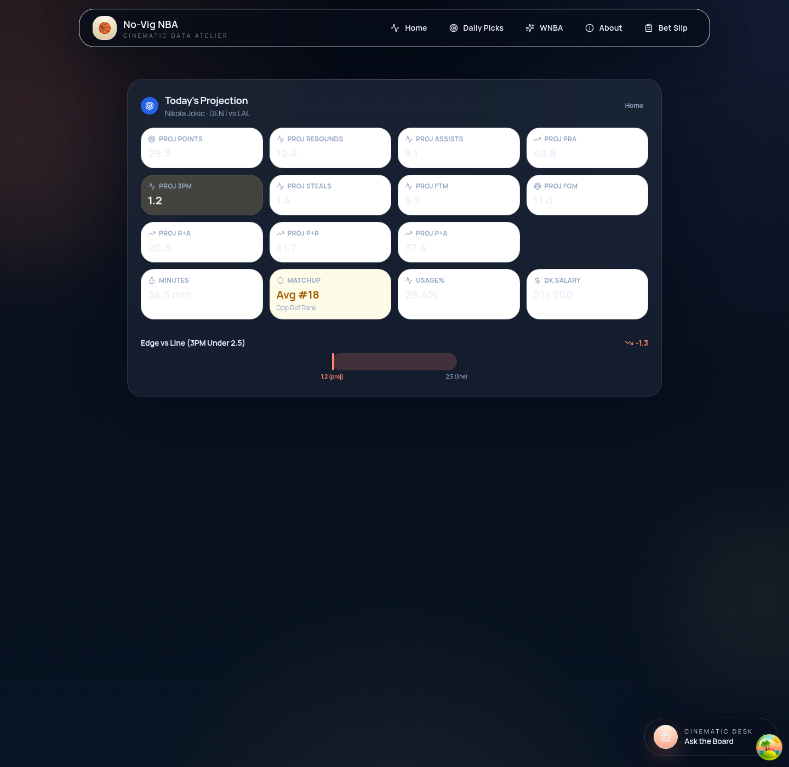
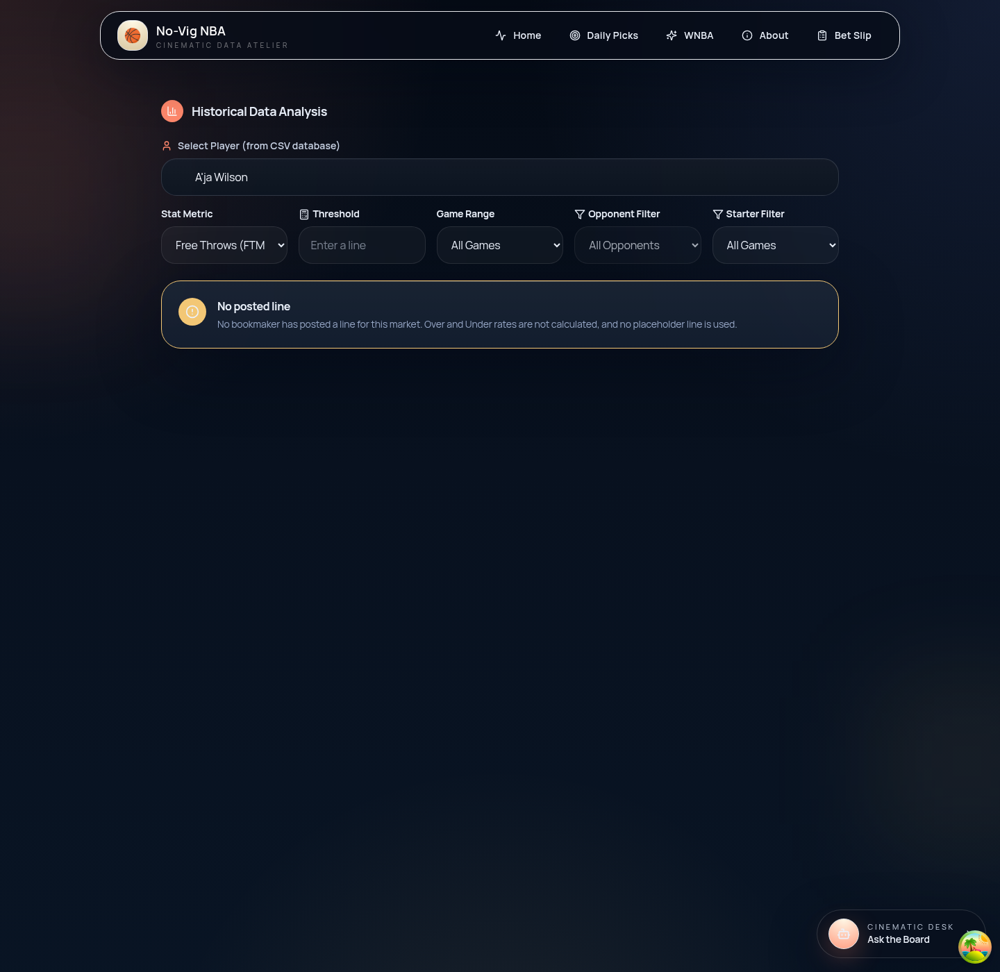
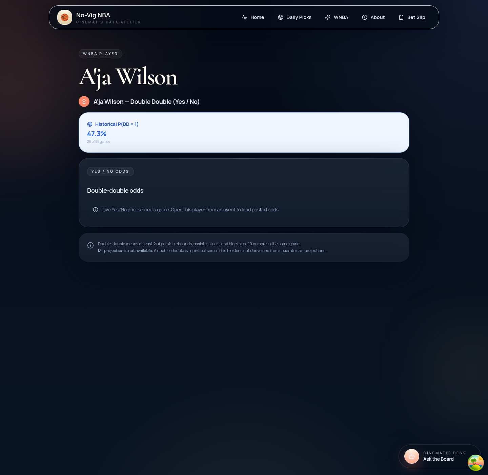

# SPO-105 — Frontend fixes from the SPO-103 review

## Summary

The event-page calculator and history panel were still describing a double-double as an Over/Under line. A DD calculation showed the `0.5` placeholder as the line, a one-sided Yes quote could be read as a posted No price, and the projection panel highlighted the wrong card. Empty boards (FTM and FGM) still computed an Over/Under rate against the `24.5` placeholder, and the shared game-range control offered an 82-game season on WNBA.

This change follows the SPO-104 contract on both leagues. `under_odds`, `no_price`, and `p_under_imp` may be null. Each result row may include `line_is_synthetic` and `market_kind` (`"binary"` or `"over_under"`). Those fields are optional and nullable, so payloads from before and after the backend merge both parse. NBA and WNBA share `noVigResponseSchema` in `frontend/lib/api.ts`.

## Changes

| File | Change |
|---|---|
| `frontend/lib/schemas.ts` | `under_odds`, `over_odds`, and both implied probabilities are nullable. `line_is_synthetic` and `market_kind` are optional. `fetched_at` and `data_age_seconds` stay on the parsed no-vig response. `recentGamesOptions(league)` is 82 for NBA and 44 for WNBA. |
| `frontend/lib/no-vig-display.ts` | Yes/No vs line, null price as `—`, and the 4.5% single-leg prior signal (`under_odds === null` or `no_price === null`). |
| `frontend/components/ResultsTable.tsx` | DD rows show Yes/No instead of `0.5`. A one-sided No price and its implied probability render `—`. Fair Yes/No from that quote stay visible and are labeled `4.5% single-leg prior`. The odds age is shown when the response has it. |
| `frontend/lib/projection-metric.ts` | Each market maps to its own projection card. Double-double maps to none, and its line is not an edge. |
| `frontend/components/PlayerProjectionPanel.tsx` | Cards for 3PM, STL, FTM, FGM, R+A, P+R, and P+A. No highlight and no edge when the metric is null. |
| `frontend/components/EventDetail.tsx` | Uses that mapping for NBA and WNBA. A synthetic or binary line is not passed into the edge bar. |
| `frontend/components/PlayerHistoryStats.tsx` | No `24.5` default. An empty board shows "No posted line" and does not query history. A zero-game sample renders `historyData.message`. The game-range options follow `cacheNamespace`. |
| `frontend/components/PlayerDDTile.tsx` | Fair values on a one-sided quote are labeled `4.5% single-leg prior`. A consensus is labeled only when every book used that prior. |
| `frontend/lib/player-dd.ts` | Book quotes carry `usesSingleLegPrior` from the null No price. |
| `frontend/app/wnba/player/[name]/page.tsx` | Mounts `PlayerDDTile` for WNBA. There is no event id, so history loads and the odds block uses its empty state. |
| `frontend/test/fixtures/props-no-vig/player-double-double-one-sided.json` | SPO-104 shape: null `under_odds` / `no_price` / `p_under_imp`, `line_is_synthetic: true`, `market_kind: "binary"`. |
| `docs/progress.md` | SPO-105 row. |

## Why

A reader who sees line `0.5` and a copied Yes price in the Under column can treat a one-sided double-double as a two-sided total. The fair No number is still real: it is the complement of the single-leg de-vig (`implied Yes / 1.045`). It has to stay on screen, with a label that says where it came from. `null` on `under_odds` or `no_price` is that signal. Before SPO-104 the copied price lives in `under_odds` while `no_price` is already null, so the same label works on the current payload.

`line_is_synthetic: true` hides the numeric line. When the flag is absent, `market_kind: "binary"` or `market === "player_double_double"` is the fallback. An explicit `line_is_synthetic: false` keeps the number.

The projection object already has fields for threes, steals, free throws, field goals, and the two-stat combos. Highlighting Points or PRA for those markets pointed the edge at the wrong stat. Double-double has no projection field, so the panel highlights nothing and does not subtract `0.5` from a points projection.

The `24.5` threshold was an initial value, not a line from the board. FTM and FGM usually return `results: []`. History now waits for a posted line or a number the user types. A sample with `n_games === 0` renders the backend message instead of a rate.

WNBA regular season is 44 games. The shared history panel is the caller on both event pages (`cacheNamespace` `nba` or `wnba`). The WNBA player page has no game-range control; it does not send `n=82`.

## Tests / Verification

- `npx vitest run` — 26 files, 107 tests, passed.
- `npx tsc --noEmit` — passed.
- `npm run lint` — passed, 0 warnings.
- Integration test: SKIPPED. No new external API client. The UI reads the existing `/props/no-vig` and `/player-dd-history` routes.
- Screenshots below are rendered from the fixtures in `frontend/test/fixtures/`, not from a live odds call.

| Fix | Test |
|---|---|
| DD table is Yes/No, and a null Under price is `—`, for both payload shapes | `shows a double-double as Yes/No and dashes a null under price` |
| Projection card per market, and no `0.5` edge for DD | `highlights 3PM on its own card and does not edge a double-double against 0.5` |
| Full season is 82 NBA games and 44 WNBA games | `labels the full season as 82 NBA games and 44 WNBA games` |
| Empty board does not use `24.5` | `does not compute an Over/Under rate against a placeholder when the board is empty` |
| Zero-game history renders `historyData.message` | `renders historyData.message when the sample has zero games` |
| DD tile labels the 4.5% single-leg prior | `labels fair probabilities that came from the 4.5% single-leg prior` |
| WNBA player page mounts the DD tile without an event id | `renders double-double history without an event and shows the odds empty state` |
| Zod keeps `fetched_at` and `data_age_seconds`, and the table shows the age | `shows how old the odds are from fetched_at and data_age_seconds` |
| Fair percents use the same half-away rounding as the DD tile | `renders 0.6755 as 67.6% in ResultsTable and PlayerDDTile` |
| `uses_prior` wins when present and a null No price is the fallback | `prefers uses_prior when it is present and falls back when it is absent` |
| A mixed consensus is labeled when any book used the prior | `labels a mixed consensus when any book used the prior` |
| `consensus_uses_prior` is read from the consensus object | `reads consensus_uses_prior from the consensus object` |
| Envelope copies of the SPO-104 flags are ignored, a missing consensus renders no consensus block, and a null `p_no_imp` is `—` | `ignores envelope flags, skips a missing consensus, and dashes a null No implied probability` |

Companion schema locks in `frontend/lib/player-dd-schema.test.ts`: `keeps fetched_at and data_age_seconds on the no-vig schema`, `accepts a one-sided row before the synthetic-line flags exist`, `accepts null under_odds with line_is_synthetic and market_kind`.

## Follow-ups

- The hand-typed Odds API bodies called out in the SPO-103 review are backend fixtures. This ticket does not replace them.
- Implied probabilities and continuous history percents still use `toFixed`. Fair probabilities in the results table and the DD tile share half-away rounding.

## SPO-104 contract

Final names are the ones in backend PR #37 (`965b05f`). NBA and WNBA share `noVigResponseSchema`. The new fields stay optional and nullable so a payload from current `dev` still parses.

A Yes-only quote sets `under_odds`, `p_under_imp`, `no_price`, and `p_no_imp` to null. `over_odds` is the Yes price. `p_under_fair` and `no_fair_prob` stay populated as the complement of the single-leg de-vig and are labeled `4.5% single-leg prior`. A null `p_no_imp` renders `—`.

| Field | Where |
|---|---|
| `line_is_synthetic` | each result row. True for DD, where `0.5` is a placeholder. |
| `market_kind` | each result row. `"binary"` or `"over_under"`. |
| `uses_prior` | each result row. True when that book only posted Yes. A boolean wins. When the field is absent, a null `under_odds` or `no_price` is still the signal. |
| `consensus_uses_prior` | consensus object, next to `p_yes_fair`. True if any book in that consensus used the prior. |
| `consensus_prior_book_count` | consensus object. When present and the consensus used the prior, the caption is `includes N book(s) on the 4.5% single-leg prior`. |

These flags are not read from the response envelope. Zod drops envelope copies. When there is no consensus, the object is null or absent and the consensus block is not rendered. If the consensus object is present but `consensus_uses_prior` is absent, the block is labeled when any row used the prior.

**Ticket**: SPO-105
**Branch**: `feature/SPO-105-frontend-review-fixes`
**Task summary**: `docs/task-summaries/SPO-105-frontend-review-fixes.md`
