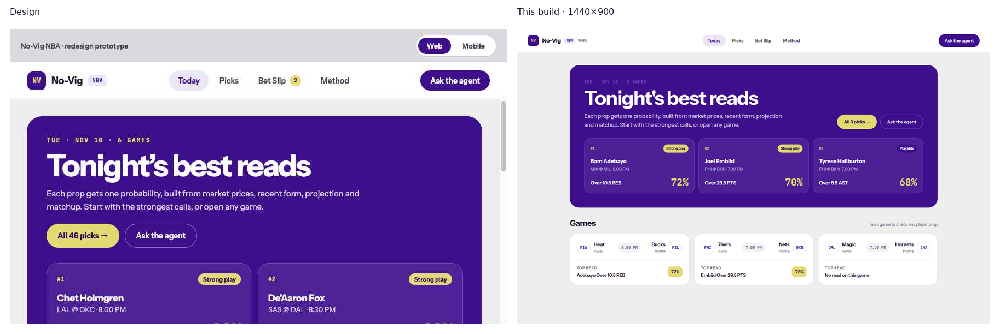
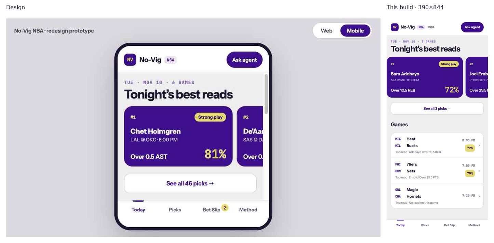

# SPO-120a — Design parity: tokens, header, Today

## Summary

The shared No-Vig tokens, the app shell, and the Today page now follow the redesign for this slice. The web header is full bleed (the mark sits at x = 32 on a 1440px viewport, height 68). The research disclaimer is no longer under every page; Method already carries it. Today prints `NBAEvent.top_read` when the events payload has one, and prints the ET wall clock from `commence_time_et` when `display_tz` is ET.

Every probability percent is a whole number (`72%`, not `72.4%`). `formatPercent(null)`, `undefined`, and non-finite values render an em dash, never `0%`. Today prints the backend `DailyPick.tier` string. It does not bucket the probability on the client and it does not read `combined_probability`.

Picks, the game page, Bet Slip, Method copy, and the agent keep their layouts. Their probability percents follow the shared formatter, so those screens also print whole numbers. WNBA Today still uses the same board. A WNBA payload with no `commence_time_et` still formats `commence_time` in the browser zone.

## Changes

| 檔案 | 變更 |
|---|---|
| `frontend/tailwind.config.ts` | Named colors, radii, type steps, header height, page max width, and the drawer shadow. Legacy `shadow-glow` and `shadow-panel` stay so other pages do not shift. |
| `frontend/app/globals.css` | The same tokens as variables. `.page-frame` / `.page-wrap` use the design padding (`clamp(16px, 3.4cqi, 40px)`, 56px bottom from `md` up). `.today-snap` is the mobile top-pick carousel. |
| `frontend/components/AppShell.tsx` | Full-width web header, centered nav, league badge radius 6px and padding 3px 7px, mobile header padding 14px 16px 12px. Shell disclaimer removed. |
| `frontend/lib/schemas.ts` | `NBAEvent` keeps `commence_time_et`, `display_tz`, `lineup_status`, and `top_read`. A `top_read` or `lineup_status` that fails the contract becomes null instead of failing the slate. `DailyPick.tier` is `"Strong play"`, `"Playable"`, `"Lean"`, or null. |
| `frontend/lib/today-board.ts` | `etWallClock` reads the offset timestamp as written. `eventTipClock` uses it when the label is ET or absent. `todayGames` prefers `top_read` and falls back to the highest daily pick. The tier is `tierFromApi` on that pick. A `top_read` borrows the tier of the matching daily pick and stays unlabeled when nothing matches. |
| `frontend/components/TodayBoard.tsx` | Design hero sentence, games hint, flat mobile top-pick cards, web card overlay `0.08` / `0.16` / hover `0.14`. An event `top_read` stays on the card when daily picks are still loading or have failed. A missing tier still shows the percent on a neutral pill. |
| `frontend/lib/player-dd.ts` | `formatPercent` rounds half away from zero to a whole percent. Missing and non-finite inputs are `—`. |
| `frontend/lib/utils.ts` | `formatProbability` and `formatVig` call `formatPercent`, so WNBA picks, the WNBA slip, implied percents, and vig use the same whole number. |
| `frontend/components/agent-widget/presentation.ts` | `formatPct` and `formatSignedPct` use the same whole number. Null and non-finite stay `N/A`. |
| `frontend/app/wnba/player/[name]/page.tsx`, `frontend/components/PlayerHistoryStats.tsx` | Over/under history rates go through `formatPercent` instead of `toFixed(1)`. |
| `frontend/app/wnba/layout.tsx` | Comment only. The shell no longer owns a footer. |
| `frontend/components/AppShell.test.tsx` | Header is full width. The shell has no disclaimer. |
| `frontend/app/about/page.test.tsx` | Method still has the research disclaimer. |
| `frontend/lib/fair-percent.test.ts`, `frontend/lib/player-dd-freshness.test.ts` | Whole percents, including `63%`. Null, undefined, NaN, and infinities are `—` and are not `0%`. A real `0` is `0%`. |
| `frontend/lib/today-board.test.ts` | ET clock, joined read time, `top_read` over the client pick, bad `top_read` falls back. A stored `"Playable"` stays Playable at probability `0.91`. A null tier stays null. |
| `frontend/components/TodayBoard.test.tsx` | Hero copy, hint, overlay vs flat card, ET time, `top_read` when picks fail, whole percents. |
| `docs/task-summaries/assets/SPO-120a/` | Design shots from the export, and Playwright shots of this build at 1440×900 and 390×844. |

## Why

`commence_time` is UTC. Formatting it with `date-fns` follows the machine zone, so the same tip was 7:00 PM in Chicago and 1:00 AM in UTC. `commence_time_et` already carries the America/New_York wall clock (`2026-11-11T01:00:00Z` → `2026-11-10T20:00:00-05:00` → `8:00 PM`). `etWallClock` reads that face and does not convert it again. A trailing `Z` is rejected. `display_tz` other than `ET` falls back to the browser clock so the card does not show an ET face under another label. WNBA responses omit both fields, so `/wnba` keeps the old clock.

`top_read` is the stored pick the events route already joined. The client list can disagree (a different filter, or a failed picks request). The card uses `top_read` when it parses, and the old highest-pick fallback when it is null. The link uses that read's player, Odds API market, and line. `lineup_status` is parsed and not drawn: Today has no lineup chip. The event header is a later slice.

The hero sentence is the design sentence. The percent under it is still `DailyPick.probability` through `formatPercent`. `combined_probability` is on the backend and is not what Today sorts, prints, or turns into a tier. The tier label is the backend's current `tier` field (`"Strong play"`, `"Playable"`, `"Lean"`, or null). Today does not call `readTier` and does not apply a combined-probability cutoff. A `top_read` has no tier of its own, so the card uses the tier on the daily pick with the same event, player, side, line, and market. If that pick is missing, the percent still renders and the tier pill is omitted. `readTier` remains on the picks board, the event page, and the bet slip until those slices.

Whole percents use `roundHalfAwayFromZero(probability * 100, 0)`. `0.6755` prints `68%`. `1.005 * 100` is the float `100.49999999999999`; the half-away nudge prints `101%`, which is the half-away result for a true `100.5`. `formatPercent(0)` is `0%`. `formatPercent(null)`, `undefined`, `NaN`, and both infinities are `—`.

`formatVig` calls `formatPercent`, so a `0.0476` vig prints `5%` and a real zero vig prints `0%`. The named `"4.5% single-leg prior"` label is unchanged. Usage rate, minutes, edges, and projected stat lines stay one decimal because they are not probabilities. The Method page's static `52.38%` / `4.76%` illustration is unchanged.

The mobile chevron stays `text-muted`. The design swatch `#B9B3C4` is on the token list as `tone-neutral`, and an existing Today test refuses that hex on the chevron. `#625B70` is the readable ink already on the row.

The shell disclaimer was a second line under every route. Method already ends with the research paragraph, so removing the shell line leaves the disclaimer on Method only. That paragraph's wording is the current Method text, not a rewrite.

## Tests / Verification

- Frontend `npm test` (`TZ=America/Chicago vitest run`): 46 files, 294 tests, passed.
- `npx tsc --noEmit`: passed.
- `npm run lint`: passed, 0 warnings.
- `npm run build`: passed.
- Integration test: SKIPPED. No new external client. Today reads the existing events and daily-picks routes.
- Fabrication scan: PASS. Card numbers come from the API. A `top_read` that fails validation is dropped and the client pick is used. Screenshots use the committed today fixtures, with `commence_time_et`, `display_tz`, and `top_read` filled from those same rows. They are not the prototype's sample board (Chet Holmgren, De'Aaron Fox, Anthony Edwards).

| Behavior | Test |
|---|---|
| Web header is full width and the shell has no disclaimer | `spans the web header and leaves the research disclaimer on Method only` |
| Method still has the disclaimer | `describes the vig math and marks a blend as planned` |
| ET wall clock, not the machine zone | `reads the ET wall clock and ignores the machine zone` |
| Read matchup uses the event clock | `prints that ET clock on a read joined by event id` |
| `top_read` wins and the percent is whole | `prefers top_read over the client pick and prints a whole percent` |
| Backend tier is not recomputed from the rate | `uses the backend tier and does not recompute one from the probability` |
| Bad `top_read` falls back to the daily pick | `drops a top_read that does not match the contract and uses the client pick` |
| Hero copy, hint, overlay card, flat mobile card | `renders tonight's reads and each game's top read from the API` |
| `top_read` remains when picks fail | `keeps top_read on the game card when daily picks fail` |
| WNBA endpoints and abbreviations | `renders the WNBA board from the WNBA endpoints` |
| Whole percents, em dash, real zero | `formatPercent` in `lib/fair-percent.test.ts` and `lib/player-dd-freshness.test.ts` |

Playwright (system Chrome) against `next start` on port 3010, with those fixture payloads:

- 1440×900: header box x = 0, width = 1440, height = 68. NV mark x = 32. Hero sentence visible. Web card background `rgba(255, 255, 255, 0.08)`. Bam reads `MIA @ MIL · 8:00 PM`, `Strong play`, and `72%`. Embiid is `70%`. Haliburton is `Playable` and `68%`. No disclaimer.
- Ask the agent in the header opens and closes the drawer.
- `/picks` has no disclaimer. `/about` has the Method paragraph once.
- `/wnba` still renders A'ja Wilson, `LVA @ NYL`, `Strong play`, `71%`, and does not show an NBA abbreviation. The clock is `1:00 AM` because the WNBA fixture has no `commence_time_et` and the browser zone is UTC.
- 390×844: NV mark x = 16. Mobile card background `rgb(62, 15, 141)`, border width 0. Bam is `72%` with `Strong play`. The hero paragraph is not visible (it stays on the web board). Mobile Method still shows the disclaimer.

### Screenshots

Design files are `export/screenshots/web-01-today.png` and `mobile-01-today.png` from the design zip. They include the prototype's Web/Mobile chrome. The build shots are the app at 1440×900 and 390×844.

## Follow-ups

- [ ] Show `combined_probability` on Today, or put the historical-rate sentence back. The hero uses the design sentence while the number is still `DailyPick.probability`. The tier is the backend's current historical `tier`, not a blend cutoff.
- [ ] SPO-120b: event page. `lineup_status` is parsed here and not rendered. That page still calls `readTier(probability)`.
- [ ] SPO-120c: game log, filters, odds.
- [ ] SPO-120d: Picks, Bet Slip, Method copy, agent. Those screens now print whole percents through the shared formatter. Picks, the event page, and the slip still label tiers with `readTier` until their slices. Agent borders still use the dark-surface utilities (`border-white/10`, `bg-white/5`). The `agent-border` token is available and unused.
- [ ] B1–B7 from the audit. None of those backend fields were invented on the client.
- [ ] Chevron `#B9B3C4` if contrast review accepts it. Today keeps `text-muted`.

## Data gaps

| Field | What Today does |
|---|---|
| `top_read` null | Highest `DailyPick` for that `event_id`. If picks are loading or failed, "Loading the top read" / "Top read unavailable". |
| `top_read` present | That player, market, side, line, and probability, as a whole percent. The tier is the matching daily pick's `tier`, or none. |
| `DailyPick.tier` null or unmatched | The percent still shows. No Strong / Playable / Lean label is invented. |
| `commence_time_et` + `display_tz` `"ET"` | Wall clock from the offset string. No "ET" suffix on Today (the event header is later). |
| Either field missing, or `display_tz` is not ET | `commence_time` in the browser zone. This is the WNBA path. |
| `lineup_status` | Parsed, not shown. |
| `combined_probability` | Not read. The card percent is `probability`. The card tier is `tier`. |
