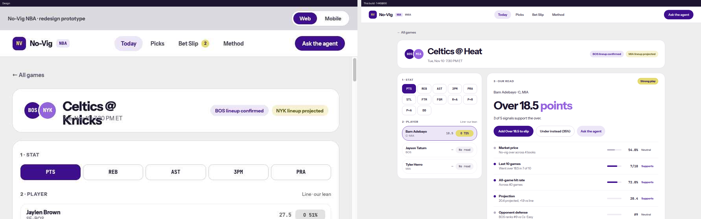
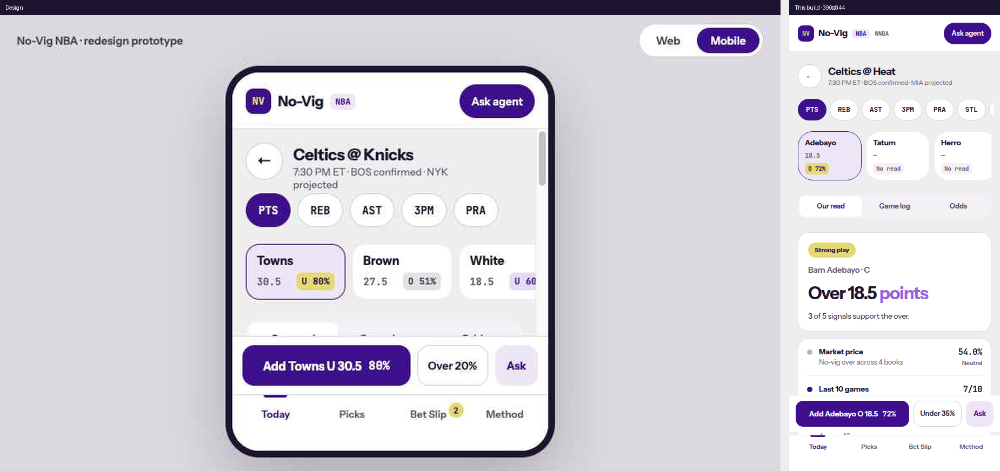

# SPO-120b — Design parity: game page read and mobile layout

## Summary

The NBA game page now follows the redesign for the header, the twelve market chips, the player rail, Our read, and the mobile layout. WNBA keeps the previous event page. A percent printed next to a backend tier rounds down (`0.697` shows `69%`) through `formatTierPercent` from SPO-120a. The sportsbook vig badge uses that same one-decimal label for its color, so `0.06` and `0.06004` both print `6.0%` and share one color.

The odds table and bookmaker picker stay on the Odds tab, and on the desktop main column, until SPO-120c. Starters, Search Player, and Historical Data Analysis are gone on NBA only.

## Changes

| 檔案 | 變更 |
|---|---|
| `frontend/lib/event-page.ts` | NBA clock, lineup chips, `joinMeta`, `percentBesideTier`, and `buildNbaRead`. Both slip sides stay on the historical pick. WNBA still uses `readTier` and `buildReadSignals`. |
| `frontend/lib/schemas.ts` | `PickSignal`, plus `position`, `p_over`, `p_under`, `signals`, and `combined_probability` on `DailyPick`. `tier` is any string so an unknown bucket does not drop the pick. |
| `frontend/components/EventDetail.tsx` | NBA layout: short names, ET clock, chips under the players, three tabs, filter sheet, action bar. History request and the history queries are unchanged. |
| `frontend/components/event/EventHeader.tsx` | Mobile 44px back button and short title. Home disc is `brand-soft` on NBA. |
| `frontend/components/event/StatChips.tsx` | All 12 markets. NBA chips use `rounded-control` and `border-line-strong`. |
| `frontend/components/event/PlayerRail.tsx` | Pill color from the backend tier. An NBA lean shows a `History` caption. Meta is position and team with a separator only when both exist. Selected player is first on mobile. |
| `frontend/components/event/OurRead.tsx` | NBA headline, stored signals, and web slip buttons. The bar is labeled `Model`. The slip buttons are labeled `History`. |
| `frontend/components/event/EventActionBar.tsx` | Mobile "Add {Last} {O\|U} {line} {percent}", the other side, and Ask. |
| `frontend/components/event/FilterSheet.tsx` | Mobile filters as a bottom sheet. Focus moves in only when the sheet opens. Tab stays inside. Escape closes it and returns focus. |
| `frontend/components/event/EventTabs.tsx` | Optional tab list. NBA passes the three tabs. |
| `frontend/components/ResultsTable.tsx` | Vig color uses the one-decimal percent `formatVig` prints. |
| `frontend/lib/player-dd.ts` | Unchanged in this branch. `formatTierPercent` is the SPO-120a helper. |
| `frontend/lib/tier-percent.qa.test.ts` | QA's nine cases, applied with `git am` from the #51 review. |
| `docs/task-summaries/assets/SPO-120b/` | Playwright shots at 1440×900 and 390×844, beside the design export. |

## Why

The tier string is `DailyPick.tier` through `tierFromApi`. The NBA path does not call `readTier`. `Pass` and any other string stay unlabeled. WNBA still calls `readTier`, because SPO-121b owns removing that call from the picks board, the WNBA event path, and the bet slip.

A percent that sits in the same control as a tier uses `formatTierPercent` (`Math.floor(p * 100 + 1e-9)`). The rail pill and the action bar print `DailyPick.probability`, which is the field the tier describes. The model bar prints `combined_probability` when that field is finite, and floors only the lean side. The other side of the bar stays on `formatPercent`. Those two numbers can disagree. The floor stops `0.697` from printing `70%` beside Playable. A missing probability is `—`. A row with no tier keeps half-away `formatPercent`, so `0.699` with a null tier prints `70%`.

The primary slip seed stores `pick.probability`. The other side stores the pick's own opposite field, `p_under` or `p_over`, and uses the `/history` rate for that side only when the field is missing. It does not store `1 − combined_probability` and it does not store `1 − probability`. Both buttons are the historical source. The model bar is `combined_probability` and is labeled `Model`. The slip buttons and the NBA rail lean are labeled `History`. A new `onClose` from the parent does not pull focus back into the filter sheet; focus moves only when `open` changes. Tab and Shift+Tab wrap inside the dialog. WNBA's other side stays the history rate. The QA case "does not de-vig the stored rate" still passes on the default path.

QA's first `event-page-nba.qa.test.ts` pinned three other-side cases to `1 − combined_probability`. That is the mix this follow-up removes (`0.59` historical next to `0.327` model, which does not add to 1). Those three cases were rewritten in a later commit, and one case was added so `p_under` wins over both the history rate and the model. The other twenty-one QA cases are unchanged.

`joinMeta` inserts ` · ` or `, ` only when position and team are both non-blank. A null team shows the position alone. Team resolution inside `eventPlayerRows` is unchanged, so SPO-122 can replace it.

NBA lineup chips read `NBAEvent.lineup_status`. A confirmed lineup snapshot does not become "confirmed" when that field is null. The clock reads `commence_time_et` through `etWallClock` and appends ` ET` only when `display_tz` is `ET`. WNBA keeps `eventWhen` and `lineupChip`.

`formatVig` already rounds to one decimal. The badge color was still `vig > 0.06` and `vig < 0.04` on the raw number, so `0.06004` printed `6.0%` in red while `0.06` printed `6.0%` in yellow. The color now parses the `formatVig` label. Above `6.0` is red, below `4.0` is green, and `4.0` through `6.0` is yellow.

The home disc is `#9564DD`. White on that purple is about 4.08:1, under 4.5. The contrast test locks that pair at a minimum of 4, which is the design token.

## Tests / Verification

- Frontend `npm test` (`TZ=America/Chicago vitest run`): 51 files, 393 tests, passed.
- `./node_modules/.bin/tsc --noEmit`: passed.
- `npm run lint`: passed, 0 warnings.
- `npm run build`: passed.
- Integration test: SKIPPED. No new external client. The page reads the existing events, picks, props, and history routes.
- Fabrication scan: PASS. Empty NBA picks render "No stored read for this player." and no client-built signal rows. Screenshots use the committed event fixtures.

| Behavior | Test |
|---|---|
| Floor at 0.56, 0.65, 0.70 and just below | `formatTierPercent` in `lib/fair-percent.test.ts`, rail/read/bar in `lib/event-page.test.ts`, rendered rail, Our read, and action bar in `components/event/tier-percent.test.tsx` |
| QA floor bands, Today card, signed edges | `lib/tier-percent.qa.test.ts` (9) |
| Backend tier, not `readTier`, on the NBA read | `keeps Playable at 0.91 and stays blank when the tier field is null` |
| Under signals stay on the under | `does not flip an under signal into an over sentence` |
| Null team has no stray separator | `joins position and team only when both exist` |
| NBA lineup chips ignore a confirmed snapshot | `reads NBA lineup chips from the event` |
| ET clock | `prints the ET face and appends ET only when display_tz is ET` |
| Vig `0.06` and `0.06004` share the 6.0% color | `colors 0.06 and 0.06004 the same, because both print 6.0%` |
| WNBA still uses its endpoints and `readTier` | `reads the WNBA game from the WNBA fixtures`, `lib/event-page.qa.test.ts` |
| Slip sides stay historical when the model disagrees | `keeps both slip sides on the historical pick when the model disagrees` |
| Filter sheet focus | `is a modal dialog, moves focus inside, and returns focus on Escape` |
| A new `onClose` does not steal focus | `does not move focus when the parent passes a new onClose` |
| Tab stays in the filter sheet | `traps Tab and Shift+Tab inside the sheet` |
| NBA rail lean is labeled History | `labels an NBA lean as History and leaves a missing read unlabeled` |

Playwright (system Chrome) against `next start` on port 3010, with the committed event fixtures served on port 8000:

- 1440×900: `Celtics @ Heat`, `Tue, Nov 10 · 7:30 PM ET`, `BOS lineup confirmed`, `MIA lineup projected`, Bam `O 72%` on a Strong play pill, `Over 18.5 points`, `3 of 5 signals support the over.`, `Add Over 18.5 to slip`, `Under instead (35%)`.
- 390×844: round back button, `7:30 PM ET · BOS confirmed · MIA projected`, free-scrolling chips, Adebayo first, three tabs, `Add Adebayo O 18.5 72%`, `Under 35%`, Ask.

The model bar is absent in these shots because the Bam fixture leaves `combined_probability` null. The bar renders only when that field is finite.

### Screenshots

Design files are `docs/design/redesign-2026-11/screenshots/web-02-event.png` and `mobile-02-event-read.png`.

## Follow-ups

- [ ] SPO-120c: restyle the game log, the filter controls, and the odds table. The table stays reachable on the Odds tab until then.
- [ ] SPO-120d: Picks, Bet Slip, Method, and the agent.
- [ ] SPO-121b: remove `readTier` from the picks board, the WNBA event path, and `BetSlipScreen`. This slice leaves those calls in place.
- [ ] SPO-122: a player whose club is not home or away gets `team: null`. This page already hides the separator when team is null. The roster fallback in `eventPlayerRows` is unchanged.
- [ ] After #51 merges, this branch already uses `formatTierPercent` from `frontend/lib/player-dd.ts`. The local copy was dropped when `02bfe60` was merged.
- [ ] B2: the rail percent is `probability` and the bar percent is `combined_probability`. They can disagree. The floor only stops the tier label from being contradicted by rounding.

## Data gaps

| Field | What the NBA game page does |
|---|---|
| No daily pick | "No stored read for this player." No fabricated signals. |
| `signals` null or empty | "Signal verdicts are not on this response." |
| `verdict` null | No Supports / Against / Neutral word. Null is not Neutral. |
| `combined_probability` null | No model bar. The other slip side still uses `p_under` / `p_over`, then the history rate. |
| `p_under` / `p_over` null | The other slip side uses the history rate at the same line. It does not subtract `combined_probability`. |
| `tier` null, `Pass`, or unknown | No tier pill. The percent uses `formatPercent`. |
| `position` or `team` null | The other part shows. No stray separator. |
| `lineup_status` null | "lineup status unavailable". A lineup snapshot is not promoted to confirmed. |
| `commence_time_et` missing | `eventWhen(commence_time)`, no zone suffix. |
