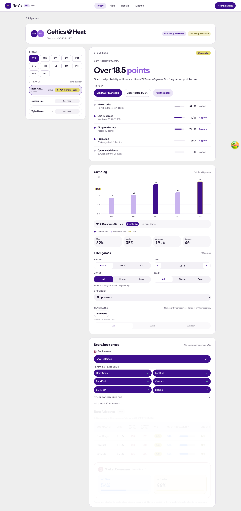
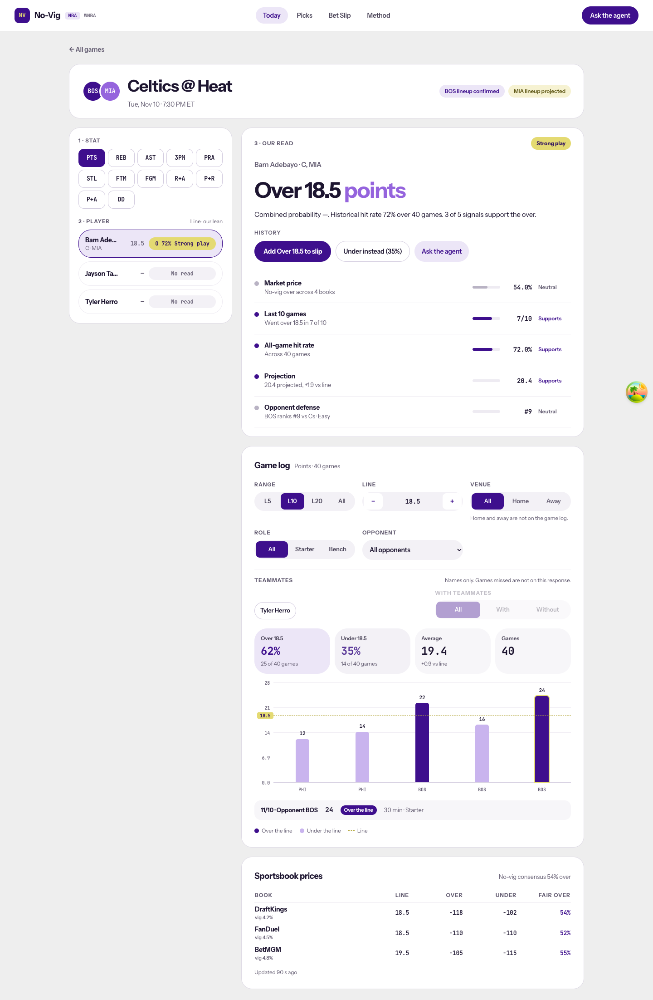
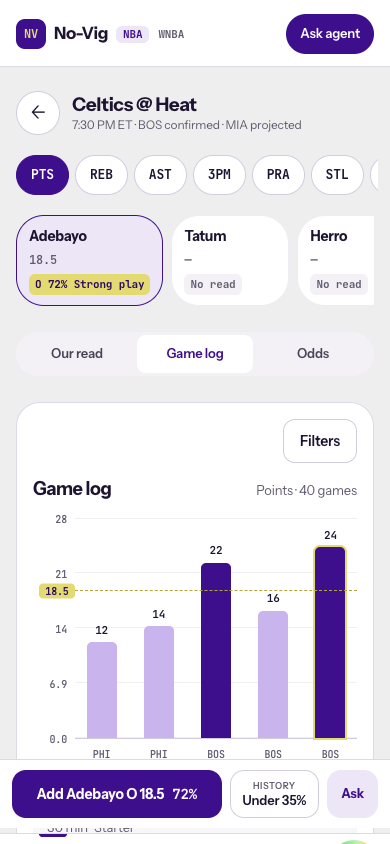
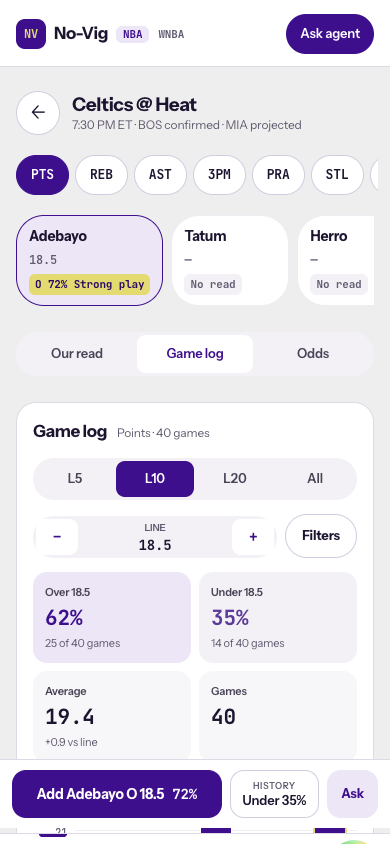
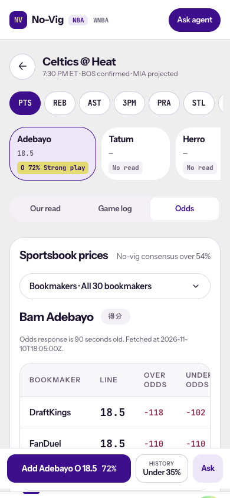
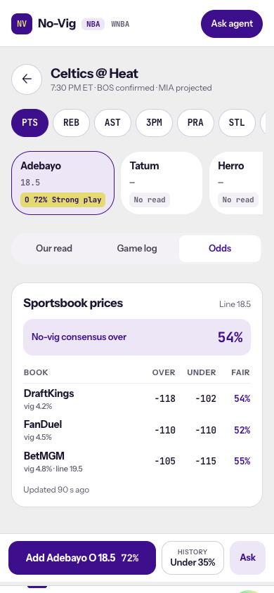
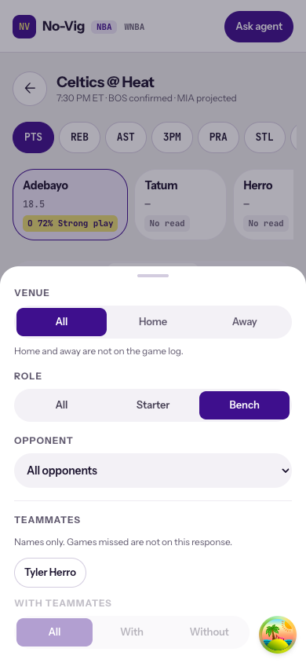
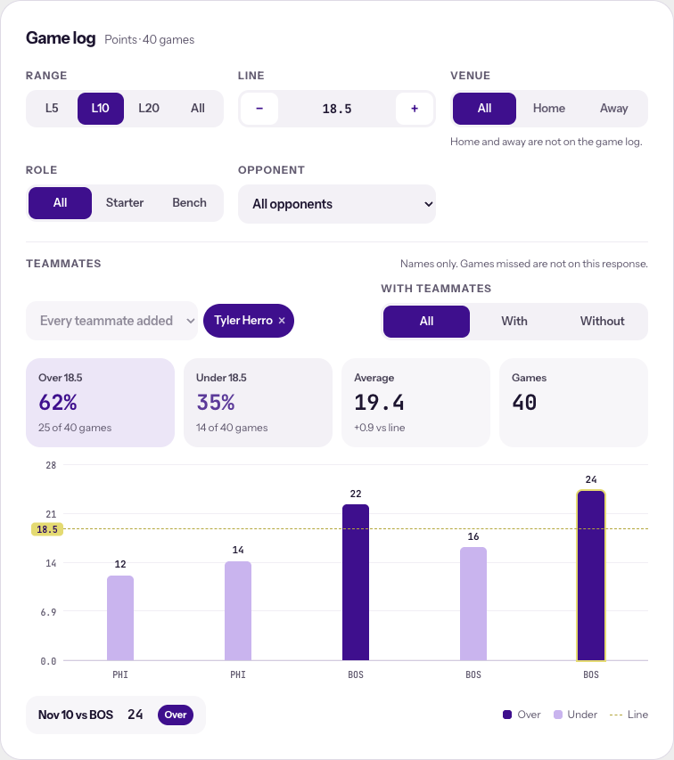
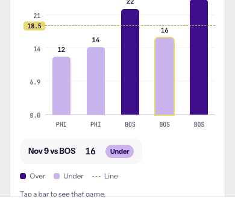
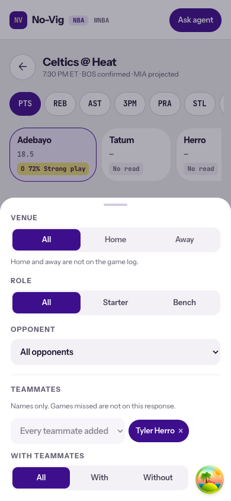

# SPO-120c — NBA odds table and game log layout

## Summary

The NBA game page now follows the redesign for the two panels left over from SPO-120b. Sportsbook prices is one compact table: book with its vig, line, over, under, and the fair over percent. On mobile it shows a consensus banner and a four-column table, and an off-line book names its line under the book. The bookmaker picker is gone on NBA, so the odds request covers every book. The game log shows its filters first, then four stat tiles with their counts, then the chart. Range is L5, L10, L20, or All.

WNBA keeps the previous game log, bookmaker picker, and results table.

## Changes

| 檔案 | 變更 |
|---|---|
| `frontend/lib/sportsbook-prices.ts` | `sportsbookPrices` builds one row per book (display name, vig, line, prices, fair yes or over), flags a book off the posted line, and reads the side consensus. `updatedLabel` prints the snapshot age. Binary and prior handling reuse `no-vig-display`. |
| `frontend/components/event/SportsbookPrices.tsx` | The NBA odds panel. Loading, error, empty, binary (Yes / No, no line column), and single-leg prior states. |
| `frontend/lib/event-page.ts` | `gameLogTiles` builds the Over, Under, Average, and Games tiles. Counts come from `p_over × n_games`, so they match the printed percent. `shortGameDate` labels each chart bar "Apr 1" in UTC. |
| `frontend/components/event/GameFilters.tsx` | Split into `RangeControl`, `LineControl`, `VenueControl`, `RoleControl`, `OpponentControl`, and `TeammatesControl`. `RANGE_OPTIONS` per league. `MoreFilters` is the NBA sheet. `GameFilters` is the WNBA panel, unchanged in content. Selected segments are brand-filled. Tracks use `rounded-control` (12px) around `rounded-mark-sm` (9px) buttons. Teammates is an "Add a teammate" menu, and only picked names show as removable chips. |
| `frontend/components/event/NbaGameLog.tsx` | The NBA game log card. Filters, tiles, chart. Mobile keeps range and line on the card and opens the sheet from a Filters button that counts active filters. Desktop has Reset filters. |
| `frontend/components/event/GameLogChart.tsx` | `heading` prop so the NBA card can own the title. The picked game is one short chip (date vs opponent, value, Over / Under / Push) with the legend on the same row. |
| `frontend/components/EventDetail.tsx` | NBA renders `NbaGameLog` and `SportsbookPrices`. WNBA keeps the old panels. |
| Tests | New `sportsbook-prices.test.ts`, `SportsbookPrices.test.tsx`, `game-log-tiles.test.ts`, `NbaGameLog.test.tsx`. `EventDetail.fixtures.test.tsx` locators follow the new layout. |
| `docs/task-summaries/assets/SPO-120c/` | Before and after screenshots. |

## Why

The previous NBA odds panel stacked a bookmaker picker, a seven-column table that scrolled sideways on mobile, and a separate consensus card. It also printed a leftover Chinese market badge and a raw ISO timestamp. The redesign reads as one consensus number backed by a per-book table, and the owner chose to drop the picker. The picker's default was already "all books", so the request and its quota cost do not change.

Line freshness still shows as "Updated 90 s ago" under the table, which replaces the raw timestamp. The design dropped it, but a stale line is not an accurate price. The table does not add a new stale warning, so behavior there is unchanged.

The design's fourth tile is Projected. The NBA projection source is gone since SPO-135, so that tile is Games. The design's teammate chips show "N out" counts. The history response has names only, so the chips stay names only. Venue stays disabled because the game log has no home or away field.

Owner review round:

- Filter radii were not concentric. This repo's Tailwind config sets `rounded-xl` to 24px, not the stock 12px, so the 42px tracks drew as pills around 9px buttons. Tracks, the opponent menu, and the mobile Filters button now use `rounded-control`, and the buttons use `rounded-mark-sm`. That is the design's 12px and 9px with the 3px padding between. The same override drew the 10px legend squares as circles (`rounded-sm` is 10px here). They are 3px now.
- Teammates listed the whole roster as chips. It is now one menu of teammates not yet picked, with the picked names as chips beside it. The WNBA panel shares the control.
- The picked-game strip is one chip, "Nov 9 vs BOS · 16 · Under", with the legend to its right on desktop. Minutes and starter or bench left the strip to match the owner's reference. "vs" names the opponent only. The game log has no home or away field, so it never means a home game here.

## Tests / Verification

- Frontend `npx vitest run`: 84 files, 686 tests, passed (local Node 22.11 needs `NODE_OPTIONS=--experimental-require-module`).
- `npx tsc --noEmit`: passed.
- `npm run lint`: passed, no warnings or errors.
- `npm run build`: passed.
- Integration test: SKIPPED. No new external client. The page reads the existing no-vig and history routes.
- Fabrication scan: PASS. Every number in the table and the tiles comes from the no-vig or history response. No projection tile, no teammate absence counts.
- Browser, headless Chromium with the committed event fixtures at 1440 and 390. No page errors. Mobile Odds shows the banner and the four columns, with BetMGM marked `line 19.5`. Picking Bench in the sheet turns the button into "Filters · 1".
- Review round, same fixtures on the dev server: computed radii are 12px on every track and menu and 9px on every inner button. Picking Tyler Herro from the menu adds one chip and disables the menu (the fixture has one teammate). The strip reads "Nov 10 vs BOS 24 Over" with the legend on the same row at 1440, and wraps under it at 390 with no sideways scroll.

| Behavior | Test |
|---|---|
| One row per book with line, prices, fair over, consensus, and age | `lib/sportsbook-prices.test.ts`, `SportsbookPrices.test.tsx` |
| Off-line book flagged and named on mobile | `flags a book that posts a different line`, `names the off-line book's line` |
| Double-double uses Yes / No, hides the line column, reads the yes consensus | `sportsbook-prices.test.ts`, `SportsbookPrices.test.tsx` |
| Single-leg prior book has no No price and a prior note | `marks a one-sided book as prior-based` |
| Empty, loading, and error states | `SportsbookPrices.test.tsx` |
| Tiles print counts and the average against the line | `lib/game-log-tiles.test.ts` |
| NBA range is L5 / L10 / L20 / All and sends `n: 5`; WNBA labels unchanged | `NbaGameLog.test.tsx` |
| Filters come before tiles, tiles before the chart | `NbaGameLog.test.tsx` |
| Filters button counts active filters; reset only when something is set | `NbaGameLog.test.tsx` |
| Line change survives tab switches and reaches the history request | `EventDetail.fixtures.test.tsx` |
| Teammate menu lists only unpicked names; chips remove; menu disables when all are picked | `NbaGameLog.test.tsx` `TeammatesControl` |
| Picked game reads date vs opponent, value, result, without minutes or role | `NbaGameLog.test.tsx`, `labels a value on the line as a push` |
| Bar dates stay on their calendar day in Chicago | `labels each game with its calendar day, not the day before in Chicago` |

### Screenshots

| Before | After |
|---|---|
|  |  |
|  |  |
|  |  |
| |  |

Review round:

| Web game log | Mobile strip | Mobile sheet |
|---|---|---|
|  |  |  |

## Follow-ups

- [ ] SPO-120d: compact pick card and the date row on Daily Picks.
- [ ] Teammate absence counts, if the history response adds games missed per teammate.
- [ ] Venue filter, if the game log adds a home or away field.
- [ ] The committed event fixtures predate SPO-135c and still carry a projection signal. Refresh them from a live response.

## Progress notes (for the docs PR)

- SPO-120c: NBA game page odds table and game log follow the redesign. Bookmaker picker removed on NBA. Range is L5 / L10 / L20 / All.
