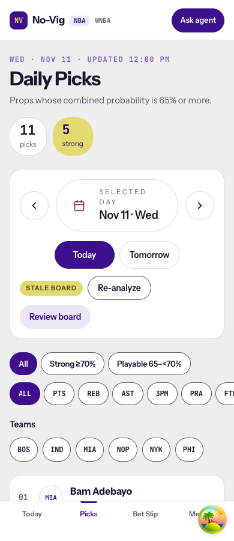
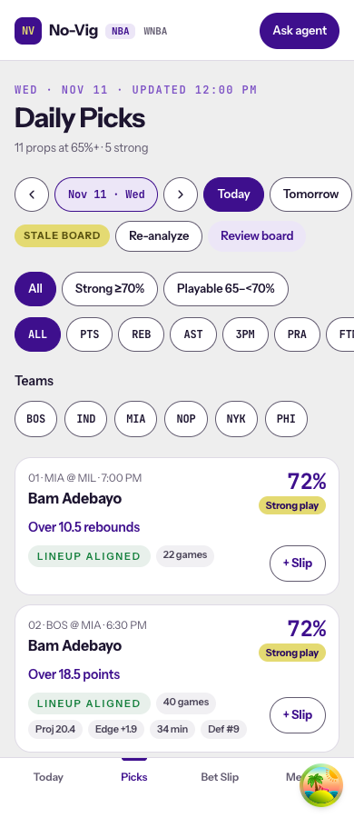
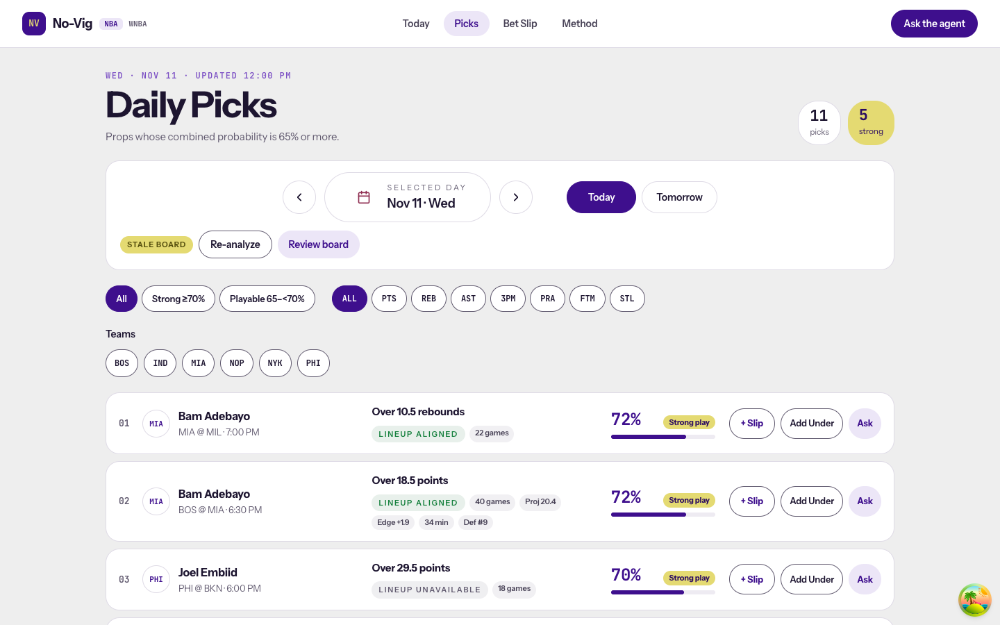
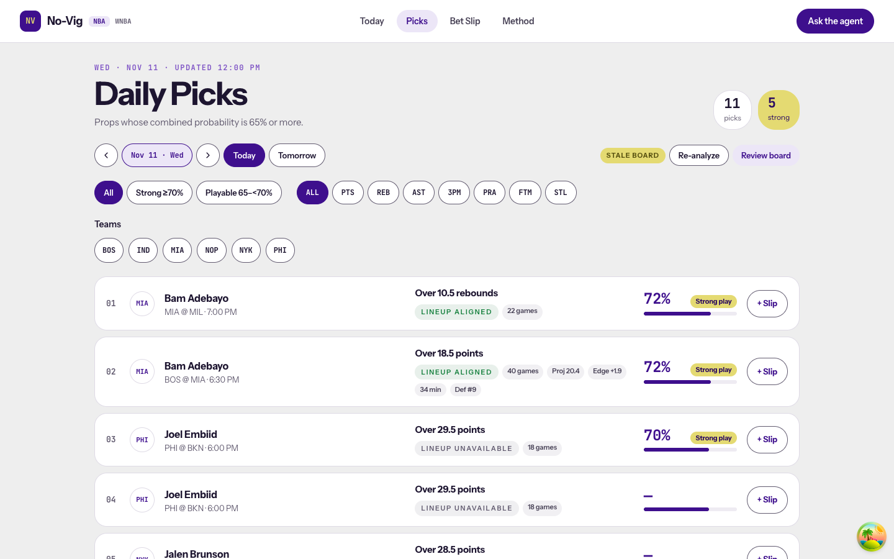

# SPO-120d — Compact pick card and date row on Daily Picks

## Summary

The NBA Daily Picks board follows the redesign. Each pick is a compact card with one slip toggle, and the whole card opens the game page. The date panel is one row of chips plus the board status, so the first pick sits near the top of a phone screen. On mobile the header shows "N props at 65%+ · M strong" in place of the two count tiles.

The reverse add and Ask buttons leave the card, per the owner's call. The game page keeps both. The pick context menu keeps its reverse option, which now stores the same leg the card's button used to store.

## Changes

| 檔案 | 變更 |
|---|---|
| `frontend/components/picks/DailyPicksBoard.tsx` | The card is one CSS grid. Mobile is two columns (matchup, player, prop on the left; percent and tier on the right; tags and slip below). Desktop is six columns (rank, team, player, prop and tags, rate, slip). The player link stretches over the card. `onAddReverse` and `onAsk` are removed. |
| `frontend/components/picks/PicksDateRow.tsx` | Previous / date / next, Today, Tomorrow, then the board status, Re-analyze, and Review board. Mobile scrolls the date chips sideways. The native date input still picks any day. |
| `frontend/components/picks/BoardChip.tsx` | The board's filter chip, moved out so the date row shares it. |
| `frontend/lib/bet-slip-board.ts` | `slipPickFromDaily` and `reverseSlipPick` build a slip leg from a daily pick. |
| `frontend/app/picks/page.tsx` | Uses `slipPickFromDaily`. `handleAddReverse` and `handleAsk` are removed. |
| `frontend/components/PickContextMenu.tsx` | Add and reverse use the shared builders. |
| Tests | Board, page, reverse-slip, injury, and Out tests follow the new card. The QA case for the old flex bases is removed. |
| `docs/task-summaries/assets/SPO-120d/` | Before and after screenshots. |

## Why

The redesign card has one action, and the card itself is the way into the signals. The owner chose that layout. The old card carried three buttons and a date panel that pushed the first pick below the fold on a phone.

Before this PR, the picks page reverse stored `rate_basis: "complement"` and the NBA blend fields, and the context menu reverse stored neither. With the card button gone, the context menu is the reverse entry on this page, so both now call `reverseSlipPick`. The same-side add from the menu also gains the tier and combined probability that the card's toggle already stored.

The card uses a stretched link (the player link's `::after` covers the card) with the slip button above it. That keeps one link and one button per card, with no button nested in a link. The grid places each piece by breakpoint, so the DOM has one copy of every value.

`DatePicker` is not changed because the WNBA picks page still uses it. `DailyPicksBoard` is only rendered by the NBA page.

## Tests / Verification

- Frontend `npx vitest run`: 80 files, 651 tests, passed (local Node 22.11 needs `NODE_OPTIONS=--experimental-require-module`).
- `npx tsc --noEmit`: passed.
- `npm run lint`: passed, no warnings or errors.
- `npm run build`: passed.
- Integration test: SKIPPED. No new external client.
- Fabrication scan: PASS. A pick with no combined probability still prints the em dash.
- Browser, headless Chromium with the committed picks fixtures:

| Measure | Before | After |
|---|---|---|
| Mobile card height (390px) | 255 px | 152 px |
| Mobile first card top | 790 px | 503 px |
| Desktop card height (1440px) | 89 px | 87 px |
| Desktop first card top | 565 px | 445 px |

- Clicking "Add to Bet Slip" stays on `/picks` and turns the button into "Added to Bet Slip". Clicking elsewhere on the card opens `/event/heat-bucks`. No page errors. No horizontal overflow at 390px.

| Behavior | Test |
|---|---|
| One slip control per card and a game link | `DailyPicksBoard.test.tsx` |
| No Ask on the card; Review board sends the visible picks | `app/picks/page.test.tsx` |
| Context menu reverse stores `1 − probability` with `rate_basis: "complement"` | `app/picks/reverse-slip.test.tsx` |
| Out card keeps Remove as its only control | `out-followups.qa.test.tsx`, `out-exclusion.qa.test.tsx` |
| Doubtful keeps a percent and a slip control | `injury-tag.test.tsx` |

### Screenshots

| Before | After |
|---|---|
|  |  |
|  |  |

## Follow-ups

- [ ] A pick with no combined probability prints an em dash but still draws a rate bar. The bar width comes from another field. This predates the PR.
- [ ] The context menu reverse uses `1 − probability` (historical), while the game page uses `1 − combined_probability`. Decide which complement the board should store.
- [ ] Move the WNBA picks page onto `DailyPicksBoard`, then retire `DatePicker`.

## Progress notes (for the docs PR)

- SPO-120d: compact NBA pick card with one slip toggle and a card-wide game link. Date panel is one row. Reverse and Ask moved off the card.
