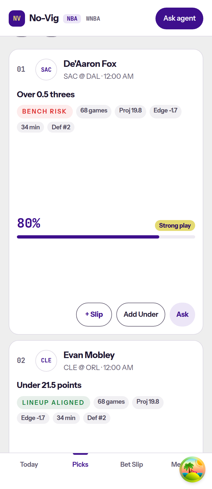
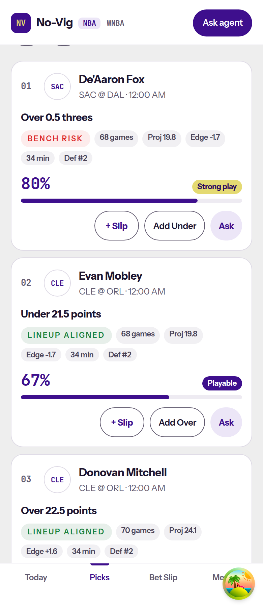
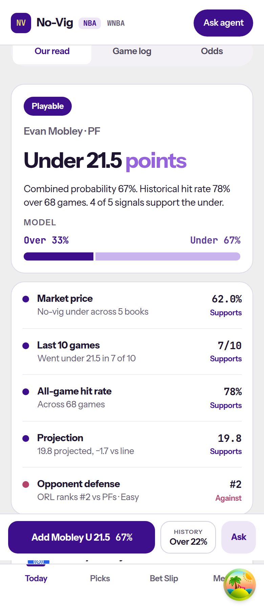
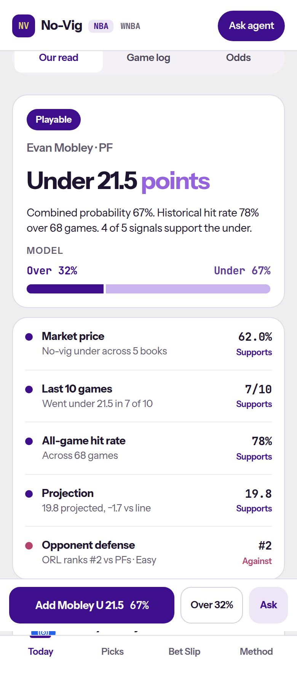
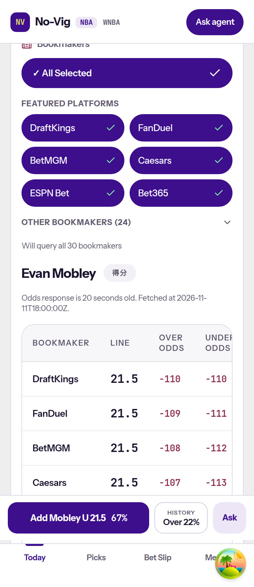
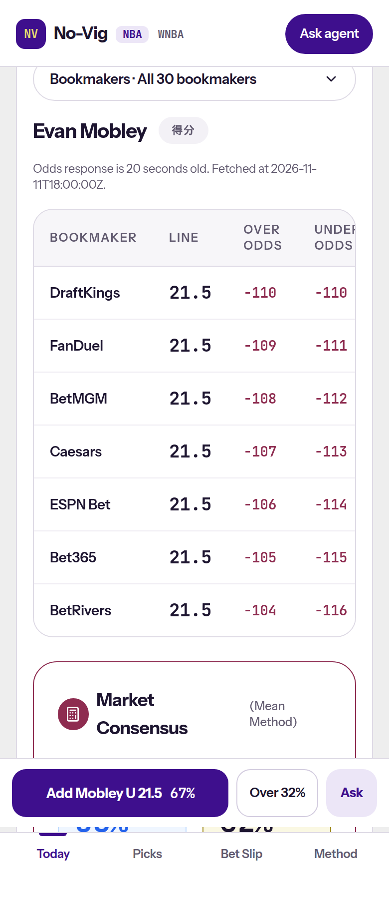
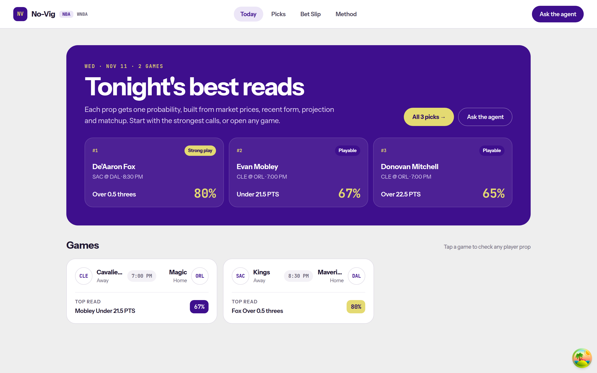
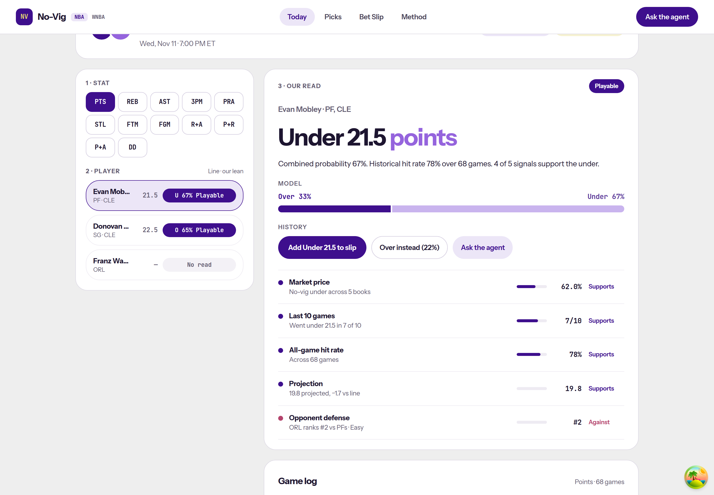
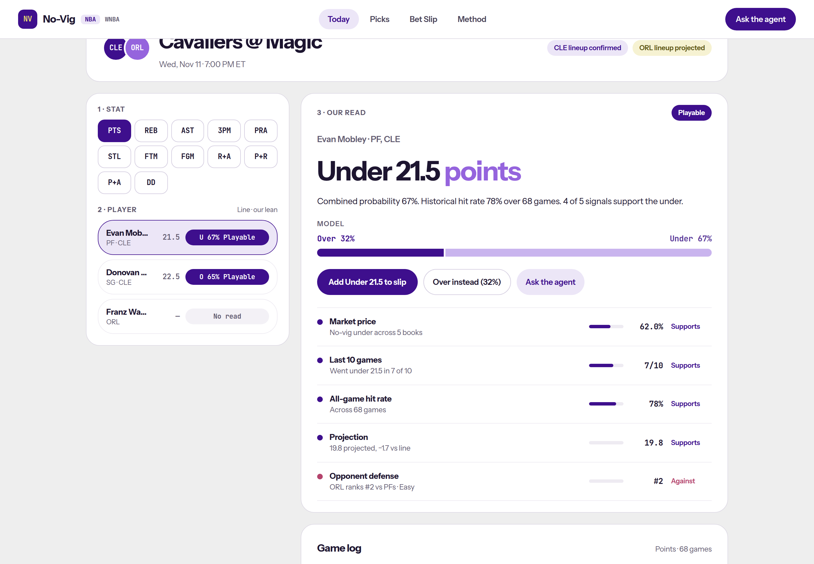

# SPO-120e — Design layout fixes

## Summary

Five design-vs-dev items on the NBA frontend. Mobile pick cards no longer stretch because a 220px flex basis was being used as height. NBA signal rows keep the value and verdict in a right-hand column below the `md` breakpoint. The odds table scrolls inside its own panel, and the bookmaker picker collapses to one line on mobile. The Today hero eyebrow is accent yellow (`#E4DA72`) on the brand purple hero. The opposite-side slip button, and the probability saved for that side, use `1 − combined_probability` when that blend is finite, matching the model bar. A missing blend still uses the historical opposite field, then the `/history` rate.

WNBA screens are unchanged. Shared components keep the previous WNBA classes and labels.

## Changes

| 檔案 | 變更 |
|---|---|
| `frontend/components/picks/DailyPicksBoard.tsx` | Player, prop, and rate columns apply `flex-1` / `basis` only from `md`, where the card is a row. |
| `frontend/components/picks/DailyPicksBoard.test.tsx` | Asserts `md:basis-[220px]` and that the mobile classes do not carry a bare `basis-[220px]` or `flex-1`. |
| `frontend/components/event/OurRead.tsx` | NBA signal rows (`showVerdict`) are `max-md:flex-nowrap`. The label is `min-w-0 flex-1` with `md:basis-60`. The value column is `shrink-0` and right-aligned. WNBA keeps `basis-60`. |
| `frontend/components/event/signal-row.test.tsx` | Class assertions for the NBA signal row, plus the rendered `62%` / `Supports` pair. |
| `frontend/components/ResultsTable.tsx` | Loaded table sits in `odds-table-scroll` with `overflow-x-auto` and `max-md:min-w-[760px]`. |
| `frontend/components/ResultsTable.test.tsx` | Asserts the scroll container and the Under Probability header. |
| `frontend/components/BookmakerSelect.tsx` | Mobile disclosure, closed by default. Desktop still renders the full picker. |
| `frontend/components/BookmakerSelect.test.tsx` | Toggle is `md:hidden` and closed. Opening it reveals the picker. Selecting DraftKings still calls `onChange`. |
| `frontend/components/EventDetail.tsx` | Page and odds panel are `min-w-0 max-w-full` so the table scroller, not the page, takes the overflow. |
| `frontend/components/TodayBoard.tsx` | Web hero eyebrow uses `text-accent` and the 12px / 1.2 / 0.12em metrics written out. |
| `frontend/components/TodayBoard.test.tsx` | Eyebrow has `text-accent` and does not use the `text-eyebrow` color class. |
| `frontend/lib/event-page.ts` | `nbaOtherSideProbability`. The other slip seed stores the complement on both `probability` and `combined_probability`. `tier` stays null. |
| `frontend/components/event/EventActionBar.tsx` | The History eyebrow is only for the historical fallback. A model complement prints `Over 33%` with no History label. |
| `frontend/lib/event-page.test.ts` | Other-side cases expect `1 − combined_probability`. |
| `frontend/lib/event-page-nba.qa.test.ts` | QA other-side cases rewritten to the complement, including the null-blend fallback. |
| `frontend/lib/event-page-nba.qa2.test.tsx` | Action bar expects `Under 33%` without a History label. |
| `frontend/components/event/tier-percent.test.tsx` | Web button `Under instead (33%)`, mobile `Under 33%`, bar still `Over 67%` / `Under 33%`. |
| `frontend/lib/other-side-probability.test.tsx` | Complement, clamp, null / NaN / Infinity fallback, half-away rounding, and the History label when the blend is null. |
| `docs/task-summaries/assets/SPO-120e/` | Before and after screenshots at 390px and 1440px. |

## Why

Item 73. The pick card is `flex-col` until `md`, then `md:flex-row`. `flex-1` is `flex: 1 1 0%`, and `basis-[220px]` sets the main size. In a column, that main size is height, so the prop column reserved about 220px of empty space between the tags and the percent. The card measured 526px. The basis now starts at `md:basis-[220px]` and `md:flex-1`, which is the same row layout the desktop card already used. The rate column's `flex-[0_1_150px]` is likewise `md:` only, so 150px is a width and not a height. After the change the same card measured 281px. The remaining height is the player row, the wrapping tags, the rate, and the action buttons. The shorter ~95px card in the design is the later picks redesign.

Item 67. `basis-60` is 15rem (240px). On a ~300px card that basis plus the value column wraps, and `62%` / `Supports` drops under the detail. NBA rows (`showVerdict`) now keep one line below `md` (`max-md:flex-nowrap`, gap 12px). The label column is `min-w-0 flex-1`, so it can shrink, and its 240px basis applies only at `md`. The mobile value column is `shrink-0 items-end text-right` and stays `md:hidden`. The desktop meter column is still `max-md:hidden`. WNBA does not pass `showVerdict`, so it keeps `basis-60` and `flex-wrap`. At 390px with this mock the value was already on the same row (content width 324px, value about 47px), so the before and after shots look alike. The class change is what stops the wrap when the row is tighter.

Item 71. The seven-column table is wider than a 375px page. `.table-container` already scrolled, and the page itself did not overflow (`scrollWidth === clientWidth`) at 374px and 390px. The table was still 821px inside a ~320px scroller, so Under Odds and Under Probability sat off-screen. The visible problem was the bookmaker picker, which stacked All Selected, the featured grid, and the other-books disclosure above the table. The table now has an explicit `overflow-x-auto` scroller and `max-md:min-w-[760px]`, so all seven columns are inside that scroller and reachable by sliding it. The page and the odds panel are `min-w-0 max-w-full`. On viewports below `md` the picker is closed behind `Bookmakers · All 30 bookmakers`. Desktop never sees that toggle (`md:hidden`), and the picker is hidden below `md` only while `mobileOpen` is false (`max-md:hidden`). The full table redesign stays on SPO-120c.

Item 56. `text-eyebrow` is both a color (`#7B4FC4`) and a font size (12px, line-height 1.2, tracking 0.12em). On the `#3E0F8D` hero the color utility won, so the date line computed to `rgb(123, 79, 196)`. `accent` is already `#E4DA72`, the same value as `yellow`. The hero eyebrow now uses `text-accent` and writes the 12px metrics out, so it does not pick up the purple color. Computed color after the change is `rgb(228, 218, 114)`. The mobile Today eyebrow stays `text-eyebrow` because that line sits on the light canvas.

Item 11. The opposite button was printing the historical `p_over` / `p_under` (`Over instead (22%)` next to a bar that says `Over 33%`). `nbaOtherSideProbability(combined, historical)` returns `{ probability: clamp01(1 − combined), source: "model" }` when `combined` is finite. The other `SlipSeed` copies the primary seed, sets `direction` to the opposite side, sets both `probability` and `combined_probability` to that complement, and sets `tier` to null. `webOtherCopy`, `mobileOtherCopy`, and both sides of `modelSplit` print that number with `formatTierPercent` (`Math.floor(p * 100 + 1e-9)`), the same floor `slipFace` uses on the slip card. `0.67` still shows `33%` on the bar, the web button (`Over instead (33%)`), the mobile bar (`Over 33%`), and the slip card. `0.675` complements to `0.325` and shows `32%` in all four places. `0.673` complements to `0.327` and shows `32%` in all four places. The two labels on the bar can add to 99 because each side floors on its own. The bar width is still the raw share.

When `combined_probability` is null, NaN, or not finite, the helper returns the historical opposite field (`p_under` or `p_over`), clamped, with `source: "history"`, and the seed leaves `combined_probability` null. If that field is also missing, `buildNbaRead` still uses the `/history` rate at the same line and side. The button then keeps the History label. The printed fallback percent also uses `formatTierPercent`. This path does not choose a tier. The primary seed still stores `pick.probability` and `pick.tier`.

The desktop Our read heading "History" is drawn only when `model.other.combined_probability` is not a finite number. A model complement has no History heading above the buttons. The mobile History eyebrow follows the same rule.

## Tests / Verification

- Frontend `npx vitest run`: 71 files, 549 tests, passed. That includes the 22 QA cases in `other-side-parity.qa.test.tsx` and `responsive-md-only.qa.test.tsx`.
- `npx tsc --noEmit`: passed.
- `npm run lint`: passed, no warnings or errors.
- `npm run build`: passed. Next.js 14.2.35 compiled and generated 10 static pages. `/wnba`, `/wnba/betslip`, `/wnba/event/[eventId]`, `/wnba/picks`, and `/wnba/player/[name]` are still in the route list.
- Integration test: SKIPPED. No new external client. Screenshots use a local mock of the existing events, picks, history, and no-vig routes.
- Fabrication scan: PASS. No client-built signals. A null blend does not invent a complement. It falls through to the historical field, then `/history`.

| Behavior | Test |
|---|---|
| `1 − combined` wins over `p_over` / `p_under` and over `/history` | `nbaOtherSideProbability` in `lib/other-side-probability.test.tsx`, `stores 1 - combined on the other side when the model disagrees with history` |
| Clamp outside `[0, 1]` | `clamps a complement outside [0, 1]` |
| Null, NaN, Infinity fall back to the historical field | `falls back to the historical field when combined is null or not finite` |
| Floored `32%` for a `0.675` or `0.673` complement on the button, the bar, and the slip card | `prints the complement with the same floor on the button, the bar, and the slip card` |
| Every `k/1000` complement matches `floor((1000 − k) / 10)` | `matches the exact-decimal floor for every combined value 0.000-1.000` |
| Desktop History heading is absent when the other side is the model complement | `the web buttons carry no History heading when the other side is 1 - combined` |
| Null blend keeps the History label and the history percent | `keeps the history rate and the History label when combined is null`, Bam fixture `Under instead (35%)` |
| `tier` on the other seed stays null | `lib/event-page-nba.qa.test.ts` |
| Mobile button drops History when the complement is stored | `lib/event-page-nba.qa2.test.tsx`, `tier-percent.test.tsx` |
| Pick prop basis is `md:` only | `stacks the card` in `DailyPicksBoard.test.tsx` |
| NBA signal value column is `shrink-0` and the label basis is `md:basis-60` | `signal-row.test.tsx` |
| Odds table scrolls inside `odds-table-scroll` | `ResultsTable.test.tsx` |
| Bookmaker picker is one line below `md` and open from `md` | `BookmakerSelect.test.tsx` |
| Hero eyebrow is `text-accent`, not `text-eyebrow` | `TodayBoard.test.tsx` |

The first screenshots were taken with system Chrome against `next dev` on port 3000 and a local mock on port 8000. Evan Mobley was under 21.5 points, `combined_probability` `0.67`, historical `p_over` `0.22`. The event after shots were retaken from `next start` so the dev indicator is absent. That retake uses `combined_probability` `0.675`, which floors to a 67 / 32 bar. Viewport 390×900 for the mobile shots and 1440×1000 for the event page.

Measured on that mock:

| Surface | Before | After |
|---|---|---|
| First pick card height at 390px | 526px | 281px |
| Hero eyebrow computed color | `rgb(123, 79, 196)` (`#7B4FC4`) | `rgb(228, 218, 114)` (`#E4DA72`) |
| Web other-side button | `Over instead (22%)` | `Over instead (32%)` |
| Mobile other-side button | `HISTORY Over 22%` | `Over 32%` |
| Model bar | `Over 33%` / `Under 67%` | `Over 32%` / `Under 67%` |
| Slip pill for the other side |  | `32%` |
| Odds page overflow at 390px | 0 | 0 |
| Odds table overflow inside its scroller | 499px | 499px |

The before column is `combined_probability` `0.67`. The retaken after column for the bar, the buttons, and the slip is `0.675`: the other side is `0.325`, and the bar, `Over instead (32%)`, `Over 32%`, and the slip pill all print `32%`. There is no History heading on that model complement. On the production server, `0.67` still prints `33%` on the bar, both buttons, and the slip pill.

### Screenshots

## Follow-ups

- [ ] SPO-120c: restyle the odds table. This slice only stops the page from growing and collapses the bookmaker picker on mobile. Under Probability is reached by scrolling the table.
- [ ] SPO-120d: the compact ~95px pick card. This slice removes the empty flex gap. The card is still taller than that design because of the tags, the rate, and the action row.
- [ ] A historical other-side leg stores `combined_probability: null` and `tier: null`. `slipFace` prints an em dash for that explicit missing blend, while the button prints the floored historical rate. That slip-face rule is unchanged.
- [ ] Other design-vs-dev items are out of this ticket.
