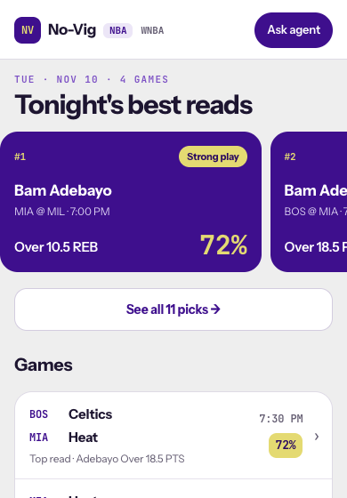
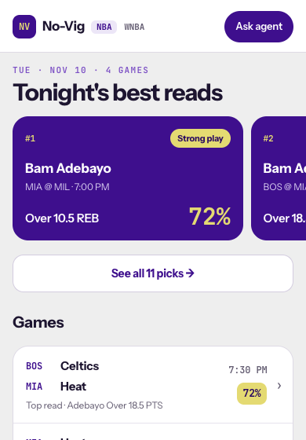
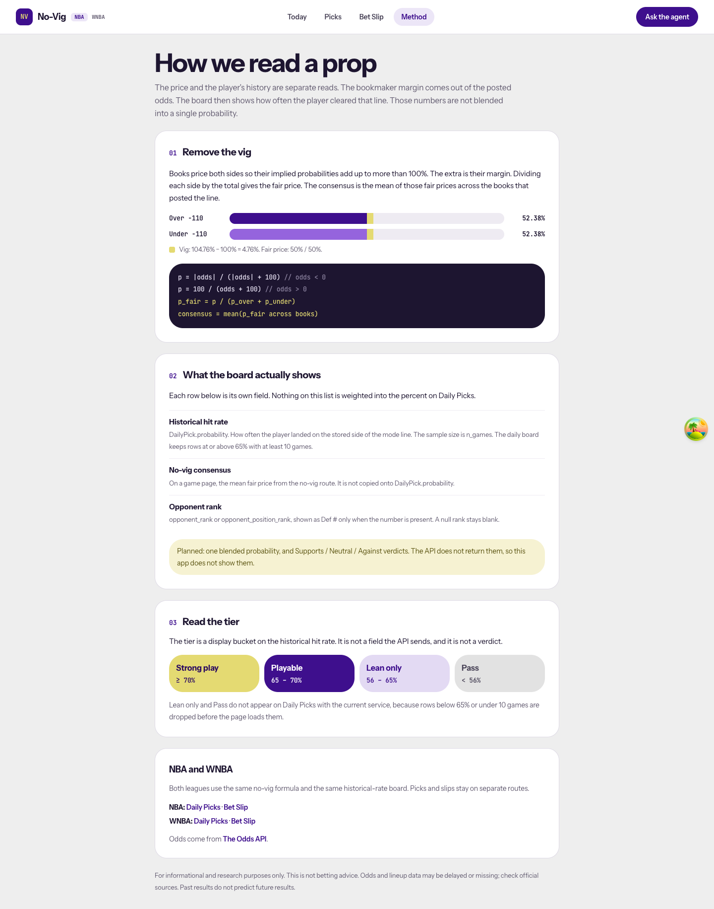
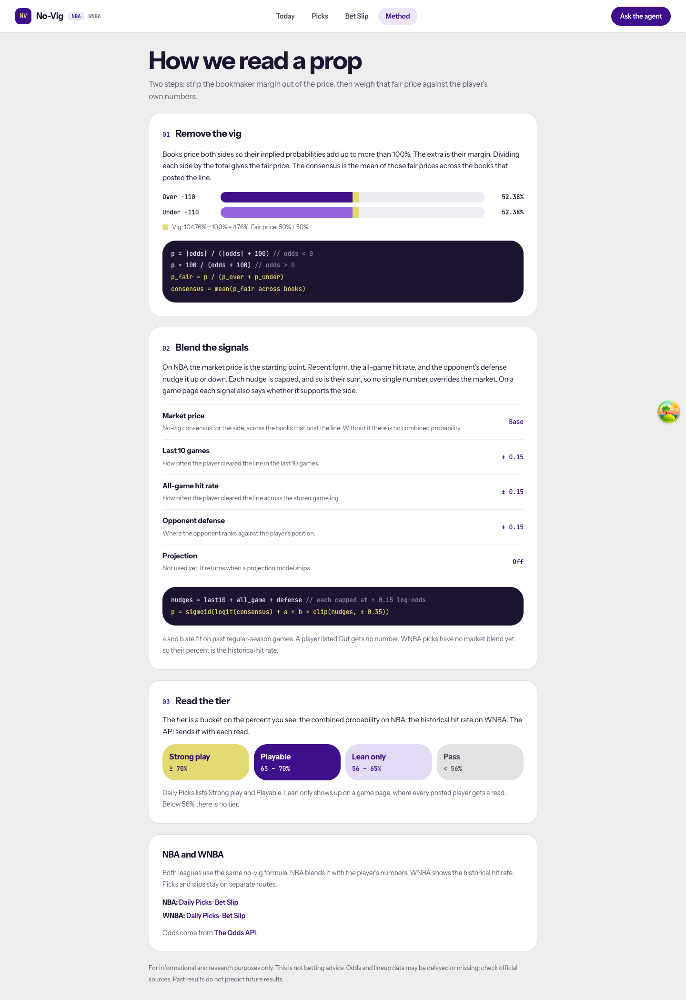

# SPO-120f — Today carousel gutter and Method copy

## Summary

Two design-vs-dev items from the November redesign audit. The first read card on the mobile Today carousel no longer sits flush against the screen edge. The Method page now describes the NBA blend the backend runs, and the tier source for each league. Before, it said the API returns no blended probability, and that the tier buckets the historical hit rate. Both statements stopped being true with SPO-112 and SPO-121b.

## Changes

| 檔案 | 變更 |
|---|---|
| `frontend/app/globals.css` | `.today-snap` reads its gutter from one custom property and adds `scroll-padding-inline` and `scrollbar-width: none`. |
| `frontend/app/about/page.tsx` | Section 02 "Blend the signals" lists the market base, three capped nudges, and the projection slot as off, with the blend formula. Section 03 names the tier source per league. The intro, the NBA and WNBA note, and the metadata description follow. |
| `frontend/app/about/page.test.tsx` | Asserts the five signal rows and their roles, the formula, the per-league tier sentence, and that no "planned" or "not blended" copy remains. |
| `docs/task-summaries/assets/SPO-120f/` | Before and after screenshots. |

## Why

`scroll-snap-type: x mandatory` aligns a snap point to the scroller's edge, not to its padding. The carousel uses negative margin plus padding to make a full-bleed strip with a 16px gutter. Without `scroll-padding`, the browser scrolled 16px to put the first card at x = 0. The prototype sets `scroll-padding: 0 16px` for this reason.

The Method copy follows `backend/app/services/pick_signals.py`. The combined probability is `sigmoid(logit(consensus) + a + b × clip(nudges, ±0.35))`. Each nudge (last 10, all-game rate, defense) is clipped to ±0.15 log-odds, and `a` and `b` are the Platt pair fit on walk-forward data. Projection adds nothing since SPO-135c. The prototype's "Blend five signals" with fixed weights of 25 / 25 / 25 / 15 / 10 is mock data. The backend has no such weights, so the page shows each signal's role and cap instead of weight bars.

## Tests / Verification

- Frontend `npx vitest run`: 80 files, 652 tests, passed. Run locally with `NODE_OPTIONS=--experimental-require-module`, because the local Node is 22.11 and jsdom's CSS dependency needs `require()` of ESM (default from Node 22.12).
- `npx tsc --noEmit`: passed.
- `npm run lint`: passed, no warnings or errors.
- `npm run build`: passed. All 11 routes are in the list.
- Integration test: SKIPPED. No new external client.
- Fabrication scan: PASS. No number on the Method page is invented. The caps and the formula come from `pick_signal_constants.py`.
- Browser, headless Chromium at 390×844 with the committed Today fixtures. Before, the first card was at `left: 0` while "See all" was at `left: 16`, and the scroller had `scrollLeft: 16`. After, both are at `left: 16`, `scrollLeft: 0`, `scroll-padding-left: 16px`.
- Browser, `/about` at 390px: `scrollWidth === clientWidth` (390). The formula block wraps inside its card.

| Behavior | Test |
|---|---|
| Five signal rows, market is Base, three nudges are ± 0.15, Projection is Off | `app/about/page.test.tsx` |
| Blend formula and the Out rule are printed | `app/about/page.test.tsx` |
| Tier sentence names combined probability for NBA and historical rate for WNBA | `app/about/page.test.tsx` |
| No "planned" or "not blended" copy | `app/about/page.test.tsx` |

### Screenshots

| Before | After |
|---|---|
|  |  |
|  |  |

## Follow-ups

- [ ] SPO-120c: game page odds table and game log layout.
- [ ] SPO-120d: compact pick card and the date row on Daily Picks.
- [ ] When the projection model ships, flip the Projection row and add its nudge to the formula.

## Progress notes (for the docs PR)

- SPO-120f: Today mobile carousel keeps the 16px gutter. Method describes the NBA blend and the per-league tier source.
