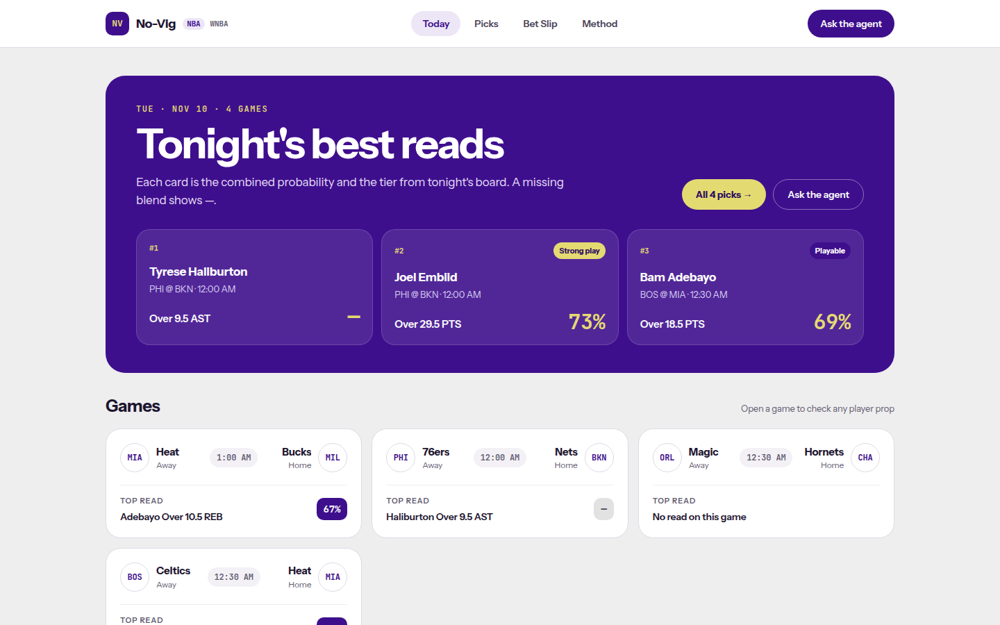
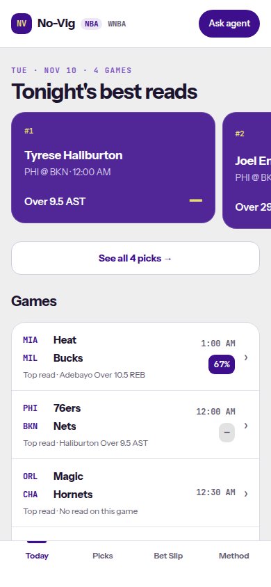
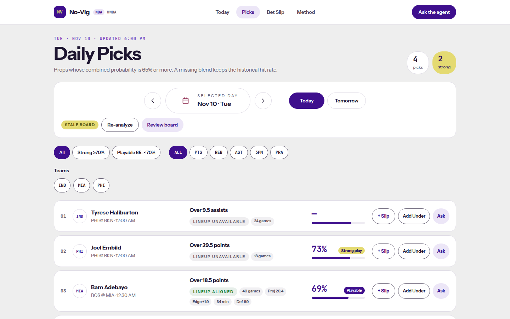
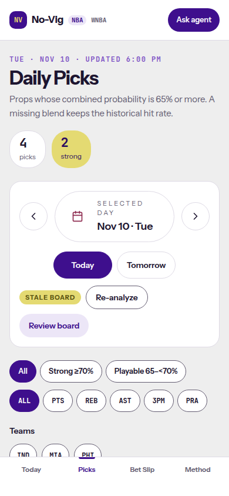
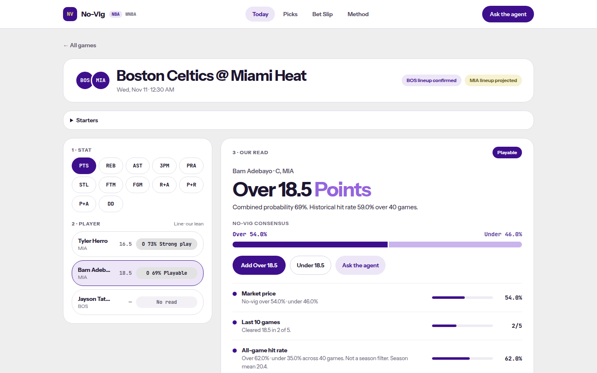
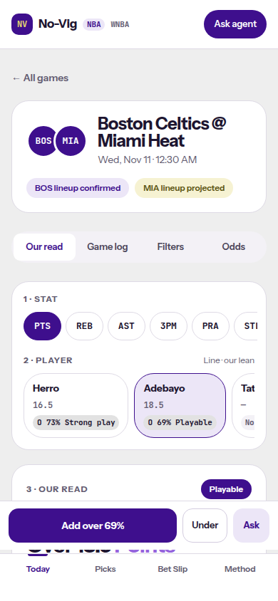

# SPO-121b — Frontend tier and 65% filter from combined_probability

- Ticket: SPO-121b
- Branch: `feature/SPO-121b-frontend-combined-tier` (from `origin/feature/SPO-121-bulk-reads`)
- Base: `dev`
- Merge right after #52. This PR is stacked on that branch.

## Summary

NBA cards stop computing a tier from a probability. The label is `DailyPick.tier`, `PropRead.tier`, or the same string copied onto a same-side bet-slip leg. The 65% filter and the Strong / Playable chips use `combined_probability` when that number is finite, and the historical `probability` when it is not. A percent printed beside a tier is `formatTierPercent(tierProbability(pick))`: the blend, or the historical rate only when the blend is null. WNBA still uses `readTier` and `formatPercent`.

## Changes

| Area | File | Change |
|---|---|---|
| Percent | `frontend/lib/player-dd.ts` | `formatTierPercent`. Floors. `formatPercent` is unchanged. |
| Face | `frontend/lib/nba-card.ts` | `tierFromBackend`, `tierProbability`, `boardRate`, `nbaTierFace`, `slipFace`. No cutoff math. |
| Schema | `frontend/lib/schemas.ts` | `tier`, `combined_probability`, `p_over`, `p_under`, `season_mean`, `position`, `signals` on `DailyPick`. `season_mean` on history. `PropRead`, event reads, and bulk props. Probability fields on the new payloads are `.min(0).max(1)`. |
| Client | `frontend/lib/api.ts` | `getEventReads`, `useEventReads`, `getEventBulkProps`, `useEventBulkProps`. |
| Today | `frontend/lib/today-board.ts`, `frontend/components/TodayBoard.tsx` | NBA percent and tier from the backend fields. WNBA still calls `readTier`. |
| Picks | `frontend/lib/picks-board.ts`, `frontend/components/picks/DailyPicksBoard.tsx` | Filter, sort, strong count, and the pill use the blend when it is finite. `pickTeamCode` is unchanged. |
| Game | `frontend/lib/event-page.ts`, `frontend/components/EventDetail.tsx`, `frontend/components/event/PlayerRail.tsx` | Reads joined on player name. Rail lean and the mobile action bar use `tierProbability`. Position and `team_code` fill the existing slots. `season_mean` is appended to the history signal when it is finite. |
| Slip | `frontend/lib/bet-slip-board.ts`, `frontend/components/betslip/BetSlipScreen.tsx`, `frontend/contexts/BetSlipContext.tsx`, `frontend/app/picks/page.tsx` | Same-side legs copy `tier` and `combined_probability`. The percent beside the tier uses `tierProbability`. A reverse leg copies neither. |
| Tests | `frontend/lib/combined-tier.test.ts`, `frontend/components/combined-tier-agreement.test.tsx`, `frontend/test/fixtures/spo-121b/combined-tier.json` | Alexander-Walker, Thybulle, null blend, floor cutoffs, no derived tier, Picks and Bet Slip both print `69% Playable` for `0.697`, and `0.59` / `0.66` / Playable prints `66% Playable`. |
| Docs | this file and `docs/task-summaries/assets/SPO-121b/` | Summary and screenshots. `docs/progress.md` is not touched. |

## Rules

1. NBA does not derive a tier. Backend strings are `Strong play`, `Playable`, `Lean`, or null. Those map to the existing `strong` / `playable` / `lean` names for CSS. There is no NBA "Lean only" or "Pass". WNBA `readTier` labels stay.
2. The 65% filter and the Strong (`>= 0.7`) and Playable (`>= 0.65` and `< 0.7`) chips use `combined_probability` when it is finite, otherwise `probability`. All does not add a new floor. A null blend does not invent a tier from the historical rate.
3. The main NBA number is the blend. A null blend with no tier prints `—` in that slot. The historical caption, the bar fallback, the prop, and the matchup stay.
4. `GET /api/nba/events/{event_id}/reads` fills a posted player who is not on the daily board. The join key is the trimmed, lowercased player name for the selected market. `position` and `team_code` come from bulk props when the daily pick does not already have them. `season_mean` is mentioned in the existing history signal only when it is finite.
5. `tierProbability(pick)` is `combined_probability` for NBA, and `probability` when the blend is null. Every percent beside a tier — Today, Picks, the Bet Slip, the game-page rail, and the mobile action bar — is `formatTierPercent` of that value. `0.59` historical with blend `0.66` and tier Playable prints `66% Playable`, not `59% Playable`. A probability with no tier stays on `formatPercent`. Vig, EV, market delta, and edge stay signed one-decimal.
6. WNBA is unchanged. Shared code is gated with `league === "nba"`.

`top_read` on the events payload still has no `tier` and no `combined_probability`. Today joins `DailyPick` by `event_id` instead.

## Why

The backend already chose the tier from the blend. Re-bucketing on the historical rate put Alexander-Walker at `59% Lean` while the API said Playable at `0.673`, and it dropped Thybulle when the blend was `0.73` and the stored rate was `0.40`. The percent beside that label has to be the number the label describes, floored, so `0.697` is `69%` on Picks and on the Bet Slip.

A missing blend stays a dash when there is no tier. Falling back for the filter keeps Pascal Siakam at `0.649` inside All. Falling back for the percent happens only when a tier is already present and the blend is null, so the pill is not paired with a blank.

## Tests

- Frontend `npm test` (`TZ=America/Chicago vitest run`): 48 files, 296 tests, passed.
- `npx tsc --noEmit`: passed.
- `npm run lint`: passed, 0 warnings.
- `npm run build`: passed.
- Backend pytest for #52: not run in this environment (no project virtualenv on the path).
- Integration test: SKIPPED. No new external client.
- Fabrication scan: PASS. A null blend prints `—` and does not invent a tier. Screenshots use a local fixture server that is not committed.

## Screenshots

Today, Picks, and the game page at 390×844 and 1440×900. The blend is the number on the pill. Haliburton has no blend, so the slot is `—` and no tier is derived from his historical rate.

## Follow-ups

- [ ] The about page still says the blend is planned. Its test locks that sentence.
- [ ] `top_read` has no tier and no blend. Today uses the daily-picks row.
- [ ] `pickTeamCode` still falls back to `home_team`. #53 owns that line.
- [ ] EV and market delta stay signed one-decimal until that format is decided.
