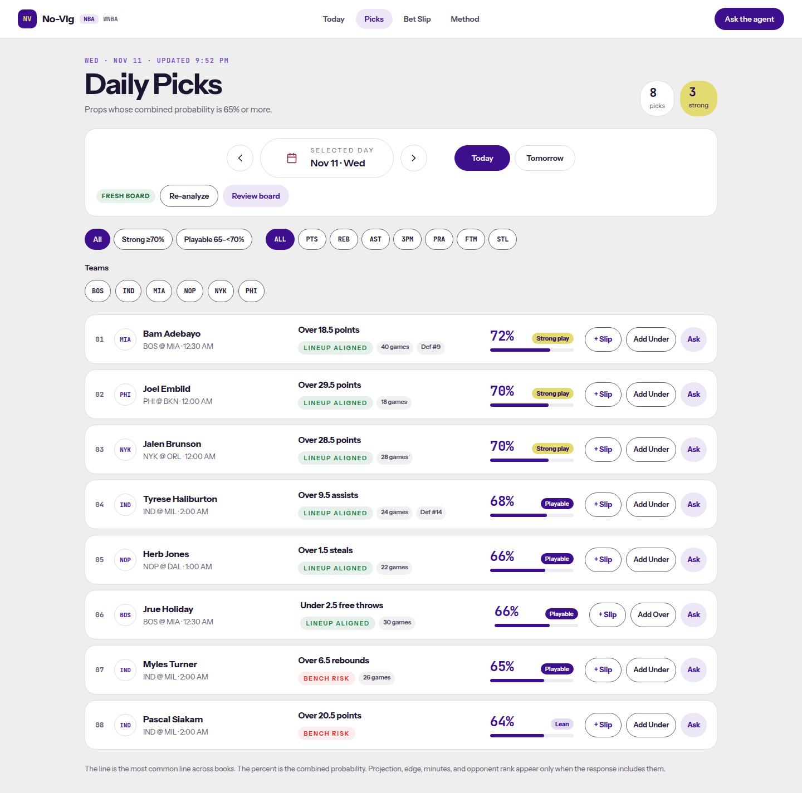
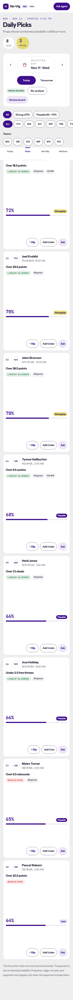
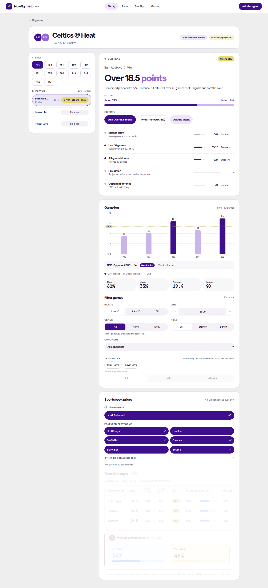
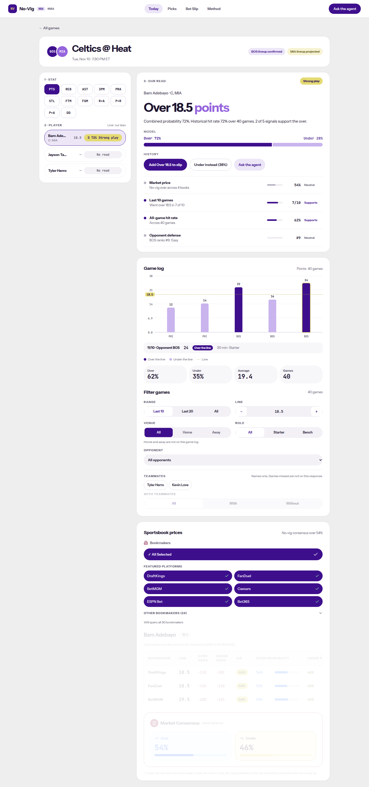
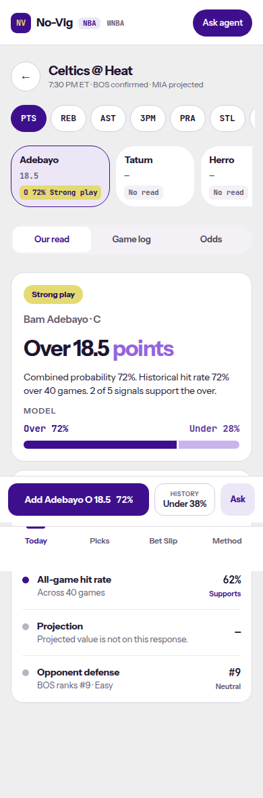
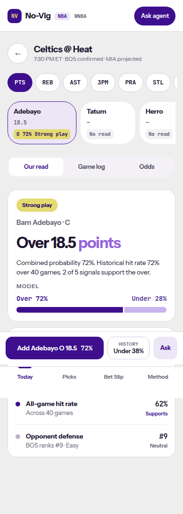

# SPO-135b — Remove SportsDataIO projections from the frontend

- Ticket: SPO-135b
- Branch: `feature/SPO-135b-remove-projections-frontend`
- Base: `dev`
- Paired with backend PR #69 (SPO-135). Frontend only. WNBA routes are unchanged.

## Summary

The NBA client no longer calls `GET /api/nba/projections`, `GET /api/nba/projections/{player}`, or `POST /api/nba/projections/refresh`. `supportsProjection` is gone from the event-page config, and selecting a player does not start a projection query. `PlayerProjectionPanel` and the history-chart projection overlay are deleted. DailyPick `projected_value`, `edge`, and `projected_minutes` stay on the schema and stay off the screen when they are null. A null NBA Projection signal row is hidden. The caption still counts that slot ("2 of 5 signals").

## Changes

| Area | File | Change |
|---|---|---|
| Client | `frontend/lib/api.ts` | Deleted `getProjections`, `getPlayerProjection`, `refreshProjections`. |
| Schema | `frontend/lib/schemas.ts` | Deleted `playerProjectionSchema`, `projectionsResponseSchema`, `projectionRefreshResponseSchema`. DailyPick projection, injury, and lineup fields stay nullable. |
| Event page | `frontend/lib/event-page.ts`, `frontend/components/EventDetail.tsx` | Removed `supportsProjection`, the projection `useQuery`, and the NBA projection panel. WNBA still shows the existing "not available" panel, gated on `league === "wnba"`. |
| Read | `frontend/components/event/OurRead.tsx` | NBA hides a projection signal whose value is blank. Other null signals still print `—`. WNBA still shows "Projection is not available for WNBA." |
| History | `frontend/components/PlayerHistoryStats.tsx` | Removed the projected stat card, reference line, and legend. The chart stays for WNBA. |
| Board | `frontend/lib/picks-board.ts` | Null projection, edge, and minutes stay omitted. A non-blank `injury_status` is a tag. `lineup_confirmed` true/false is "Lineup confirmed" / "Lineup unconfirmed". Null and blank are omitted. |
| About | `frontend/app/about/page.tsx` | Projection copy no longer says the route returns a value. |
| Tests | `frontend/components/EventDetail.no-projection-request.test.tsx`, picks and OurRead tests | Selecting a player records no `/api/nba/projections` request. Null DailyPick fields render no projection, edge, minutes, injury, or lineup chip. Non-null injury and lineup still render. |
| Deleted | `PlayerProjectionPanel.tsx`, its test, `EventDetail.projection.test.tsx`, `projection-metric.ts`, its test, `nba-projection-bam.json`, `nba-projection-nulls.json`, `opponent-defense-rank.json` | |

`frontend/lib/team-logos.ts` still mentions SportsDataIO in comments. That map is the allowed remaining reference.

## Why

PR #69 returns 404 for the projection routes and null for `projected_value`, `edge`, `projected_minutes`, `injury_status`, and `lineup_confirmed`. Leaving the query in place asked for a 404 on every player click. Leaving a dash in the Projection row looked like a missing value instead of a removed feed.

## Tests

- `npx vitest run` from `frontend/`: 64 files, 505 tests, passed.
- `npx tsc --noEmit`: passed.
- `npm run lint`: passed, 0 warnings.
- `npm run build`: passed. `/wnba`, `/wnba/event/[eventId]`, `/wnba/picks`, `/wnba/betslip`, and `/wnba/player/[name]` are in the route table.
- League switch: from `/picks`, the WNBA link lands on `/wnba/picks`.
- Screenshots use a local fixture server that returns the #69 shape. It is not committed. `docs/progress.md` is not touched.

## Screenshots

Picks and the NBA event page at 390×844 and 1440×900, before and after. The before event page shows `Projection / Projected value is not on this response. / —`. The after page does not. The caption stays `2 of 5 signals support the over.` Defense `#9` stays. The picks board already omitted Proj, Edge, and minutes under the null payload, so those two shots match. Lineup aligned badges come from the lineups route, not `DailyPick.lineup_confirmed`. No request to `/api/nba/projections` was recorded while the after shots loaded.

## Follow-ups

- The NBA Projection row is hidden when its value is blank. Other missing signals still show `—`, which is the SPO-112 rule. WNBA keeps the explanatory projection row.
- `injury_status` and `lineup_confirmed` had no renderer. They are tags on the picks board only when non-null. `LineupStatusBadge` is still the lineups-route badge and was left alone.
- The WNBA unavailable-panel copy is unchanged.
- The hidden projection signal still counts in "N of 5 signals".
