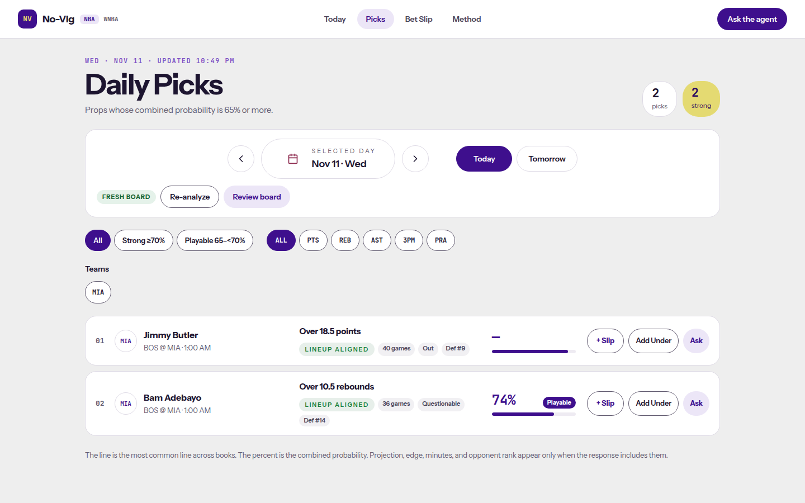
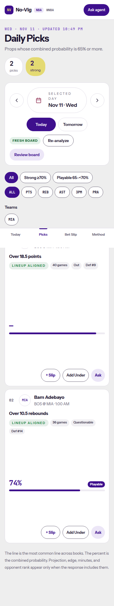
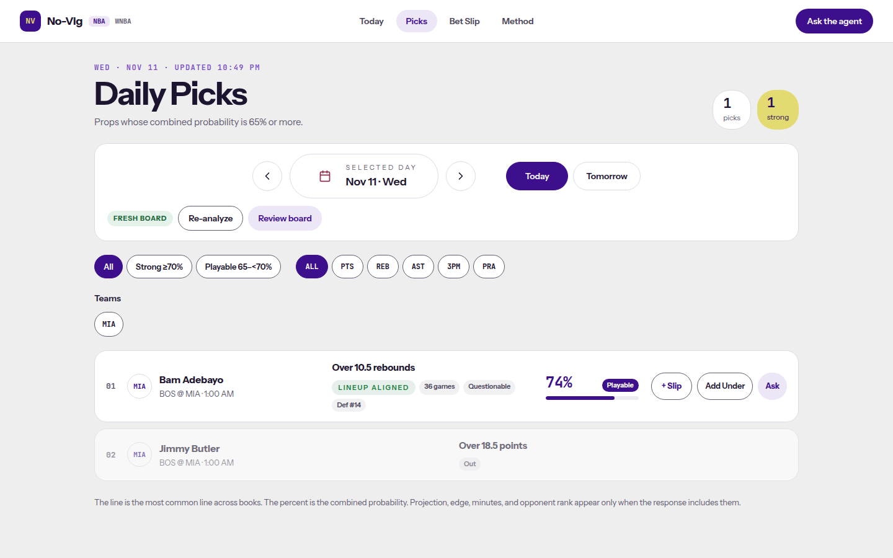
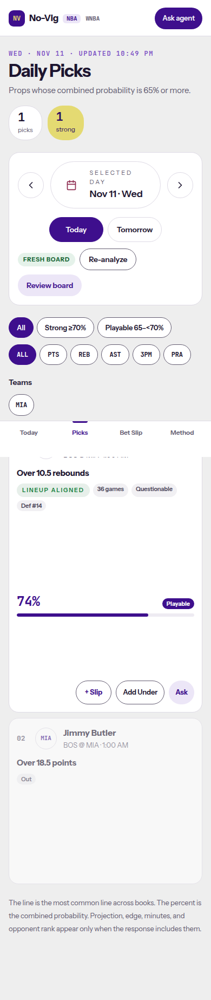

# SPO-135d — Injury tag allow-list and projection cleanup

- Ticket: SPO-135d
- Branch: `feature/SPO-135d-frontend-followups`
- Stacked on #71. This PR's base is `feature/SPO-135b-remove-projections-frontend` @ `038f859`. #71 targets `dev`.
- Frontend only. WNBA routes are unchanged.

## Summary

The picks board shows an injury tag only for `Out` and `Questionable`. A literal `Doubtful` is shown as `Questionable`. `Probable`, `Day-To-Day`, `Active`, null, and any other value show no injury tag. The `Lineup confirmed` tag is gone. `LineupStatusBadge` still covers the lineups route. Today board and agent copy no longer say the probability is built from a projection.

An Out pick is not a model read. `isOutPick` is the one check: `injury_status`, trimmed and lowercased, is `out`. Doubtful is not Out. On the picks board the card stays, dimmed, and sorts last, with only the Out tag. It has no percent, no bar, no tier, and no slip, reverse, or ask action. The name still opens the event page. The event read does not offer an add button. Out is left out of the picks count, the strong count, the Today count, tonight's top read, the player-rail lean, and the review-board suggestion list. If the top read is Out, the next eligible pick is used, or the existing empty state. A null blend that is not Out still falls back to the historical rate. Questionable is tag-only and otherwise unchanged.

Hiding the card would drop a player someone is looking for. Keeping it dimmed at the end tells the bettor the player is out, without a percent that looks like a recommendation.

## Changes

| Area | File | Change |
|---|---|---|
| Tags | `frontend/lib/picks-board.ts` | Injury tag allow-list. Removed the `Lineup confirmed` tag. `Lineup unconfirmed` stays. `isOutPick` is the shared Out check. |
| Out | `frontend/lib/picks-board.ts`, `frontend/components/picks/DailyPicksBoard.tsx`, `frontend/app/picks/page.tsx` | Out sorts last, is dimmed, and is not counted, barred, or addable. |
| Today | `frontend/lib/today-board.ts`, `frontend/components/TodayBoard.tsx` | Out is skipped for tonight's reads, the game top read, and the picks count. |
| Event | `frontend/lib/event-page.ts` | An Out player is not a rail lean and has no slip seed. |
| Copy | `frontend/components/TodayBoard.tsx`, `frontend/components/AgentWidget.tsx`, `frontend/components/agent-widget/AgentWidgetTranscript.tsx` | Today board names market prices, recent form, all-game history, and matchup. The agent header and transcript keep rest. |
| Comments | `frontend/lib/api.ts` | Dropped `projections` from the two WNBA-vs-NBA comments. |
| Indent | `frontend/components/EventDetail.tsx` | Indented the WNBA unavailable panel. Copy is unchanged. |
| Tests | `frontend/lib/picks-board.test.ts`, `frontend/components/picks/DailyPicksBoard.test.tsx`, `frontend/lib/today-board.test.ts`, `frontend/components/TodayBoard.test.tsx`, `frontend/lib/event-page.test.ts`, `frontend/lib/out-pick-render.test.tsx` | Allow-list, and Out excluded from strong, the bar, the top read, and slip suggestions. Questionable stays. |
| QA | `frontend/components/picks/spo135-contract.qa.test.tsx`, `frontend/test/fixtures/picks/nba-daily-picks-spo135.json` | #71 QA patch, kept as its own commit. |

## Why

PR #72 stores NBA `injury_status` as `Out`, `Questionable`, `Probable`, or `Day-To-Day`. Doubtful is stored as `Questionable`. Anything else is null. `lineup_confirmed` stays null. An Out pick stays on the board with `combined_probability` null. Showing every non-empty status, or a `Lineup confirmed` tag, would disagree with that. The projection sentence was left over from before #69 removed that feed.

## Copy

Today board, before: `Each prop gets one probability, built from market prices, recent form, projection and matchup. Start with the strongest calls, or open any game.`

Today board, after: `Each prop gets one probability, built from market prices, recent form, all-game history, and matchup. Start with the strongest calls, or open any game.`

Agent header, before: `Checks market, form, projection and matchup`

Agent header, after: `Checks market, form, matchup and defense rank, and rest`

Agent empty transcript, before: `I check any prop against market price, recent form, projection and matchup. What do you want to look at?`

Agent empty transcript, after: `I check any prop against market price, recent form, matchup and defense rank, and rest. What do you want to look at?`

## Tests

- `npx vitest run` from `frontend/`: 66 files, 524 tests, passed. The QA file is 12 of those.
- `npx tsc --noEmit`: passed.
- `npm run lint`: passed, 0 warnings.
- `npm run build`: passed. `/wnba`, `/wnba/event/[eventId]`, `/wnba/picks`, `/wnba/betslip`, and `/wnba/player/[name]` are in the route table.

## Screenshots

`next start` against a local mock. Jimmy Butler is Out, blend null, historical rate 0.91. Bam Adebayo is Questionable, blend 0.74. No dev overlay.

Before, the Out card is first because the bar falls back to that 0.91 rate. It shows `—`, a filled bar, `Out`, `Def #9`, and the slip actions. The header counts both cards, including Out as strong.

After, Bam is first at `74%` with the Questionable tag. Jimmy is last, dimmed, with only the Out tag. No bar, no percent, no slip. The header counts 1 pick and 1 strong.

## Follow-ups

- `Lineup unconfirmed` still appears when `lineup_confirmed` is false. The badge from the lineups route was left alone.
- A null blend that is not Out still prints `—` and can still fill the bar from the historical rate.
- The picks-board footer still says projection, edge, and minutes appear only when the response includes them. That sentence is still true.
- WNBA copy, including the unavailable projection panel, is unchanged.
