# SPO-135f — Out follow-ups

- Ticket: SPO-135f
- Branch: `feature/SPO-135f-out-followups`
- Stacked on #75. This PR's base is `feature/SPO-135d-frontend-followups` @ `c3f5af4`.
- Frontend only. WNBA screens and WNBA tests are unchanged. `/wnba` routes still build.

## Summary

An Out player is a fact about that player in that game, not about one prop. `isOutPick` still decides a single row (trim, ignore case, match only `out`). `isPlayerOutInGame` is the wider check. It is true when any loaded row for that player and event is Out. Doubtful stays Questionable and is not Out.

Today drops that player from the hero and from the game top read, on every line and market. The event page says `Listed Out. No model read.` and hides Ask for that player. A slip leg that is Out shows Out, keeps a remove control, and stays out of the average and the all-hit product. The picks board shows Remove on an Out card that is already in the slip.

## Changes

| Area | File | Change |
|---|---|---|
| Player in a game | `frontend/lib/picks-board.ts` | `isPlayerOutInGame` matches event id and player name, then `isOutPick`. |
| Today | `frontend/lib/today-board.ts`, `frontend/components/TodayBoard.tsx` | NBA hero and game top read skip a player who is Out on any row in that game. WNBA still matches the exact prop. |
| Event | `frontend/lib/event-page.ts`, `frontend/components/EventDetail.tsx`, `frontend/components/event/OurRead.tsx`, `frontend/components/event/EventActionBar.tsx` | Caption is `Listed Out. No model read.` The player Ask control is hidden. The rail lean says Out. |
| Slip | `frontend/lib/bet-slip-board.ts`, `frontend/components/betslip/BetSlipScreen.tsx` | Render-time lookup. Out legs are labelled Out and left out of the average and all-hit. The saved count stays. |
| Board | `frontend/components/picks/DailyPicksBoard.tsx`, `frontend/app/picks/page.tsx` | An Out card already in the slip shows Remove. Add, reverse, and Ask stay off. The dimmed card no longer reserves a 220px column on a narrow screen. |
| Copy | `frontend/components/AgentWidget.tsx`, `frontend/components/agent-widget/AgentWidgetTranscript.tsx` | Header and empty light transcript list defense rank in the same series as the other checks. |
| Fixture | `frontend/test/fixtures/lineups/empty.json`, `frontend/lib/out-pick-render.test.tsx` | The inline empty lineups mock lives in the fixture. |
| Tests | `frontend/lib/out-followups.test.tsx` | Top read, fallback, event caption, slip average, and board remove. |
| QA | `frontend/lib/out-exclusion.qa.test.tsx` | Applied unchanged, then one assertion updated in a later commit. |

## Why

`combined_probability` is null on an Out row, but a sibling line can still carry a blend. Featuring that blend, or averaging a slip leg the board already calls Out, reads as a recommendation for a player who is not playing. The caption `Combined probability —.` looked like a missing number. `Listed Out. No model read.` says there is no read.

## Today fallback

`todayGames` takes an optional injury list. It defaults to the picks used for ranking. Today passes the last picks body even when the picks request is not a success, and passes an empty ranking list unless that request succeeded.

- The player is Out on any loaded row for that game. The API `top_read` for that player is dropped, and so is every ranked pick for that player. The next eligible player is the read. If nobody is left, the card says `No read on this game`.
- The picks request failed, and the query still holds a previous body. Those rows are injury evidence only. They are not ranked into the hero. An Out player's `top_read` becomes `Top read unavailable`.
- The picks request failed or came back empty, and there is no picks body. Events and lineups do not carry a per-player injury status, so there is nothing to block on. The events `top_read` stays. A healthy player with no injury row is unchanged.

## Slip lookup

Nothing new is stored on `BetSlipPick` or in `betslip_picks`. `BetSlipScreen` loads `["daily-picks", date]` for each slip date, the same key the board uses. `isPlayerOutInGame` against those rows marks the leg. If that request fails or returns no rows, the leg stays a normal leg, because there is no injury status to apply. The share card prints Out for the same legs. The summary count is still the number of saved cards. The average and all-hit use only the legs that are not Out. If every leg is Out, both figures are `—`.

## Copy

Agent header, before: `Checks market, form, matchup and defense rank, and rest`

Agent header, after: `Checks market, form, matchup, defense rank, and rest`

Empty light transcript, before: `I check any prop against market price, recent form, matchup and defense rank, and rest. What do you want to look at?`

Empty light transcript, after: `I check any prop against market price, recent form, matchup, defense rank, and rest. What do you want to look at?`

## Tests

- `npx vitest run` from `frontend/`: 68 files, 564 tests, passed. The QA file is 27 of those.
- `npx tsc --noEmit`: passed.
- `npm run lint`: passed, 0 warnings.
- `npm run build`: passed. `/wnba`, `/wnba/event/[eventId]`, `/wnba/picks`, `/wnba/betslip`, and `/wnba/player/[name]` are in the route table.

The QA patch applied clean with `git am`. One assertion no longer held. It expected no button on an Out card that is already in the slip. This ticket adds Remove on that card, and still has no reverse and no Ask. That assertion was updated in its own commit.

## Screenshots

`next start` against a local mock. Jimmy Butler is Out on rebounds. His points `top_read` is 88%. Bam Adebayo is Questionable at 66%. The slip was seeded with both points legs. No dev overlay.

Before, Today leads with Butler at 88%, the event caption is `Combined probability —.` with Ask, and the slip averages 77%.

After, Today leads with Adebayo at 66%. The event caption is `Listed Out. No model read.` and the player Ask control is gone. The slip shows Butler as Out with Remove, and the average is 66%.

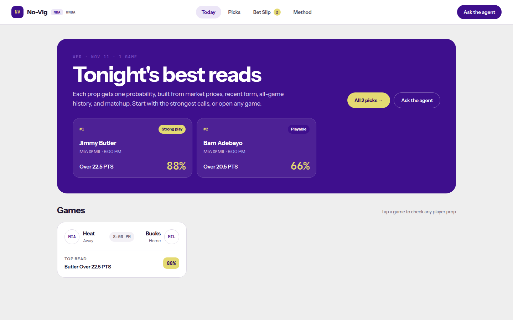

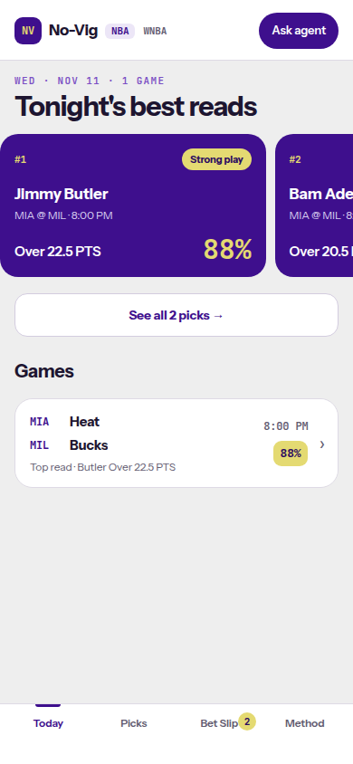

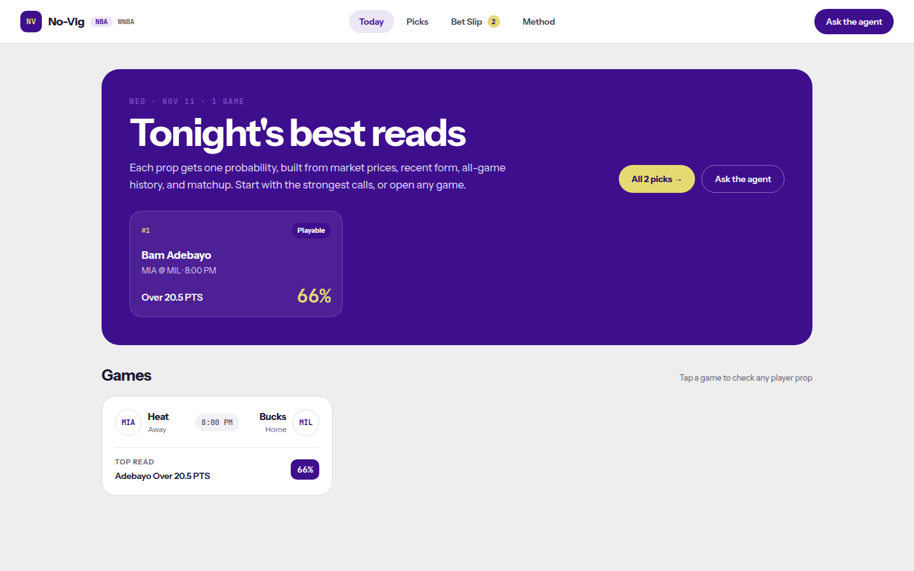

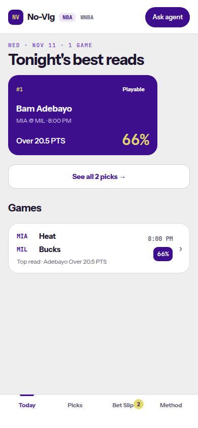

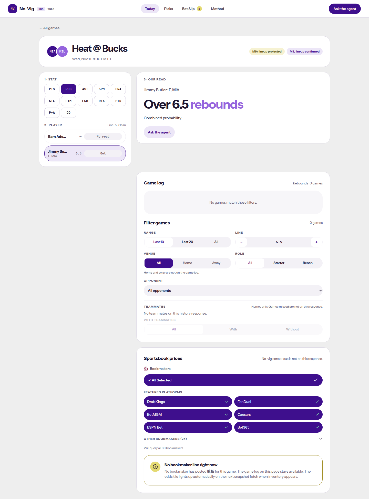

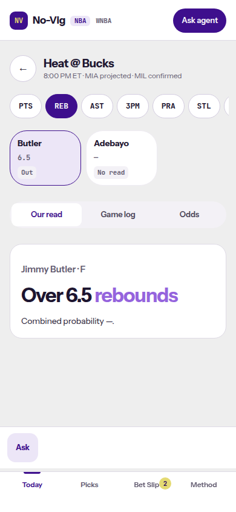

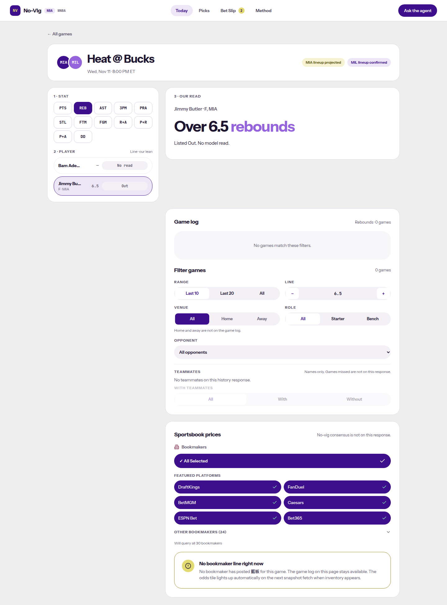

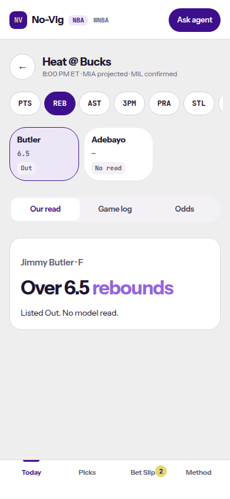

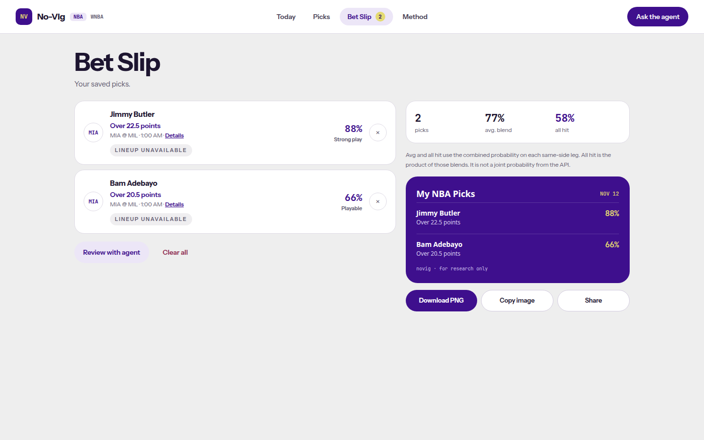

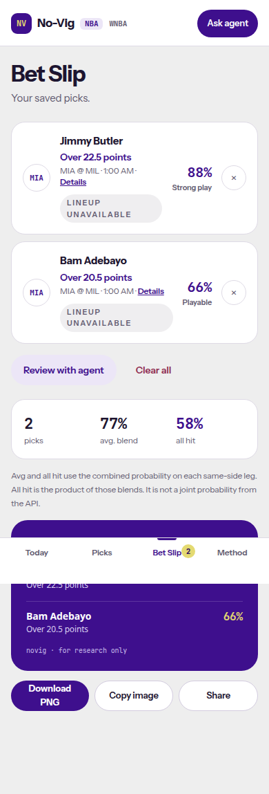

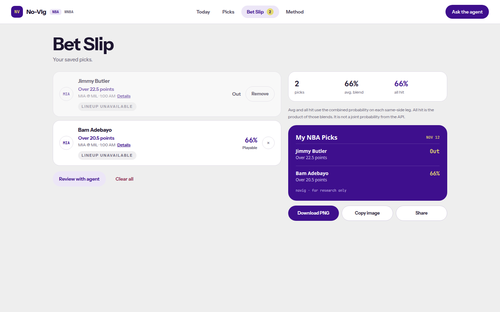

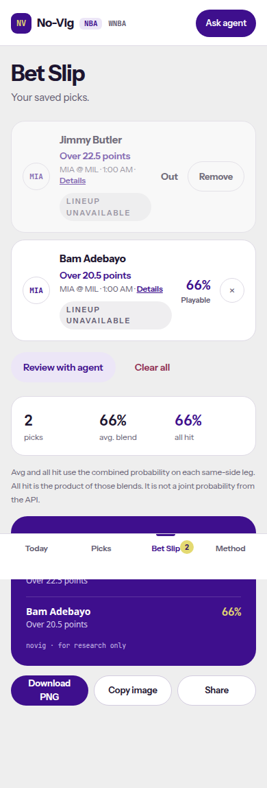

## Follow-ups

- A picks row whose own status is not Out stays addable, even when another line for that player is Out. Today, the event page, and the slip treat the player as Out.
- A failed or empty picks response with no stored body cannot hide an events `top_read`.
- A slip leg stays a normal leg when the daily picks request for its date fails or is empty.
- Doubtful is still shown as Questionable.
- WNBA still blocks only the exact prop.
