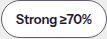
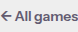
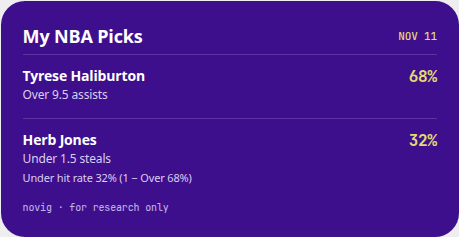
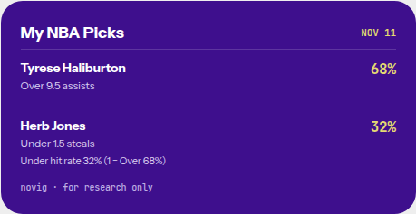
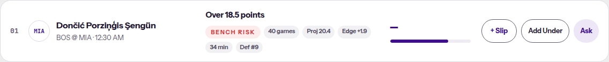

# SPO-136b. Subset the self-hosted fonts

- Ticket: SPO-136b
- Branch: `feature/SPO-136b-font-subset`
- Base: `dev`

## Summary

The two self-hosted webfonts are Latin subsets, including Latin Extended-A and combining marks, so names such as Dončić, Porziņģis, and Şengün stay in these faces. Instrument Sans is pinned to width 100 and keeps the weight axis. The share card uses `var(--font-sans)` and `var(--font-mono)`. The frontend workflow builds with `fonts.googleapis.com` and `fonts.gstatic.com` pointed at loopback, after deleting `.next`, so a build that asks Google Fonts for a file fails. `unshare -rn` is not allowed on the GitHub runner.

## Sizes

| File | Before | After |
|---|---:|---:|
| Instrument Sans | 88,784 bytes `InstrumentSans[wdth,wght].woff2` | 45,440 bytes `InstrumentSans[wght].woff2` |
| JetBrains Mono | 71,660 bytes | 48,616 bytes |
| Total | 160,444 bytes | 94,056 bytes |

94,056 bytes is 91.9 KB. The first subset on this branch was 78,800 bytes (37,584 + 41,216). Latin Extended-A (U+0100 through U+017F) and combining diacritical marks (U+0300 through U+036F) add 15,256 bytes. Each size is one `stat` of the woff2 on disk after fontTools 4.68 wrote it.

The same subsetter, asked for only one of those blocks, measured 88,520 bytes with Latin Extended-A (9,720 more than 78,800) and 84,488 bytes with the combining marks (5,688 more). Together the files are 94,056 bytes. The separate deltas add to 15,408, so 152 bytes of table overhead is shared.

An earlier run that kept Latin-1, Latin Extended-A, and Latin Extended-B, and did not keep the combining marks, was 89,392 bytes. That is the 10.6 KB figure. This change keeps Latin Extended-A and the combining marks. It does not add Latin Extended-B.

The total is not about 40 KB because both files still carry a weight axis. Instrument Sans keeps `wght` 400 to 700. JetBrains Mono keeps `wght` 100 to 800. `layout.tsx` registers weights 400, 500, 600, and 700 for Instrument Sans and 500, 600, and 700 for JetBrains Mono. A single-weight instance would drop those faces.

## What changed

| File | Change |
|---|---|
| `frontend/app/fonts/InstrumentSans[wght].woff2` | Instrument Sans with `wdth` instanced at 100. The `wght` axis remains. Replaces `InstrumentSans[wdth,wght].woff2`. |
| `frontend/app/fonts/JetBrainsMono[wght].woff2` | Same file name. Latin subset. The `wght` axis remains. |
| `frontend/app/fonts/*-OFL.txt` | Unchanged. |
| `frontend/app/layout.tsx` | The four Instrument Sans `src` paths use the new file name. Weights, `display: "swap"`, `adjustFontFallback: "Arial"`, and `font-stretch: 100%` stay. |
| `frontend/components/betslip/BetSlipScreen.tsx` | `ShareCard` sets the face with Tailwind `[font-family:var(--font-sans)]` and `[font-family:var(--font-mono)]`. |
| `.github/workflows/ci.yml` | `frontend-lint` blocks `fonts.googleapis.com` and `fonts.gstatic.com` in `/etc/hosts`, deletes `.next`, then runs `npm run build`. |
| `docs/task-summaries/assets/SPO-136b/` | Screenshots. |

`docs/progress.md` is not changed.

`frontend/tailwind.config.ts` and `frontend/app/globals.css` still list `"Instrument Sans"` and `"JetBrains Mono"` after the CSS variables. Those are fallbacks for the rest of the UI. The WNBA share template in `frontend/app/wnba/betslip/page.tsx` still uses a system stack. It does not name these two families.

## Glyphs

Both files keep every glyph the source font had in U+0000 through U+00FF, U+0100 through U+017F, U+0300 through U+036F, and U+2000 through U+206F, plus these code points when the source font had a glyph.

| Code point | Glyph | Where the UI prints it | Instrument Sans | JetBrains Mono |
|---|---|---|---|---|
| U+00B7 | · | clocks, matchups, share-card footer | kept | kept |
| U+00D7 | × | bet slip remove control | kept | kept |
| U+0107 | ć | name folding in `event-page` tests. Inside Latin Extended-A | kept | kept |
| U+010D | č | Dončić | kept | kept |
| U+0123 | ģ | Porziņģis | kept | kept |
| U+0146 | ņ | Porziņģis | kept | kept |
| U+015E | Ş | Şengün | kept | kept |
| U+015F | ş | kept with Latin Extended-A | kept | kept |
| U+2013 | – | "Playable 65–<70%" | kept | kept |
| U+2014 | — | missing values | kept | kept |
| U+2018 U+2019 | ‘ ’ | general punctuation, kept with the block | kept | kept |
| U+201C U+201D | “ ” | general punctuation, kept with the block | kept | kept |
| U+2022 | • | general punctuation, kept with the block | kept | kept |
| U+2026 | … | loading copy | kept | kept |
| U+203A | › | today game row | kept | kept |
| U+2190 | ← | event back control | kept | kept |
| U+2192 | → | "All picks →" | kept | kept |
| U+2212 | − | line stepper, complement caption | kept | kept |
| U+2264 | ≤ | not in the UI source. Kept because the ticket asked | absent in the source font | kept |
| U+2265 | ≥ | "Strong ≥70%" | absent in the source font | kept |
| U+2713 | ✓ | slip buttons | absent in the source font | absent in the source font |
| U+03BC U+03C3 | μ σ | WNBA sample line | absent in the source font | kept |
| U+2248 | ≈ | WNBA chart label | absent in the source font | kept |
| U+26A0 | ⚠ | history warning | absent in the source font | kept |

U+00B7, U+00D7, U+2013, U+2014, U+2018, U+2019, U+201C, U+201D, U+2022, U+2026, and U+203A sit inside those ranges. They are listed because the ticket named them.

The source fonts do not contain every code point in Latin Extended-A or the combining block. Instrument Sans keeps 99 Latin Extended-A glyphs and 15 combining marks. JetBrains Mono keeps 126 and 22. The cmap counts are 309 and 369. The first subset had 196 and 222. U+0107 was already in that first subset, so it is not part of the added count.

`≥` on the confidence chip uses the sans stack. Instrument Sans has never contained U+2265, so that chip already paints the glyph from the Arial fallback `next/font` builds with `adjustFontFallback: "Arial"`. `✓` is the same. Emoji and Chinese text in comments or a few strings are not in either source font, so the browser keeps using the system fallback for those characters. Subsetting does not remove a glyph the file never had.

After the subset, the `←`, `≥`, `–`, and `−` crops at 1440 are the same pixels as the crops taken before the subset. The event page at 1440 is the same pixels. The picks pages differ in the "UPDATED" minute because the clock moved between shots.

## License

Subsetting and instancing `wdth` make a Modified Version under OFL 1.1. Condition 3 says a Modified Version may not use a Reserved Font Name. The license defines that name as one "specified as such after the copyright statement(s)."

The Instrument Sans copyright line is "Copyright 2022 The Instrument Sans Project Authors" and then the license. The JetBrains Mono copyright line is "Copyright 2020 The JetBrains Mono Project Authors" and then the license. Neither line specifies a Reserved Font Name. Condition 3 does not require a rename.

Name ID 1 stays "Instrument Sans" and "JetBrains Mono". Name ID 4 stays "Instrument Sans Regular" and "JetBrains Mono Regular". Name ID 6 stays `InstrumentSans-Regular` and `JetBrainsMono-Regular`. The OFL text files stay beside the fonts.

The Instrument Sans file name changed from `InstrumentSans[wdth,wght].woff2` to `InstrumentSans[wght].woff2` because the file no longer has a `wdth` axis. That rename is not an OFL requirement.

## Share card

`html-to-image` reads `element.style.fontFamily` before the computed value. An inline `font-family: var(--font-sans)` would be stored as the literal `var(--font-sans)`, and the PNG embedder would look for a face with that name. The class `[font-family:var(--font-sans)]` leaves the inline style empty. The computed family is the face `next/font` generated.

On `next start`, after `document.fonts.ready`.

- Before, the card computed family was `"Instrument Sans", system-ui, sans-serif`. The mono lines were `"JetBrains Mono", ui-monospace, monospace`. Those names are not the self-hosted faces.
- After, the card computed family was `__sans_f84d8a, __sans_Fallback_f84d8a`. The mono lines were `__mono_9f5d58, __mono_Fallback_9f5d58`. The body stack was `__sans_f84d8a, __sans_Fallback_f84d8a, "Instrument Sans", system-ui, sans-serif`. Loaded faces included `__sans_f84d8a` at 400, 500, 600, and 700.

## CI

`frontend-lint` already runs `npx next build` with the Vercel env set. The new step runs with `NEXT_TELEMETRY_DISABLED=1` and no Vercel env.

The first push ran `unshare -rn npm run build` on `ubuntu-latest`. The runner rejected it.

```
unshare: write failed /proc/self/uid_map: Operation not permitted
```

That job is [run 43135923499](https://github.com/eason034056/nba-player-stats-analysis/actions/runs/43135923499). The other jobs in that run passed. `unshare -rn true` had exited 0 on the machine that prepared the branch. The GitHub runner does not allow the user namespace.

The step appends both hosts to `/etc/hosts` as `127.0.0.1`, then checks that `curl --fail` cannot reach `https://fonts.googleapis.com` or `https://fonts.gstatic.com`. It deletes `.next` and then runs `npm run build`. A font download connects to loopback and fails the build. The step also searches `.next/static/css` for those hosts. Next's own runtime JS mentions the hosts because it detects a Google Fonts `<link>`. That JS is not a download, so the search is limited to built CSS. The search is not the check that catches `next/font/google`.

The hosts-file build is [run 43136389635](https://github.com/eason034056/nba-player-stats-analysis/actions/runs/43136389635). `curl` printed `Failed to connect to fonts.googleapis.com port 443 after 1 ms: Could not connect to server` and the same failure for `fonts.gstatic.com` after 0 ms. `next build` compiled and generated 10 static pages. Frontend Lint & Type Check succeeded on that run.

That success did not prove the block. The job builds once with the network up, then builds again in the same directory. `.next/cache` from the first build stayed. A `next/font/google` import was served from that cache, so the second build never fetched and still exited 0. The CSS search stayed quiet for the same reason. `next/font` downloads the file and self-hosts it, so `fonts.googleapis.com` does not appear in the built CSS.

The step now deletes `.next` before `npm run build`. The CSS search stays as a secondary check for a stylesheet that names a Google host. It does not catch a `next/font/google` import. The log line `No build cache found` is what shows the cache was gone.

A throwaway branch, `cursor/spo-136b-font-proof-d41a`, was cut from `bae7b16`. It imported `Inter` from `next/font/google` in `frontend/app/layout.tsx` and added that branch to the workflow `push` list so Actions would run the same step. No pull request was opened. [Run 43139314565](https://github.com/eason034056/nba-player-stats-analysis/actions/runs/43139314565) failed Frontend Lint & Type Check. The other five jobs passed. The blocked step logged `No build cache found`, then `connect ECONNREFUSED 127.0.0.1:443` for `https://fonts.googleapis.com/css2?family=Inter:wght@100..900&display=swap`, then `Failed to fetch Inter from Google Fonts.` The hosts file sends that name to loopback, so the error is `ECONNREFUSED`. An `unshare` trial reports `EAI_AGAIN` instead, because DNS fails before a connection. Both mean the fetch did not complete. The branch was deleted after the run.

The feature branch, without the Inter import, stayed green. [Run 43139252466](https://github.com/eason034056/nba-player-stats-analysis/actions/runs/43139252466) is `bae7b16`. All 6 jobs passed.

## Screenshots

Playwright drove system Chrome against `next start` on port 3010. A local fixture server on port 8000 answered the NBA routes. Animations were disabled. The React Query devtools container was hidden. Viewports were 1440×900 and 390×844, full page.

- `docs/task-summaries/assets/SPO-136b/before-picks-1440.png`
- `docs/task-summaries/assets/SPO-136b/before-picks-390.png`
- `docs/task-summaries/assets/SPO-136b/after-picks-1440.png`
- `docs/task-summaries/assets/SPO-136b/after-picks-390.png`
- `docs/task-summaries/assets/SPO-136b/before-event-1440.png`
- `docs/task-summaries/assets/SPO-136b/before-event-390.png`
- `docs/task-summaries/assets/SPO-136b/after-event-1440.png`
- `docs/task-summaries/assets/SPO-136b/after-event-390.png`
- `docs/task-summaries/assets/SPO-136b/before-betslip-1440.png`
- `docs/task-summaries/assets/SPO-136b/before-betslip-390.png`
- `docs/task-summaries/assets/SPO-136b/after-betslip-1440.png`
- `docs/task-summaries/assets/SPO-136b/after-betslip-390.png`
- `docs/task-summaries/assets/SPO-136b/before-share-card-1440.png`
- `docs/task-summaries/assets/SPO-136b/before-share-card-390.png`
- `docs/task-summaries/assets/SPO-136b/after-share-card-1440.png`
- `docs/task-summaries/assets/SPO-136b/after-share-card-390.png`
- `docs/task-summaries/assets/SPO-136b/before-glyph-ge-1440.png`
- `docs/task-summaries/assets/SPO-136b/after-glyph-ge-1440.png`
- `docs/task-summaries/assets/SPO-136b/before-glyph-endash-1440.png`
- `docs/task-summaries/assets/SPO-136b/after-glyph-endash-1440.png`
- `docs/task-summaries/assets/SPO-136b/before-glyph-arrow-1440.png`
- `docs/task-summaries/assets/SPO-136b/after-glyph-arrow-1440.png`
- `docs/task-summaries/assets/SPO-136b/before-glyph-arrow-390.png`
- `docs/task-summaries/assets/SPO-136b/after-glyph-arrow-390.png`
- `docs/task-summaries/assets/SPO-136b/before-glyph-minus-1440.png`
- `docs/task-summaries/assets/SPO-136b/after-glyph-minus-1440.png`











Shared glyph outlines in the 94,056-byte files match the 78,800-byte subset. Chrome painted `Bam Adebayo · All picks → Strong ≥70% Playable 65–<70% ← − ×` at 32px weight 700, and `68.1% − 9.5 · ≥` at 32px weight 600, from each pair of files. Both pairs differed by 0 pixels. The picks, event, bet slip, and share-card shots were not retaken.

The picks board at 1440, with the fixture name `Dončić Porziņģis Şengün` on the Bam Adebayo row. The link computed family was `__sans_457df3, __sans_Fallback_457df3, "Instrument Sans", system-ui, sans-serif`, weight 700, 16px. A canvas measure of that string was 189.34px in that stack and 192.91px in Arial, so the letters are the self-hosted face. `document.fonts.check` on `__sans_457df3` was true for č, ņ, ş, Ş, ģ, and ć.

- `docs/task-summaries/assets/SPO-136b/name-doncic-porzingis-sengun-1440.png`



## Tests

From `frontend/`.

- `npx vitest run`. 70 files, 541 tests, passed.
- `npx tsc --noEmit`. Exit 0.
- `npm run lint`. No ESLint warnings or errors.
- `NEXT_TELEMETRY_DISABLED=1 npx next build`. Exit 0.

`frontend/lib/font-subset.qa.test.ts` is the four added tests. They read the woff2 cmap and passed on the 94,056-byte subset. Nothing in them conflicts with keeping Latin Extended-A or the combining marks.

## Follow-ups

- The WNBA share template still uses a system font stack.
- `BetSlipScreen.tsx` conflicts with #78 and #85. Those stay for merge time. Keep `className="[font-family:var(--font-mono)]"`. Do not restore `SHARE_FONT_*`.
