# SPO-137b — BDL raw injury status tags

- Ticket: SPO-137b
- Branch: `feature/SPO-137b-raw-injury-tags`
- Stacked on #78. This PR's base is `feature/SPO-135f-out-followups` @ `0a21f4e`.
- Frontend only. WNBA screens and WNBA tests are unchanged. `/wnba` routes still build.

## Summary

The tag shows BDL's original injury word. `injury_status` is unchanged, so a Doubtful player still arrives there as Questionable. The displayed word is `injury_status_raw ?? injury_status`. Out exclusion still reads `injury_status` only, so Doubtful never blocks.

`injury_status_raw` is on `DailyPick` only. The daily board, the event page, and Today already load those rows. Event reads, lineups, and the events `top_read` object do not grow an injury field.

## Design

Three ways the five words could read at a glance.

1. One chip shape, a hue ramp from rose to green. Fast if you see hue. A colorblind reader cannot separate Out from Probable. Rejected.
2. A structure ladder. Out is the only solid dark chip with white text. Doubtful and Questionable are tinted chips with a solid border, rose then amber. Day-To-Day is the neutral chip with a dashed border. Probable is a pale green chip with a solid green border. The word is the label. Fill, border, and dash stay distinct without hue. Picked.
3. One neutral chip plus one to five severity ticks. The order is visible even if the words are new. The ticks are too wide beside "Questionable" and "24 games" at 390px. Rejected.

Doubtful and Questionable share a bordered tint because every Tailwind border width in this app is 1px, so thickness cannot carry the step. Opaque chip fills stay readable on a white card and on the brand Today hero.

Measured contrast for 11px text, all at least 4.5:1.

| Word | Text | Fill | Ratio |
|---|---|---|---|
| Out | `#FFFFFF` | `#6E1E34` | 11.06 |
| Doubtful | `#6E1E34` | `#F6E3EA` | 9.01 |
| Questionable | `#5A5310` | `#F6F2D2` | 6.92 |
| Day-To-Day | `#1D1530` | `#F1F0F3` | 15.39 |
| Probable | `#166534` | `#E5F2EA` | 6.19 |
| Unknown | `#4A4458` | `#F1F0F3` | 8.19 |

The Out card still dims the name and the prop. The chip is not inside that fade. A 60% opacity on white text over the dark fill drops the flattened contrast under 4.5, and the word disappeared in the first screenshots. The slip does the same. The name and the line fade. The Out chip and Remove stay full strength.

## Unknown words

A word that is not one of the five is shown trimmed, in the casing BDL sent, on the neutral chip. Hiding it would make a new BDL status look like a healthy player. Null, a blank string, and Active show nothing. Active means available. A blank raw does not fall through to `injury_status`, because `??` only replaces null and undefined.

Matching ignores case and surrounding whitespace. It does not strip spaces inside the word and it does not treat spaces as hyphens. `day to day` is unknown and is shown as sent. `Day-To-Day` is the known word.

## Changes

| Area | File | Change |
|---|---|---|
| Type | `frontend/lib/schemas.ts` | `DailyPick.injury_status_raw` is `string \| null` and optional. Reads, lineups, and `top_read` are untouched. `api.ts` parses this schema. |
| Words | `frontend/lib/injury-tag.ts` | One registry for the five words, the paint, and the display rule. |
| Chip | `frontend/components/InjuryStatusTag.tsx` | The shared chip. `data-injury-tone` carries the tone. |
| Styles | `frontend/tailwind.config.ts` | Content includes `lib`, so the chip classes in the registry are generated. |
| Board | `frontend/lib/picks-board.ts`, `frontend/components/picks/DailyPicksBoard.tsx` | The tag uses the display word. Out still drops the bar, the percent, and the slip actions. The chip sits outside the dim. |
| Event | `frontend/lib/event-page.ts`, `frontend/components/event/PlayerRail.tsx`, `frontend/components/event/OurRead.tsx` | The rail and the read take the word from the DailyPick already on the page. WNBA rows stay without a chip. |
| Today | `frontend/lib/today-board.ts`, `frontend/components/TodayBoard.tsx` | Hero and game top read use the same DailyPick word. A top read with no matching pick looks the player up in the loaded picks. |
| Slip | `frontend/lib/bet-slip-board.ts`, `frontend/components/betslip/BetSlipScreen.tsx` | The leg and the share card use the chip. The caption adds `Avg and all hit leave out Out legs.` only when an Out leg is excluded. |

## Exclusion

`isOutPick` and `isPlayerOutInGame` still key off `injury_status`. The raw word is not read. Doubtful with status Questionable keeps a percent, Add to Bet Slip, and Ask.

The Doubtful sample is `injury_status: "Questionable"`, `injury_status_raw: "Doubtful"`, `combined_probability: 0.6095`. The card floors a combined probability, so it prints 60%. Half-away rounding of the same number is 61%. This ticket does not change that floor. The Out sample has both fields `"Out"` and `combined_probability: null`. The WNBA sample is null on both fields.

## QA patch

`uploads/pr78_qa_tests1.patch` applied with `git am` and no edits. That commit is `43fa47c`. No assertion in the new file conflicted with this ticket.

Two older tests were updated after that commit. The Ask assertion looked for `ask the agent`, and the button is labelled `Ask Agent about …`, so the assertion could not fail. It now matches `ask agent about`. The picks response helper spreads the parsed today fixture instead of hand-typing the wrapper. A board assertion that expected a Doubtful status with no raw field to render as Questionable now expects Doubtful, because the display word is the status itself when raw is missing.

## Tests

- `npx vitest run` from `frontend/`: 70 files, 594 tests, passed.
- `npx tsc --noEmit`: passed.
- `npm run lint`: passed, 0 warnings.
- `npm run build`: passed. `/wnba`, `/wnba/event/[eventId]`, `/wnba/picks`, `/wnba/betslip`, and `/wnba/player/[name]` are in the route table.

## Screenshots

`next start` against a local mock. Five Heat props on one game. Herro is Questionable, Adebayo is Doubtful (status Questionable), Martin is Probable, Lowry is Day-To-Day, Butler is Out. The slip was seeded with Butler and Adebayo. No dev overlay. The mobile tab bar is in normal flow at the bottom of the 390 shots so it does not sit on the cards.

Before, on `43fa47c`, Adebayo's tag is Questionable, Probable and Day-To-Day are hidden, and the slip caption does not mention Out legs.

After, the board shows all five words, the event rail and the read show Adebayo as Doubtful, and the slip caption ends with `Avg and all hit leave out Out legs.`

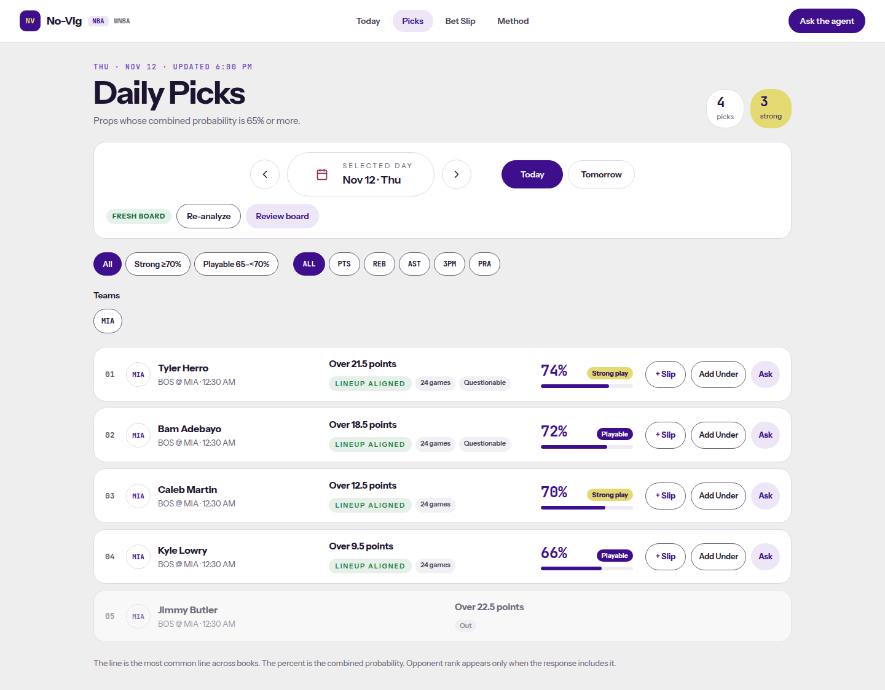

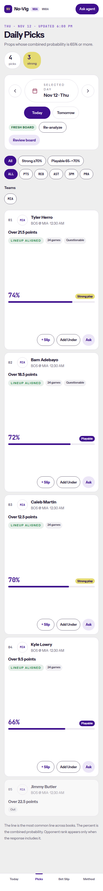

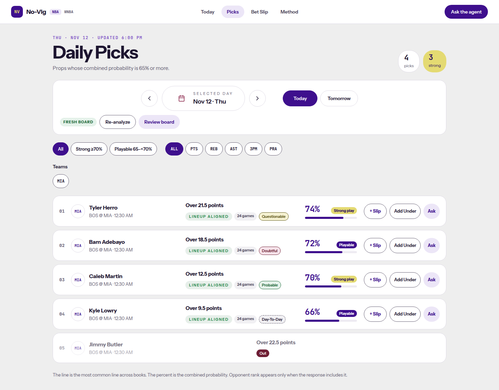

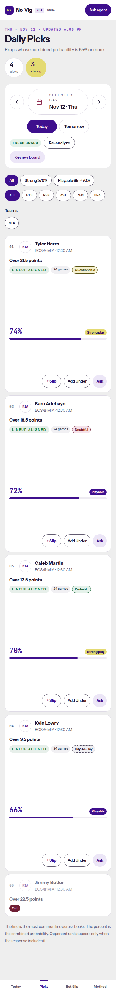

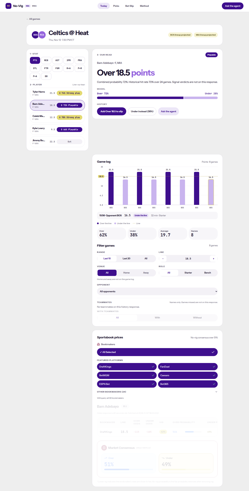

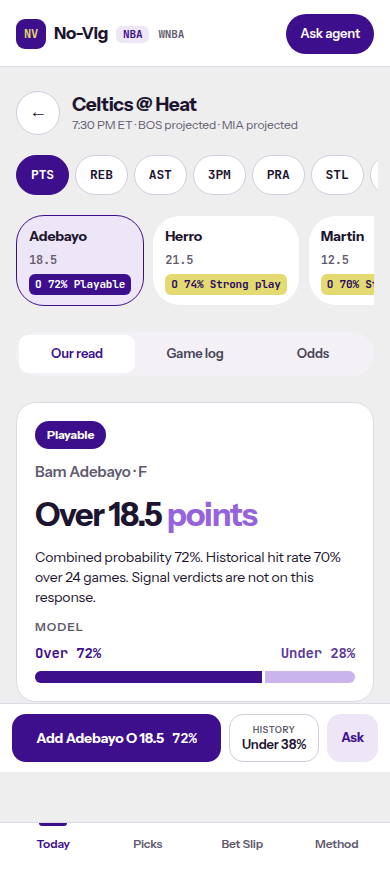

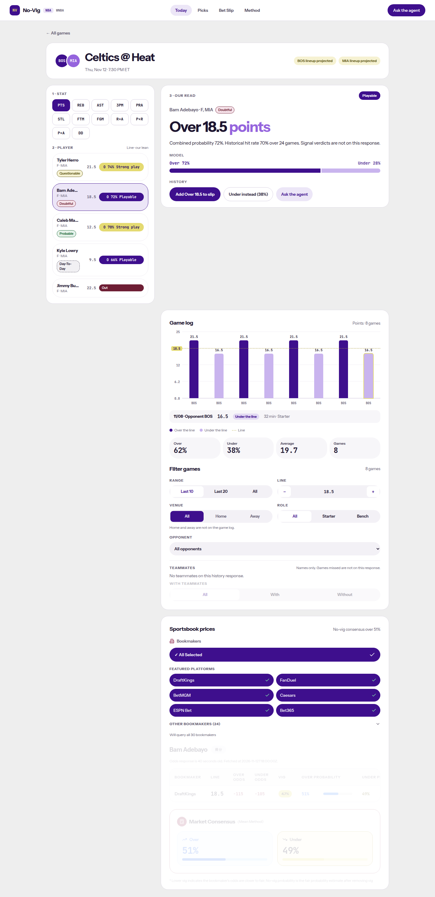

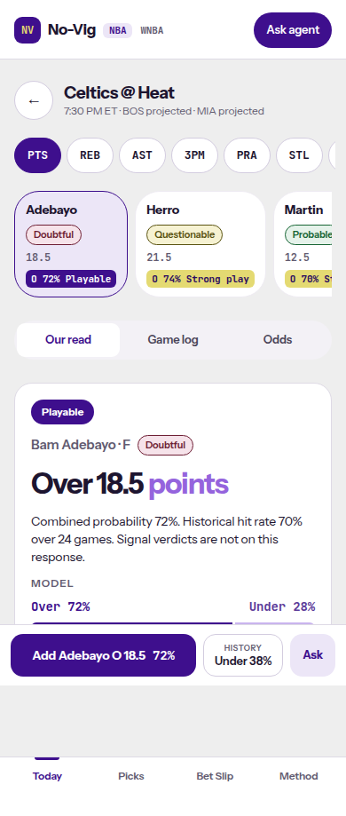

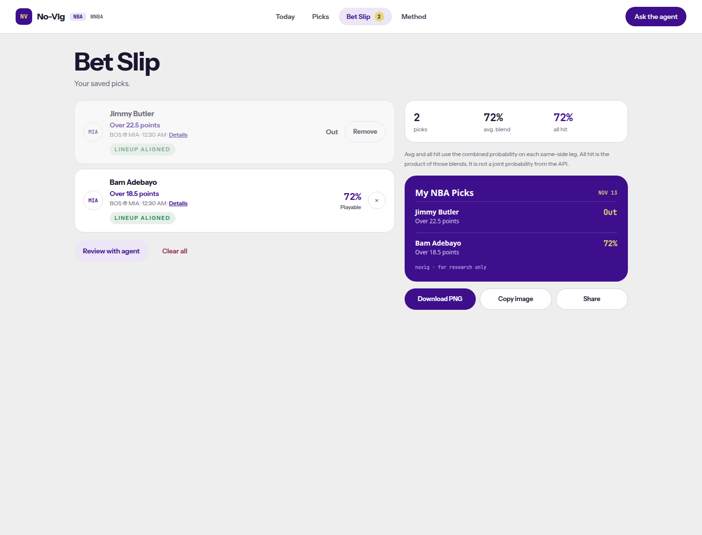

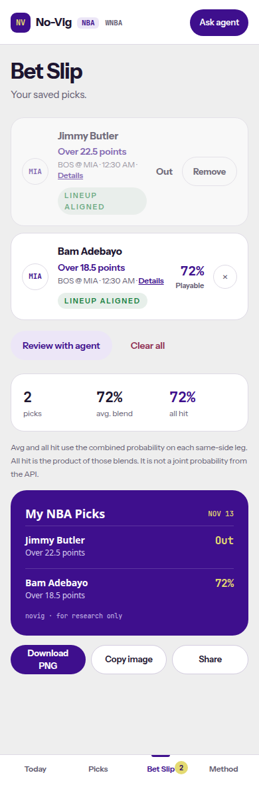

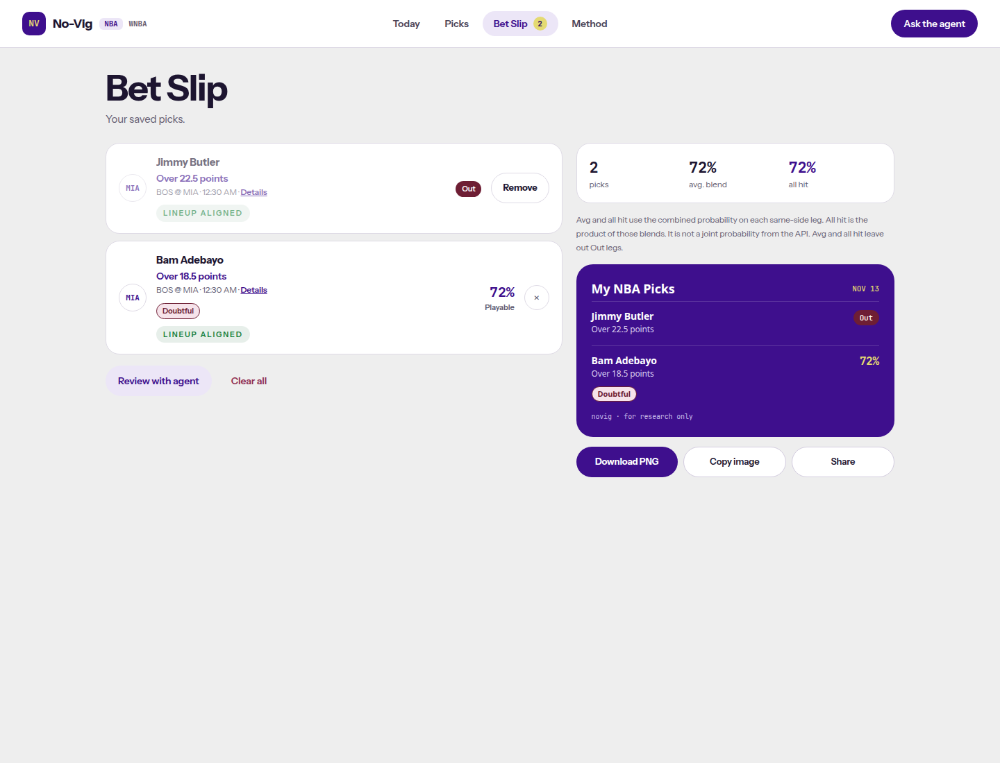

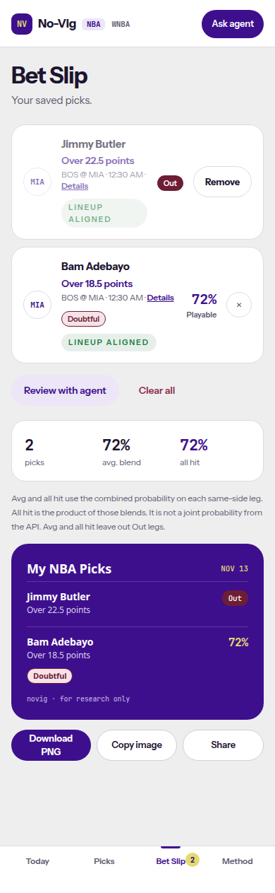
