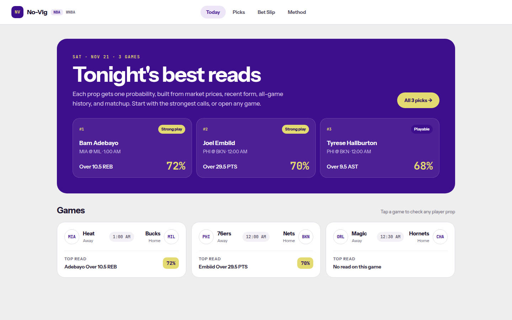
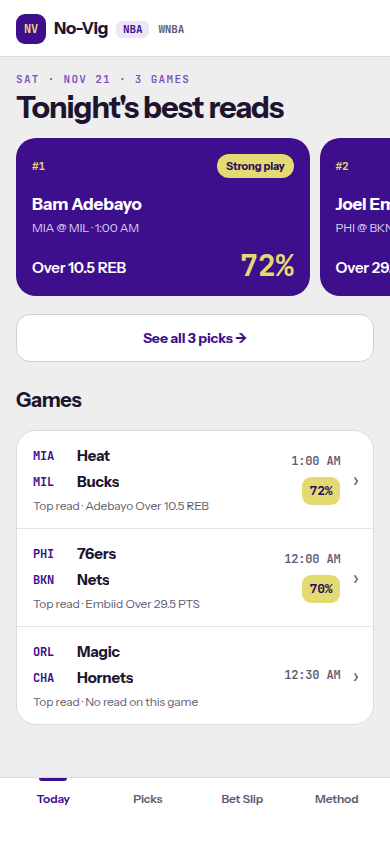
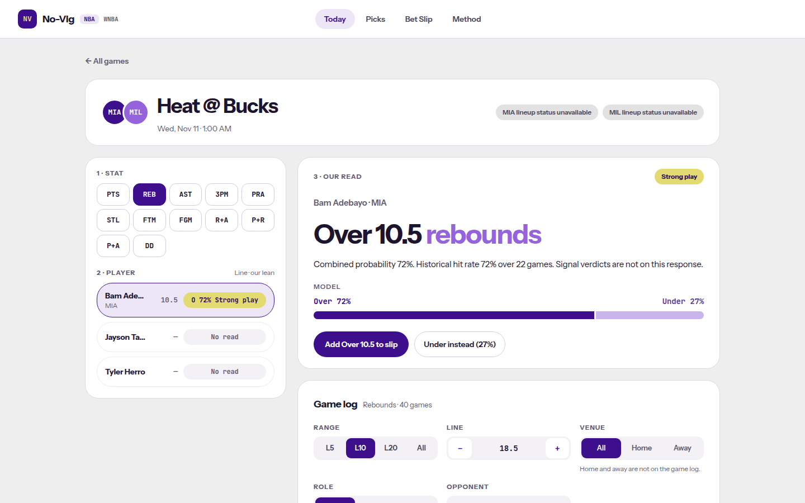
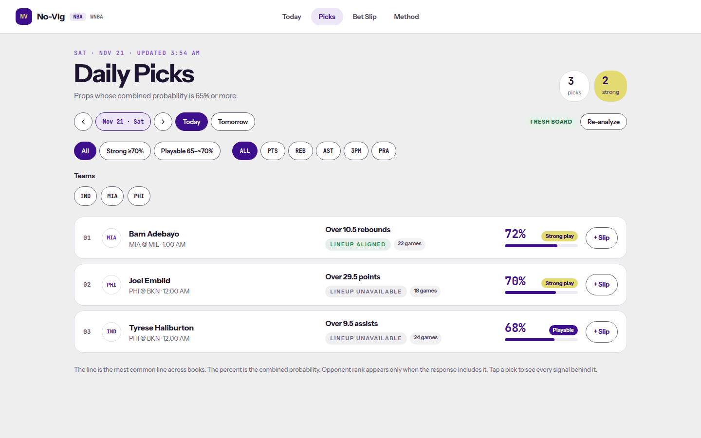
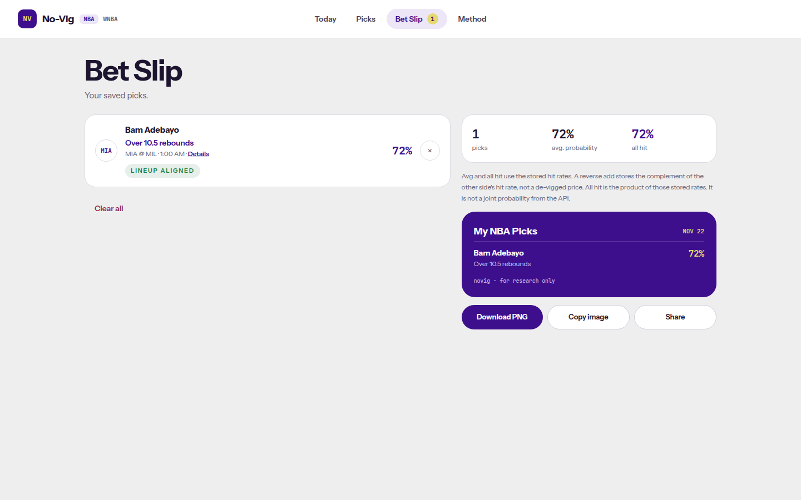

# SPO-142c — Hide the agent chat UI

- Ticket: SPO-142c
- Branch: `feature/SPO-142c-hide-agent-ui`
- Base: `dev`
- Frontend only. `frontend/app/wnba` is unchanged.

## Summary

The agent chat surfaces stay in the repo and are switched off by one constant, `AGENT_CHAT_UI_ENABLED`, which defaults to `false` in `frontend/lib/agent-chat-ui.ts`. With that default, the global widget is not mounted, and AppShell, Today, the event read, the mobile event bar, NBA daily picks, and the NBA slip do not render Ask or Review controls. The widget context also refuses to open or to call `sendAgentChat`. Setting the constant to `true` puts those controls and the widget back without rewriting the feature.

`OurRead`, `EventActionBar`, `TodayBoard`, and `AppShell` are shared by the NBA and WNBA routes. The same flag hides Ask on those shared surfaces, including a WNBA event page that previously opened the widget. The files under `frontend/app/wnba` are untouched. The WNBA slip and picks pages were already unwired.

## Changes

| Area | File | Change |
|---|---|---|
| Flag | `frontend/lib/agent-chat-ui.ts` | `AGENT_CHAT_UI_ENABLED` defaults to `false`. |
| Mount | `frontend/app/providers.tsx` | `AgentWidgetProvider` stays. `<AgentWidget />` renders only when the flag is on. |
| Shell | `frontend/components/AppShell.tsx` | Header “Ask the agent” and compact “Ask agent” render only when the flag is on. |
| Today | `frontend/components/TodayBoard.tsx` | Hero “Ask the agent” renders only when the flag is on. |
| Event | `frontend/components/event/OurRead.tsx`, `frontend/components/event/EventActionBar.tsx`, `frontend/components/EventDetail.tsx` | Desktop “Ask the agent” and mobile “Ask” render only when the flag is on. `askAgent` returns before it opens the widget when the flag is off. |
| Picks | `frontend/app/picks/page.tsx` | `onReviewBoard` is omitted when the flag is off, so “Review board” is not rendered. `handleReviewBoard` returns before `submitAction`. |
| Slip | `frontend/components/betslip/BetSlipScreen.tsx` | “Review with agent” renders only when the flag is on. `handleReviewSlip` returns before `submitAction`. |
| Context | `frontend/contexts/AgentWidgetContext.tsx` | `openWidget`, `submitAction`, and `runRequest` return before any chat request when the flag is off. |
| Tests | AppShell, Today, event UI, EventDetail fixtures, picks page, betslip page, `AgentWidgetContext.flag.test.tsx` | Hidden-default assertions. The enabled-path cases are skipped while the flag is off. |
| Widget tests | `frontend/components/AgentWidget.test.tsx` | This file still mounts the widget and turns the flag on for that file only, so the kept widget still has coverage. |

Left in the tree, unchanged as source: `frontend/components/AgentWidget.tsx`, `frontend/components/agent-widget/*`, `frontend/contexts/AgentWidgetContext.tsx` (gate only), `frontend/lib/api.ts` `sendAgentChat`, `frontend/lib/agent-chat.ts`.

## Why

The chat routes are being removed. A visible Ask or Review control would still post `/api/nba/agent/chat`. Hiding the controls, skipping the widget mount, and refusing the send inside the context means a click cannot reach that path. Deleting the widget would make a later restore a rewrite. One boolean keeps the restore as a single edit.

An Out player already hid Ask. That check stays. The flag is an extra condition in front of it.

## Tests

`npm test` from `frontend/` (`TZ=America/Chicago vitest run`): 85 files, 685 passed, 7 skipped, 692 total. The 7 skipped cases are the enabled-path checks (shell Ask, OurRead Ask, mobile Ask, picks Review board, slip Review with agent). They run when the constant is `true`.

`npx tsc --noEmit` and eslint on the touched frontend files passed.

Screenshots below are a local `next dev` against fixture JSON. The header, Today hero, event Our Read, NBA picks, and NBA slip show no Ask or Review control. League switch, slip add, Clear all, and share actions are still there.

## Follow-ups

- Set `AGENT_CHAT_UI_ENABLED` to `true` to restore the widget and the Ask / Review controls.
- `frontend/app/wnba` still does not wire a WNBA chat client. That was already the case.
